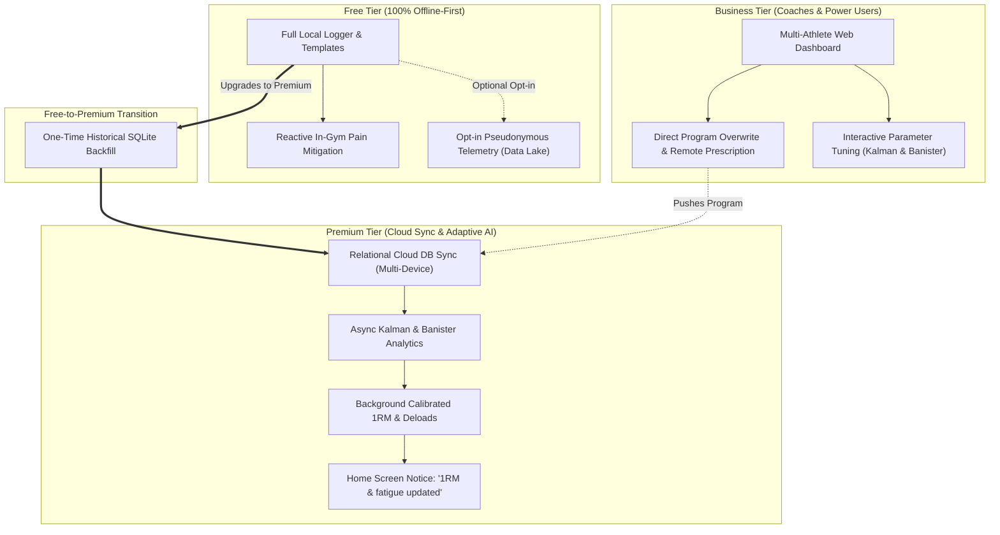

# Workout Suite — Data Flow & Tier Architecture Specification

## 1. System Vision & Local-First Philosophy
The primary goal of the Workout Suite is to provide a lightning-fast, zero-bloat mobile workout tracker while powering an advanced sports-science analytics suite.

- **Zero-Bloat Mobile App**: The mobile client (React Native / Expo + SQLite) is strictly offline-first. All set logging, rest timing, ghosted previous session numbers, and plate calculations execute instantly on-device against local SQLite with zero network latency.
- **Analytical Powerhouse**: The companion analysis suite (Python 3.11+) runs heavy mathematical modeling—such as Lombardi-linearized Kalman filters ($\mathbf{x}_t = [\ln(1\text{RM}_t), k_t]^T$) and Banister impulse-response fatigue models—asynchronously on a dedicated backend or desktop environment.

---

## 2. Data Synchronization & Database Cost Optimization

### 2.1 The Challenge
Frequent cloud database writes (e.g., sending an HTTP request on every logged set) create chatty network traffic, introduce latency in low-reception gym basements, and rapidly escalate transactional database IOPS and billing costs.

### 2.2 The Solution: Batched Session Ingestion
1. **Zero In-Gym Cloud Traffic**: While a lifter trains, all mutations are written directly to local SQLite (`CrashRecoveryService` write-through). No cloud API calls are made during the workout.
2. **Post-Workout Compressed Batch Sync**: When the user finishes a session:
   - The session record, completed sets, and optional pain reports are packaged into a single transactional JSON payload (`POST /api/v1/sessions`).
   - If offline or on cellular data, the sync is queued and uploaded when stable connectivity (or Wi-Fi) is available.
3. **Asynchronous Analytical Processing**:
   - Once ingested into the backend, a background worker triggers the Kalman and Banister analysis pipelines asynchronously.
   - Analytical results (updated calibrated parameters $(1\text{RM}, k)$ and mesocycle fatigue state) are cached and pushed back to the client, keeping transactional database queries minimal and isolated.

---

## 3. Local Program Storage & Performance

### 3.1 Clarification on SQLite Capacity
SQLite embedded on modern iOS and Android devices can effortlessly store thousands of workout programs and templates without degradation. A complete 4-day split across 20 exercises occupies less than 15 KB of disk storage. Database queries execute in under 2 milliseconds.

### 3.2 UI Clutter Mitigation: Active vs. Archived Programs
To prevent app bloat and visual overwhelm:
- Lifters can create or save **unlimited local programs**.
- The Program Library features an **Active / Archived** filter.
- Inactive or historical routines can be archived to keep the active pre-flight picker focused on the current training split, while remaining fully accessible locally for immediate re-activation.

---

## 4. User Tiers & Functional Entitlements

### 4.1 Free Tier (Fast, Functional & Private)
- **Features**: Full access to the local-first workout tracker, unlimited local routines, calendar agenda, plate calculator, body metrics, PR board, and CSV import/export.
- **Pain Report Handling**:
  - Full access to in-session pain logging (`PainReportModal`).
  - Provides **reactive in-gym mitigations**: automatic remaining set pruning when severity $> 6$, and 1-tap exercise substitution via the variant tree (`parent_exercise_id`).
  - *Boundary*: Does **not** include automated longitudinal mesocycle redesign or AI-driven program re-weighting.
- **Normative Baseline Telemetry**:
  - Lifters are prompted during onboarding with a transparent opt-in checkbox: *"Contribute pseudonymous training data to improve sports science models [x]"*.
  - When enabled, completed workouts strip all PII (user IDs, personal notes, timestamps) and transmit raw mathematical tuples `(exercise_id, weight_kg, reps, rpe, user_sex, bodyweight_kg)` tagged with a rotating random device token.
  - This data streams directly into an ultra-low-cost analytical data lake (Parquet/ClickHouse, pennies per million rows) to train global repetition-endurance ($k$) and volume-recovery baselines without inflating relational DB costs.

### 4.2 Free-to-Premium Upgrade Transition
- **Authoritative Source of Truth**: Because the mobile client is local-first, the user's phone already contains their complete historical training record inside SQLite.
- **One-Time Historical Backfill**:
  - When a Free user purchases Premium, the mobile app packages all historical SQLite tables (`workouts`, `workout_sets`, `body_metrics`, `pain_reports`) and uploads them in a single bulk sync to their new relational cloud account.
  - Prior pseudonymous points in the public research pool remain in the collective data lake (fully GDPR-compliant, unlinked from personal identities).
  - The user's cloud account is now completely populated with their historical record from day one.

### 4.3 Premium Tier (Frictionless Adaptive Intelligence)
- **Cloud Backup & Sync**: Seamless multi-device relational cloud synchronization.
- **Immediate Post-Workout Background Tuning**:
  - Upon completing and syncing a workout, the companion backend executes the Tier 2 Lombardi-linearized Kalman filter and Banister fatigue calculations.
  - The updated exercise parameters ($(1\text{RM}, k)$ and covariance metrics) are written to the mobile device's `calibrated_params` table in the background.
  - The user is notified via a subtle, non-intrusive Home screen banner: *"1RM calibrated & fatigue updated"*.
  - Tier 1 mobile heuristics immediately start using individualized $k$ values instead of population defaults ($k = 0.10$).
- **Mesocycle & Deload Intelligence**:
  - Evaluates fatigue accumulation, iso-load RPE drift, and Kalman velocity stalls to recommend optimal deload timing and automatic volume adjustments before overtraining occurs.

### 4.4 Business Tier (Coaches & Power Lifters)
- **Multi-Athlete Coach Portal**:
  - Coaches receive web dashboard access to monitor their entire athlete roster.
  - Real-time visualization of each athlete's Banister impulse-response curves (Fitness, Fatigue, Readiness), Kalman 1RM trajectories, and weekly effective rep volume landmarks.
- **Two-Way Management & Direct Overwrite**:
  - Coaches can directly assign, replace, or modify workout programs and prescriptions remotely.
  - The athlete's mobile app applies the coach's program directly without requiring manual confirmation, ensuring athletes always walk into the gym with their coach's latest plan loaded.
- **Power-User Customization**:
  - Dedicated access for self-coached power users to inspect and adjust analytical parameters (e.g., Banister decay constants $\tau_1, \tau_2$, Kalman process noise $Q$, and CUSUM change-point deload thresholds).

---

## 5. Popular Programs & Intellectual Property Strategy

### 5.1 Legal Context
In sports science and fitness programming, underlying mathematical schemes (e.g., wave loading percentages, progressive overload rules, exercise pairings) are functional mechanisms and cannot be copyrighted. However, proprietary program names, trademarks, and verbatim descriptive text must be respected.

### 5.2 Implementation Strategy: Educational Presets with Full Attribution
The Workout Suite includes standard pre-built routines structured as **Educational Presets** with explicit citations:
1. **5/3/1 Wave Progression**: Clearly attributed to **Jim Wendler** as an educational template implementing wave loading ($65\% \rightarrow 75\% \rightarrow 85\%$, $70\% \rightarrow 80\% \rightarrow 90\%$, $75\% \rightarrow 85\% \rightarrow 95\%$) with AMRAP top sets.
2. **PHAT (Power Hypertrophy Adaptive Training)**: Clearly attributed to **Dr. Layne Norton**, implementing heavy power days paired with speed and hypertrophy volume days.
3. **Generic Bulking Routine (GBR)**: Clearly attributed to **Lyle McDonald**, implementing classic 4-day Upper/Lower periodization with prescribed cycle run-ups and submaximal deload intervals.

All pre-built programs include author bios, links/citations to original publications, and clear disclaimers that the app is an independent tracking platform.