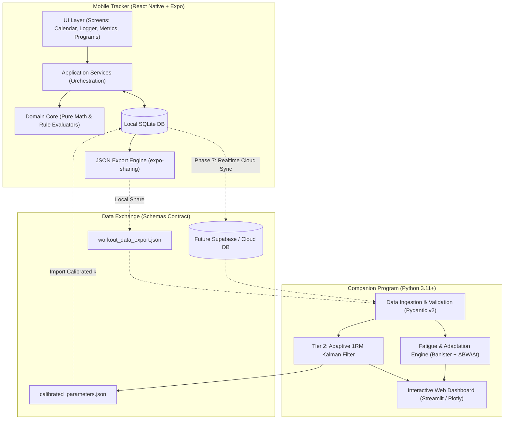

### How This Plan Is Optimized for Gemini Flash 3.8

1. **Strict Layer Isolation per Step**: Flash models excel when a task is confined to **one architectural layer** (e.g., pure TypeScript math, SQLite repositories, or React Native UI) rather than mixing database DDL, business logic, and UI state in a single prompt.
2. **File-Count Capping (3–6 Files per Step)**: Every step is scoped so the agent only creates or modifies a small cluster of files, preventing context degradation or unfinished stubs.
3. **Deterministic CLI Verification Gates**: Flash models can hallucinate "completion" unless forced to run a concrete CLI command (`npx jest`, `npx tsc --noEmit`, `pytest`). Every single step now ends with an explicit **Verification Gate** using headless unit tests or in-memory/mock repositories before any UI is attached.
4. **Modern API Guardrails**: Explicitly mandates modern `expo-sqlite` (`openDatabaseAsync`, `execAsync`, `runAsync`, `getAllAsync`) and incorporates `raw_input_weight` alongside canonical `weight` so SQLite aggregations remain fast and accurate.

You can either copy-paste the markdown block below directly into `IMPLEMENTATION_PLAN.md`, or give it to Antigravity to overwrite the file.

---

```markdown
# Workout Suite — Agentic Implementation Plan (Flash 3.8 Optimized)

This implementation plan translates the requirements in `Rough_sketch.md`, `1RM_calculation.txt`, and `docs/ARCHITECTURE.md` into an atomic, bottom-up execution blueprint designed specifically for **agentic engineering with Gemini Flash 3.8**.

---

## 0. Agentic Execution Rules (Read Before Every Step)

To ensure 100% reliability and zero broken builds when executing with Gemini Flash 3.8:
1. **One Step Per Prompt**: Never combine multiple steps into a single agent execution turn.
2. **Strict Working Directories**:
   - Never create a `package.json` or `node_modules` in the repository root (`/`).
   - Run all mobile commands inside `mobile/` (e.g., `cd mobile && npx tsc --noEmit`).
   - Run all companion commands inside `companion/` using `companion/.venv`.
3. **Bottom-Up Layering**: Always implement and unit-test **Domain Math & Types** $\rightarrow$ **Repository Interfaces & SQLite Adapters** $\rightarrow$ **Application Services** $\rightarrow$ **Presentation UI**.
4. **Mandatory Verification Gate**: A step is **NOT** complete until its specific CLI verification command (`jest`, `tsc`, `pytest`, or `mypy`) executes with zero errors and `docs/CODEMAP.md` is updated.

---

## 1. System Architecture Overview

The system follows a **local-first hexagonal architecture**: the mobile tracker operates entirely offline using an on-device SQLite database (`expo-sqlite`), while heavy state-space modeling runs in the Python Companion Suite.



---

## 2. Canonical Relational SQLite Schema

All weight values in `workout_sets.weight` are stored in **kilograms as the canonical effective mechanical load** (accounting for dumbbell doubling, bar tare, cable ratios, or bodyweight). The exact number typed by the user in the UI is preserved in `raw_input_weight`. Schema versioning uses `PRAGMA user_version`.

```sql
-- Core Exercises Library
CREATE TABLE exercises (
    id TEXT PRIMARY KEY,
    name TEXT NOT NULL,
    muscle_group TEXT NOT NULL,
    category TEXT NOT NULL,                  -- 'Barbell' | 'Dumbbell' | 'Cable' | 'Bodyweight' | 'Machine'
    is_compound INTEGER NOT NULL DEFAULT 0,  -- 1 = Compound, 0 = Isolation
    is_bodyweight INTEGER NOT NULL DEFAULT 0,-- 1 = Bodyweight/Assisted (calculates total system load), 0 = External
    is_unilateral INTEGER NOT NULL DEFAULT 0,-- 1 = Unilateral movement (independent limb logging)
    load_mode TEXT NOT NULL DEFAULT 'total', -- 'total' (barbell/machine) | 'per_hand' (dumbbell: auto-doubled)
    default_cable_ratio REAL DEFAULT 1.0,    -- 1.0 (1:1 rows/pulldowns), 0.5 (2:1 functional trainers)
    default_bar_weight_kg REAL DEFAULT 20.0, -- Default tare bar weight (20.0 kg standard Olympic)
    is_custom INTEGER NOT NULL DEFAULT 0,
    parent_exercise_id TEXT REFERENCES exercises(id) ON DELETE SET NULL,
    standard_lift_type TEXT,                 -- 'squat' | 'bench' | 'deadlift' | 'ohp' | 'row' | NULL
    default_rest_seconds INTEGER NOT NULL DEFAULT 120
);

-- Gear & Equipment Inventory (Specialty barbells, custom machine/cable ratios)
CREATE TABLE gear_inventory (
    id TEXT PRIMARY KEY,
    name TEXT NOT NULL,                      -- e.g. "Safety Squat Bar", "Trap Bar", "Gym B Dual Pulley"
    type TEXT NOT NULL,                      -- 'barbell' | 'cable_machine' | 'plate_loaded_machine'
    tare_weight_kg REAL NOT NULL DEFAULT 20.0,
    cable_ratio REAL NOT NULL DEFAULT 1.0,   -- Mechanical ratio (1.0 = 1:1, 0.5 = 2:1)
    is_default INTEGER NOT NULL DEFAULT 0,
    notes TEXT
);

-- Training Programs / Meso-Cycle Splits
CREATE TABLE programs (
    id TEXT PRIMARY KEY,
    name TEXT NOT NULL,
    color_hex TEXT NOT NULL DEFAULT '#3B82F6',
    notes TEXT,
    created_at TEXT NOT NULL
);

-- Workout Templates / Routines (Daily sessions within a program)
CREATE TABLE workout_templates (
    id TEXT PRIMARY KEY,
    program_id TEXT REFERENCES programs(id) ON DELETE CASCADE,
    name TEXT NOT NULL,
    notes TEXT,
    order_index INTEGER NOT NULL DEFAULT 0,
    created_at TEXT NOT NULL
);

-- Active Program Meso-Cycles / Training Eras
CREATE TABLE program_blocks (
    id TEXT PRIMARY KEY,
    program_id TEXT NOT NULL REFERENCES programs(id) ON DELETE CASCADE,
    start_date TEXT NOT NULL,                -- ISO8601: YYYY-MM-DD
    end_date TEXT                            -- NULL if currently active
);

CREATE TABLE template_exercises (
    id TEXT PRIMARY KEY,
    template_id TEXT NOT NULL REFERENCES workout_templates(id) ON DELETE CASCADE,
    exercise_id TEXT NOT NULL REFERENCES exercises(id),
    gear_id TEXT REFERENCES gear_inventory(id) ON DELETE SET NULL,
    target_sets INTEGER,
    target_reps_min INTEGER,
    target_reps_max INTEGER,
    target_rpe REAL,
    target_rir REAL,
    order_index INTEGER NOT NULL,
    exercise_group_id TEXT                   -- Links exercises in a superset/giant set group
);

-- Progression Rules (declarative condition-action engine)
CREATE TABLE progression_rules (
    id TEXT PRIMARY KEY,
    template_exercise_id TEXT NOT NULL REFERENCES template_exercises(id) ON DELETE CASCADE,
    priority INTEGER NOT NULL DEFAULT 0,
    rule_json TEXT NOT NULL                  -- Serialized JSON: { conditions: [...], actions: [...] }
);

-- Completed / In-Progress Workouts
CREATE TABLE workouts (
    id TEXT PRIMARY KEY,
    template_id TEXT REFERENCES workout_templates(id),
    date TEXT NOT NULL,                      -- ISO8601: YYYY-MM-DD
    name TEXT NOT NULL,
    notes TEXT,
    started_at TEXT NOT NULL,                -- ISO8601 timestamp
    duration_seconds INTEGER,
    status TEXT NOT NULL DEFAULT 'in_progress', -- 'in_progress' | 'completed' | 'discarded'
    completed_at TEXT,
    imported_from TEXT                       -- 'strong' | 'hevy' | 'csv' | NULL
);

-- Exercise Sets Logged
CREATE TABLE workout_sets (
    id TEXT PRIMARY KEY,
    workout_id TEXT NOT NULL REFERENCES workouts(id) ON DELETE CASCADE,
    exercise_id TEXT NOT NULL REFERENCES exercises(id),
    gear_id TEXT REFERENCES gear_inventory(id) ON DELETE SET NULL,
    set_number INTEGER NOT NULL,
    weight REAL NOT NULL,                    -- Canonical effective mechanical load in kg
    raw_input_weight REAL NOT NULL,          -- Exact number typed by user (in kg) prior to ratio/dumbbell multiplier
    added_weight REAL,                       -- External added/assisted delta in kg (+10 belt, -15 assist)
    reps INTEGER NOT NULL,                   -- Reps completed (or Left limb reps if unilateral)
    reps_right INTEGER,                      -- Optional: Right limb reps if unilateral (NULL if bilateral)
    rpe REAL,                                -- 6.0 - 10.0 (half-value increments)
    rir REAL,                                -- 0.0 - 4.0 (half-value increments)
    set_type TEXT NOT NULL DEFAULT 'working',-- 'warmup' | 'working' | 'drop' | 'myorep' | 'failure'
    set_notes TEXT,
    exercise_group_id TEXT,
    created_at TEXT NOT NULL
);

-- Body Composition & Anthropometry
CREATE TABLE body_metrics (
    id TEXT PRIMARY KEY,
    date TEXT NOT NULL,                      -- ISO8601: YYYY-MM-DD
    bodyweight REAL NOT NULL,                -- Canonical kg
    body_fat_manual REAL,
    waist_cm REAL,
    neck_cm REAL,
    hip_cm REAL,
    bicep_cm REAL,
    chest_cm REAL,
    thigh_cm REAL,
    calf_cm REAL,
    navy_body_fat REAL
);

-- Calibrated 1RM Parameters (imported from Companion Suite)
CREATE TABLE calibrated_params (
    id TEXT PRIMARY KEY,
    exercise_id TEXT NOT NULL REFERENCES exercises(id) ON DELETE CASCADE,
    calibrated_1rm REAL NOT NULL,
    calibrated_k REAL NOT NULL,
    calibrated_at TEXT NOT NULL,
    UNIQUE(exercise_id)
);

-- App Settings (key-value flags)
CREATE TABLE user_settings (
    key TEXT PRIMARY KEY,
    value TEXT NOT NULL
    -- Keys: 'intensity_metric' ('RPE' | 'RIR'), 'unit_system' ('kg' | 'lbs'), 'pure_utility_mode' ('1' | '0')
);

-- User Psychological Profile, Goals & Constraints Matrix
CREATE TABLE user_profiles (
    id TEXT PRIMARY KEY,
    gender TEXT NOT NULL,                    -- 'male' | 'female'
    birthdate TEXT,
    height_cm REAL,
    training_enjoyment TEXT NOT NULL DEFAULT 'neutral', -- 'enthusiast' | 'neutral' | 'minimalist'
    intensity_style TEXT NOT NULL DEFAULT 'balanced',   -- 'high_intensity_low_volume' | 'volume_accumulation' | 'balanced'
    primary_goal TEXT NOT NULL DEFAULT 'hypertrophy',   -- 'strength' | 'hypertrophy' | 'powerbuilding' | 'endurance' | 'longevity'
    secondary_goals TEXT,                    -- JSON array
    preferred_days_per_week INTEGER NOT NULL DEFAULT 4,
    preferred_session_duration_mins INTEGER NOT NULL DEFAULT 60,
    equipment_access TEXT NOT NULL DEFAULT 'commercial_gym',
    created_at TEXT NOT NULL,
    updated_at TEXT NOT NULL
);

-- Pre-Seeded SBD Strength Standards Benchmarks
CREATE TABLE strength_standards (
    id TEXT PRIMARY KEY,
    lift_type TEXT NOT NULL,                 -- 'squat' | 'bench' | 'deadlift' | 'ohp' | 'row'
    gender TEXT NOT NULL,                    -- 'male' | 'female'
    bodyweight_kg REAL NOT NULL,
    untrained_1rm REAL NOT NULL,
    novice_1rm REAL NOT NULL,
    intermediate_1rm REAL NOT NULL,
    advanced_1rm REAL NOT NULL,
    elite_1rm REAL NOT NULL
);

```

---

## 3. Step-by-Step Atomic Execution Plan

### Implementation Progress & Milestone Tracker

| Phase | Step | Name | Status | Verified Deliverables |
| :--- | :--- | :--- | :--- | :--- |
| **Phase 0** | **0.1** | **Monorepo Governance & Canonical JSON Schemas** | **`[x] COMPLETED`** | Section 8 in `AGENTS.md`, ADR-026/027 in `docs/DECISIONS.md`, `workout_export.schema.json`, `calibrated_parameters.schema.json` validated |
| | **0.2** | **Mobile Expo TypeScript & Jest Harness** | **`[x] COMPLETED`** | Expo SDK init, strict tsconfig, ts-jest, `src/core/types/index.ts`, smoke tests verified |
| | **0.3** | **Companion Python 3.11+ & Pytest Harness** | **`[x] COMPLETED`** | `pyproject.toml`, `requirements.txt`, Pydantic v2 `schemas.py`, 8/8 pytest suite, strict mypy verified |
| **Phase 1** | 1.1–1.6 | Foundation & Minimum Viable Logger | `[ ] PENDING` | Core in-gym logger, domain math, SQLite repositories |
| **Phase 2** | 2.1–2.4 | Advanced Workout Mechanics & Onboarding | `[ ] PENDING` | Supersets, unilateral logging, CSV import, JSON export |
| **Phase 3** | 3.1–3.4 | Meso-Cycles, Records & Strength Standards | `[ ] PENDING` | Program blocks, PR tables, SBD standards, DOTS scores |
| **Phase 4** | 4.1–4.3 | Autonomous Progression Engine | `[ ] PENDING` | Condition-action rules, proposal banners, generator wizard |
| **Phase 5** | 5.1–5.3 | Body Composition & Psychological Profiling | `[ ] PENDING` | Anthropometry, Navy body fat, psychological matrix |
| **Phase 6** | 6.1–6.4 | Companion Analysis Engine & Streamlit UI | `[ ] PENDING` | Linear Kalman filter, Banister model, Streamlit dashboard |
| **Phase 7** | 7.1–7.2 | Cloud Synchronization & Social Leaderboards | `[ ] PENDING` | Supabase RLS migrations, offline-first sync queue |

---

Each phase is divided into small, self-contained **Steps**. Every step specifies:

* **Scope**: The exact files to create or update.
* **Deliverables**: Concrete logic to implement.
* **Verification Gate**: The exact test/typecheck command that must pass before moving to the next step.

---

### Phase 0: Repository Governance, Contracts & Workspace Scaffolding [COMPLETED ✅]

*Goal: Establish strict workspace boundaries, canonical JSON schemas, and testing harnesses for both TypeScript and Python.*

#### Step 0.1: Monorepo Governance & Canonical JSON Schemas [COMPLETED ✅]

* **Status**: **Completed**. Verified against schema validators.
* **Scope**: `AGENTS.md`, `docs/DECISIONS.md`, `schemas/workout_export.schema.json`, `schemas/calibrated_parameters.schema.json`.
* **Deliverables**:
1. Add Section 8 ("Monorepo Execution & Working Directory Rules") to `AGENTS.md` enforcing `mobile/` and `companion/` isolation. *(Done)*
2. Add `ADR-026` to `docs/DECISIONS.md` documenting `weight` (effective mechanical load in kg) vs `raw_input_weight` (user-typed load in kg), and clarifying that the +10% deadlift adjustment applies only to static linear equations, never to the Tier 2 Kalman filter. *(Done, also ADR-027 added)*
3. Create `schemas/workout_export.schema.json` (JSON Schema Draft 7) matching Section 2 tables. *(Done)*
4. Create `schemas/calibrated_parameters.schema.json` for companion-exported $(1\text{RM}, k)$ parameters. *(Done)*


* **Verification Gate**: Validate that both `.schema.json` files parse as valid JSON via `python -m json.tool schemas/workout_export.schema.json > /dev/null`. *(Verified: Exit code 0)*

#### Step 0.2: Mobile Expo TypeScript & Jest Harness Initialization [COMPLETED ✅]

* **Status**: **Completed**. Verified with `npx tsc --noEmit` and `npx jest`.
* **Scope**: `mobile/package.json`, `mobile/tsconfig.json`, `mobile/jest.config.js`, `mobile/src/core/types/index.ts`.
* **Deliverables**:
1. Initialize the Expo TypeScript project inside `mobile/` with strict TypeScript (`"strict": true`). *(Done)*
2. Configure Jest (`ts-jest`) for fast headless unit testing of `mobile/src/core/` and `mobile/src/services/`. *(Done)*
3. Define all core TypeScript interfaces and enums in `mobile/src/core/types/index.ts` matching the SQLite schema and domain entities. *(Done)*


* **Verification Gate**: Run `cd mobile && npx tsc --noEmit && npx jest --passWithNoTests`. *(Verified: 3 tests passed in 0.7s, tsc exited 0)*

#### Step 0.3: Companion Python 3.11+ & Pytest Harness Initialization [COMPLETED ✅]

* **Status**: **Completed**. Verified with `pytest` and `mypy --strict`.
* **Scope**: `companion/pyproject.toml`, `companion/requirements.txt`, `companion/src/ingestion/schemas.py`, `companion/tests/test_schemas.py`.
* **Deliverables**:
1. Create `companion/pyproject.toml` and `companion/requirements.txt` (`pydantic>=2.6`, `numpy>=1.26`, `scipy>=1.12`, `pandas>=2.2`, `streamlit>=1.32`, `plotly>=5.20`, `pytest>=8.0`, `mypy>=1.8`). *(Done)*
2. Implement Pydantic v2 models in `companion/src/ingestion/schemas.py` mirroring `schemas/workout_export.schema.json` and `schemas/calibrated_parameters.schema.json`. *(Done)*
3. Write unit tests in `companion/tests/test_schemas.py` verifying valid and invalid mock JSON payloads against the Pydantic models. *(Done)*


* **Verification Gate**: Run `pytest companion/tests/test_schemas.py` and `mypy --strict companion/src/ingestion/schemas.py`. *(Verified: 8/8 pytest tests passed in 0.10s, mypy --strict 0 issues)*

---

### Phase 1: Foundation & Minimum Viable Logger (Core In-Gym Tracking)

*Goal: Build a zero-latency workout logger that lifters can immediately use in the gym with crash recovery and cognitive offloading tools.*

#### Step 1.1: Domain Core Math (1RM Heuristic, Load Normalizer, Plate Solver, Units)

* **Scope**: `mobile/src/core/math/unitConversion.ts`, `mobile/src/core/math/heuristic1rm.ts`, `mobile/src/core/math/loadNormalizer.ts`, `mobile/src/core/math/plateCalculator.ts`, `mobile/src/core/math/__tests__/`.
* **Deliverables**:
1. `unitConversion.ts`: Pure `kgToLbs`, `lbsToKg`, and display formatting helpers.
2. `heuristic1rm.ts`: Computes $r_{\text{eff}} = \text{reps} + \text{RIR}$ (or $10 - \text{RPE}$, clamped $\ge 1.0$) and Lombardi $\text{e1RM} = w \cdot r_{\text{eff}}^{k}$ (default $k = 0.10$, or custom calibrated $k$).
3. `loadNormalizer.ts`: Pure function computing `{ effectiveWeightKg, rawInputWeightKg, addedWeightKg }` across `per_hand` dumbbells (2x multiplier), `cable_ratio` (e.g., 0.5x for 2:1 pulley), and `is_bodyweight` (`bodyweightKg + addedWeightKg`).
4. `plateCalculator.ts`: Pure greedy solver returning `{ platesPerSide: number[], remainderKg: number }` given target weight, bar tare weight (default 20 kg), and available plate denominations (`[25, 20, 15, 10, 5, 2.5, 1.25]`).


* **Verification Gate**: Run `cd mobile && npx jest src/core/math && npx tsc --noEmit`. All edge cases (0 reps, RIR > 3, odd plate remainders, assisted pull-ups with negative added weight) must pass.

#### Step 1.2: Repository Interfaces & In-Memory Mock Repositories

* **Scope**: `mobile/src/domain/repositories/IExerciseRepository.ts`, `IWorkoutRepository.ts`, `IGearRepository.ts`, `IUserSettingsRepository.ts`, and `mobile/src/database/mocks/`.
* **Deliverables**:
1. Define clean async TypeScript interfaces for CRUD, global ghost-set lookup (`getMostRecentCompletedSetsForExercise(exerciseId)`), and crash recovery (`getInProgressWorkout()`).
2. Implement in-memory mock repositories in `mobile/src/database/mocks/` with unit tests verifying repository contract behavior (allowing services and UI to be tested without native SQLite binaries).


* **Verification Gate**: Run `cd mobile && npx jest src/database/mocks && npx tsc --noEmit`.

#### Step 1.3: SQLite Schema Migrations, Seed Catalog & Concrete Repositories

* **Scope**: `mobile/src/database/schema.ts`, `mobile/src/database/seeds/defaultExercises.ts`, `mobile/src/database/repositories/SQLiteExerciseRepository.ts`, `SQLiteWorkoutRepository.ts`, `SQLiteGearRepository.ts`, `SQLiteUserSettingsRepository.ts`.
* **Deliverables**:
1. Implement `schema.ts` using the modern Expo SDK `expo-sqlite` async API (`openDatabaseAsync`, `execAsync`, `runAsync`, `getAllAsync`, `getFirstAsync`) with `PRAGMA journal_mode = WAL;`, `PRAGMA foreign_keys = ON;`, and `PRAGMA user_version` migrations.
2. Seed 40+ foundational exercises (Barbell SBD, OHP, Rows, Dumbbell, Cable, Machine, Bodyweight) with accurate `load_mode`, `is_compound`, `is_bodyweight`, `parent_exercise_id`, and `standard_lift_type` values, plus default gear items (20 kg Olympic Bar, 29 kg SSB, 25 kg Trap Bar, 15 kg Technique Bar, 1:1 and 2:1 Cable stacks).
3. Implement the concrete SQLite repositories with write-through persistence for `workout_sets`.


* **Verification Gate**: Run `cd mobile && npx tsc --noEmit` and unit-test SQL query generation/mapping against a mocked `SQLiteDatabase` driver in Jest.

#### Step 1.4: Core Logger Application Services (Session, Rest Timer, Substitution, Crash Recovery)

* **Scope**: `mobile/src/services/activeSessionService.ts`, `restTimerService.ts`, `exerciseSubstitutionService.ts`, `crashRecoveryService.ts`, `mobile/src/services/__tests__/`.
* **Deliverables**:
1. `activeSessionService.ts`: Orchestrates starting a session, adding/deleting/reordering sets, pre-filling ghost values from the most recent global session, normalizing weights via `loadNormalizer`, and immediately writing every edit to `IWorkoutRepository`.
2. `restTimerService.ts`: Pure state machine & timer manager supporting start on set completion, `+30s` / `-30s` / `Skip`, and background expiration timestamp calculation (`endTimeMs - Date.now()` so locking the phone never drifts the timer).
3. `exerciseSubstitutionService.ts`: Finds compatible replacement exercises via shared `parent_exercise_id` or `muscle_group`, transfers target rep brackets, and fetches ghost sets for the substitute movement.
4. `crashRecoveryService.ts`: Detects `status = 'in_progress'` workouts on startup and provides `resumeSession()` or `discardSession()`.


* **Verification Gate**: Run `cd mobile && npx jest src/services && npx tsc --noEmit`.

#### Step 1.5: Active Workout Logger UI & QoL Popovers

* **Scope**: `mobile/src/features/logger/ActiveLoggerScreen.tsx`, `SetRowComponent.tsx`, `RestTimerBanner.tsx`, `PlateCalculatorModal.tsx`, `ExerciseSubstitutionModal.tsx`, `CrashRecoveryDialog.tsx`.
* **Deliverables**:
1. High-contrast OLED-friendly `ActiveLoggerScreen` with 1-tap set completion, RPE/RIR half-step inputs, set type tags (`warmup`, `working`, `drop`, `myorep`, `failure`), per-set notes, and ghost placeholders.
2. Dumbbell `30 kg (×2)` badge and gear subtext indicator (e.g., `Safety Squat Bar (29 kg)`).
3. 1-tap `PlateCalculatorModal` on barbell weight fields and 1-tap `ExerciseSubstitutionModal` ("Swap for this session only" vs "Update template permanently").
4. `CrashRecoveryDialog` on launch when an interrupted workout is detected.


* **Verification Gate**: Run `cd mobile && npx tsc --noEmit && npm run lint`.

#### Step 1.6: Calendar View, Basic Settings & Root Navigation

* **Scope**: `mobile/src/features/calendar/CalendarScreen.tsx`, `SessionDetailModal.tsx`, `mobile/src/features/settings/SettingsScreen.tsx`, `mobile/App.tsx`.
* **Deliverables**:
1. Monthly and weekly calendar agenda showing completed workout badges and drill-down inspection of past sessions (total volume, duration, sets, e1RM).
2. Basic `SettingsScreen` with instant toggles for Unit System (`kg` / `lbs`), Intensity Metric (`RPE` / `RIR`), and `Pure Utility Mode`.
3. Bottom Tab Navigation wiring `Logger`, `Calendar`, and `Settings`.


* **Verification Gate**: Run `cd mobile && npx tsc --noEmit && npx jest`. *(Milestone: Phase 1 MVP is complete and usable in the gym).*

---

### Phase 2: Advanced Workout Mechanics, Hierarchy & Data Onboarding

*Goal: Support supersets, unilateral limb tracking, custom gear management, external CSV imports (Strong/Hevy), and standardized JSON exports.*

#### Step 2.1: Superset Grouping & Unilateral Limb Mechanics

* **Scope**: `mobile/src/services/activeSessionService.ts`, `mobile/src/services/restTimerService.ts`, `mobile/src/features/logger/SupersetBracketGroup.tsx`, `SetRowComponent.tsx`.
* **Deliverables**:
1. Group/ungroup exercises into supersets or giant sets sharing an `exercise_group_id`.
2. Suppress automatic rest timer triggers between exercises inside a superset group; trigger the full rest timer only when the final exercise in the group completes its set.
3. Render dual rep inputs (`reps` Left, `reps_right` Right) on a single row when `exercise.is_unilateral === 1`.


* **Verification Gate**: Run `cd mobile && npx jest src/services && npx tsc --noEmit`.

#### Step 2.2: Exercise Library Manager, Variant Tree & Gear Inventory UI

* **Scope**: `mobile/src/features/gear/GearInventoryScreen.tsx`, `mobile/src/features/inspection/ExerciseLibraryScreen.tsx`, `ExerciseFormModal.tsx`.
* **Deliverables**:
1. CRUD interface for `gear_inventory` (custom barbells with tare weights, custom cable machines with mechanical ratios).
2. Exercise catalog search/filter by muscle group and equipment, custom exercise creation, and linking variants to a root movement via `parent_exercise_id`.


* **Verification Gate**: Run `cd mobile && npx tsc --noEmit && npx jest`.

#### Step 2.3: Standardized JSON Export Service (Contract-Verified)

* **Scope**: `mobile/src/services/exportService.ts`, `mobile/src/services/__tests__/exportService.test.ts`.
* **Deliverables**:
1. Serializes full SQLite database state into the exact structure defined by `schemas/workout_export.schema.json`.
2. Integrates with `expo-file-system` and `expo-sharing` for 1-tap export from Settings.
3. Writes a sample fixture `schemas/fixtures/sample_workout_export.json` during test execution so Python contract tests can verify it.


* **Verification Gate**: Run `cd mobile && npx jest src/services/__tests__/exportService.test.ts` AND run `pytest companion/tests/test_schemas.py` against the generated fixture.

#### Step 2.4: External Data Import Engine (Strong CSV, Hevy CSV, Generic CSV)

* **Scope**: `mobile/src/core/parsers/csvImportParser.ts`, `mobile/src/services/importService.ts`, `mobile/src/features/import/ImportScreen.tsx`, `mobile/src/core/parsers/__tests__/`.
* **Deliverables**:
1. Pure, zero-dependency parsers in `csvImportParser.ts` for Strong CSV exports, Hevy CSV exports, and custom column-mapped CSVs.
2. Exercise name matching against the existing catalog, automatic custom exercise fallback creation, duplicate session detection (matching date + exercise + set count), and `imported_from` provenance tagging.
3. `ImportScreen.tsx` wizard using `expo-document-picker`.


* **Verification Gate**: Run `cd mobile && npx jest src/core/parsers && npx tsc --noEmit`.

---

### Phase 3: SBD Strength Standards & Performance Intelligence

*Goal: Provide allometric strength classification tiers, powerlifting DOTS scores, Rep-Max PR boards, and balance radar charts.*

#### Step 3.1: Allometric Strength Standards, DOTS & Cohort Math Engine

* **Scope**: `mobile/src/core/math/strengthStandards.ts`, `mobile/src/core/math/dotsCoefficients.ts`, `mobile/src/database/seeds/strengthStandardsSeed.ts`, `mobile/src/core/math/__tests__/`.
* **Deliverables**:
1. Official powerlifting DOTS polynomial coefficient formula in `dotsCoefficients.ts` for males and females.
2. Seeded empirical weight-bracket lookup tables (`squat`, `bench`, `deadlift`, `ohp`, `row`) across 5 tiers (`Untrained`, `Novice`, `Intermediate`, `Advanced`, `Elite`).
3. Continuous normalized strength score ($0\text{--}100+$) with bilinear interpolation across bodyweight and e1RM, returning `{ tier, continuousScore, nextTierName, kgNeededForNextTier, demographicPercentile }`.


* **Verification Gate**: Run `cd mobile && npx jest src/core/math && npx tsc --noEmit`.

#### Step 3.2: Exercise Inspection Service & Rep-Max Record (PR Board) Queries

* **Scope**: `mobile/src/services/exerciseInspectionService.ts`, `mobile/src/database/repositories/SQLiteWorkoutRepository.ts`, `mobile/src/services/__tests__/`.
* **Deliverables**:
1. Repository query extracting the heaviest load lifted per unique repetition count (`1RM`, `2RM`, `3RM`, `5RM`, `8RM`, `10RM`, `12RM`, etc.) with optional filtering by `program_blocks` date range or cross-variant aggregation (`parent_exercise_id`).
2. Service computing the set e1RM benchmark ($w \cdot r_{\text{eff}}^k$) alongside each rep record and resolving SBD standard classifications.


* **Verification Gate**: Run `cd mobile && npx jest src/services/__tests__/exerciseInspectionService.test.ts && npx tsc --noEmit`.

#### Step 3.3: Exercise Inspection UI, SBD Tier Widget & Symmetry Radar

* **Scope**: `mobile/src/features/inspection/ExerciseDetailScreen.tsx`, `PRBoardTable.tsx`, `SBDStandardsCard.tsx`, `SBDBalanceRadarChart.tsx`.
* **Deliverables**:
1. `ExerciseDetailScreen` displaying the Rep-Max PR Board (with All-Time vs. Program Block toggle and tap-to-view historical session).
2. `SBDStandardsCard` showing current classification badge, progress bar to next tier (`+X.X kg needed`), DOTS score, and offline demographic percentile bell curve placement.
3. `SBDBalanceRadarChart` visualizing Squat, Bench, and Deadlift percentile symmetry.


* **Verification Gate**: Run `cd mobile && npx tsc --noEmit && npm run lint`.

---

### Phase 4: Training Psychology, Program Generation & Rule Builder

*Goal: Adapt programming to user psychology, build multi-day meso-cycle templates, and run declarative IF/THEN/ELSE progression rules.*

#### Step 4.1: Declarative Progression Rule Engine (Pure Evaluator)

* **Scope**: `mobile/src/core/rules/progressionRuleEngine.ts`, `mobile/src/core/rules/__tests__/progressionRuleEngine.test.ts`.
* **Deliverables**:
1. Pure, side-effect-free evaluator taking `(rules: ProgressionRule[], recentSessions: WorkoutSession[], currentPrescription: TemplateExercise)` and evaluating conditions (`ALL_SETS_HIT_TARGET_REPS`, `ANY_SET_HIT_TOP_REP_RANGE`, `AVERAGE_RPE_LESS_THAN`, `CONSECUTIVE_SUCCESSFUL_SESSIONS`, `CONSECUTIVE_FAILED_SESSIONS`).
2. Outputs deterministic proposed actions (`INCREASE_LOAD_FIXED`, `INCREASE_LOAD_PERCENT`, `DECREASE_LOAD_FIXED`, `INCREASE_TARGET_REPS`, `ADD_WORKING_SET`, `RESET_TO_BASELINE`, `TRIGGER_DELOAD`) with human-readable explanation strings.
3. Presets for Linear Progression (LP), Double Progression (DP), and Dynamic Double Progression (DDP).


* **Verification Gate**: Run `cd mobile && npx jest src/core/rules && npx tsc --noEmit`.

#### Step 4.2: Profile-Driven Program Synthesizer (Pure Generator)

* **Scope**: `mobile/src/core/generator/programSynthesizer.ts`, `mobile/src/core/generator/__tests__/programSynthesizer.test.ts`.
* **Deliverables**:
1. Pure generator mapping `UserProfile` (`training_enjoyment`, `intensity_style`, `primary_goal`, `preferred_days_per_week`, `preferred_session_duration_mins`, `equipment_access`) to a complete multi-day program split (Full Body, Upper/Lower, or PPL).
2. Automatically configures set counts (1–2 high-intensity sets @ RPE 9.5 vs. 3–4 volume sets @ RPE 7.5), antagonist superset pairings (`exercise_group_id`) for `minimalist` time budgets, and default `progression_rules`.


* **Verification Gate**: Run `cd mobile && npx jest src/core/generator && npx tsc --noEmit`.

#### Step 4.3: Programs, Templates, Meso-Cycle Blocks & Profile Repositories

* **Scope**: `mobile/src/domain/repositories/IProgramRepository.ts`, `IUserProfileRepository.ts`, `mobile/src/database/repositories/SQLiteProgramRepository.ts`, `SQLiteUserProfileRepository.ts`, `mobile/src/services/programBlockService.ts`.
* **Deliverables**:
1. Full persistence for `programs`, `workout_templates`, `template_exercises`, `progression_rules`, `program_blocks`, and `user_profiles`.
2. `programBlockService.ts`: Handles 1-tap active program swapping (closing the previous `program_blocks.end_date` and opening a new block with the program's `color_hex`).


* **Verification Gate**: Run `cd mobile && npx jest && npx tsc --noEmit`.

#### Step 4.4: Questionnaire UI, Program Builder, Rule Editor & Interactive Progression Banner

* **Scope**: `mobile/src/features/profile/UserProfileScreen.tsx`, `mobile/src/features/progression/ProgramOverviewScreen.tsx`, `ProgressionBuilderModal.tsx`, `mobile/src/features/logger/ProgressionProposalBanner.tsx`.
* **Deliverables**:
1. `UserProfileScreen`: Multi-step training psychology & logistics questionnaire with 1-tap "Generate Custom Program" button.
2. `ProgramOverviewScreen` & `ProgressionBuilderModal`: Manage multi-day splits, program accent colors (`color_hex`), and IF/THEN/ELSE progression rules.
3. `ProgressionProposalBanner` in the logger: Surfaces pending rule triggers before starting a session (`"Target hit last session! Increase Squat to 142.5 kg? [Accept / Dismiss]"`).
4. Calendar program swap badges tinted with `color_hex`.


* **Verification Gate**: Run `cd mobile && npx tsc --noEmit && npm run lint`.

---

### Phase 5: Anthropometry, Body Composition & Longitudinal Plotting

*Goal: Track bodyweight, U.S. Navy body fat %, circumference metrics, and render longitudinal charts with synchronized program era background shading.*

#### Step 5.1: U.S. Navy Body Fat, Rolling Averages & Body Metrics Repository

* **Scope**: `mobile/src/core/math/navyBodyFat.ts`, `mobile/src/core/math/__tests__/navyBodyFat.test.ts`, `mobile/src/domain/repositories/IBodyMetricsRepository.ts`, `mobile/src/database/repositories/SQLiteBodyMetricsRepository.ts`.
* **Deliverables**:
1. `navyBodyFat.ts`: Pure U.S. Navy circumference formula for males and females (in cm) + 7-day rolling exponential/simple moving average calculator for bodyweight time-series.
2. `SQLiteBodyMetricsRepository`: CRUD operations for `body_metrics` with automatic `navy_body_fat` calculation when waist, neck, and height (plus hip for females) are present.


* **Verification Gate**: Run `cd mobile && npx jest src/core/math/__tests__/navyBodyFat.test.ts && npx tsc --noEmit`.

#### Step 5.2: Body Metrics Screen & Longitudinal Plots with Program Era Shading

* **Scope**: `mobile/src/features/bodyMetrics/BodyMetricsScreen.tsx`, `mobile/src/features/plots/PlotsScreen.tsx`, `ProgramEraShadedChart.tsx`.
* **Deliverables**:
1. `BodyMetricsScreen`: Log bodyweight, manual BF%, and tape measurements (neck, waist, hip, bicep, chest, thigh, calf).
2. `ProgramEraShadedChart`: Reusable chart wrapper rendering semi-transparent vertical background spans from `program_blocks` in each program's `color_hex`.
3. Time-series charts for Exercise e1RM progression, Bodyweight + 7-day rolling average, Body Fat %, Muscle Circumferences, and Weekly Tonnage Volume.


* **Verification Gate**: Run `cd mobile && npx tsc --noEmit && npm run lint`.

---

### Phase 6: Companion Scientific Analysis Suite (Python Engine & Dashboard)

*Goal: Implement the Adaptive Linear Kalman Filter for individualized $(1\text{RM}, k)$ tracking, Banister Fitness-Fatigue ODEs with $\Delta BW / \Delta t$ recovery scaling, and the Streamlit dashboard.*

#### Step 6.1: Tier 2 Adaptive Linear Kalman Filter Engine (`kalman_1rm.py`)

* **Scope**: `companion/src/models/kalman_1rm.py`, `companion/tests/test_kalman_1rm.py`.
* **Deliverables**:
1. Implement the exact specification from `1RM_calculation.txt`:
* Intra-session filtering: keep top 2 sets with lowest RIR per exercise per session; discard sets with $\text{RIR} > 3$ or $0$ completed reps.
* State vector $\mathbf{x}_t = [\ln(1\text{RM}_t), k_t]^T$, observation $z_t = \ln(w_t)$, observation matrix $\mathbf{H}_t = [1, -\ln(r_{\text{eff}, t})]$.
* Quadratic measurement noise $R_t = \sigma_{\text{base}}^2 (1 + \lambda r_{\text{eff}, t}^2)$ and diagonal process noise $\mathbf{Q}$.
* Exercise-specific priors ($k_0 = 0.085$ bench, $0.095$ squat, $0.075$ deadlift) and post-update constraint $k_t \in [0.03, 0.16]$.


* **Verification Gate**: Run `pytest companion/tests/test_kalman_1rm.py` and `mypy --strict companion/src/models/kalman_1rm.py`. Verify true 1RM tests ($r_{\text{eff}} = 1.0$) bypass $k$ updates and high-rep sets are discounted.

#### Step 6.2: Dynamic Recoverability ($\Delta BW / \Delta t$) & Banister Impulse-Response Engine

* **Scope**: `companion/src/models/recovery_modifier.py`, `companion/src/models/fatigue_banister.py`, `companion/src/models/recommendations.py`, `companion/tests/test_banister.py`.
* **Deliverables**:
1. `recovery_modifier.py`: Computes 14-day rolling OLS slope of bodyweight ($\Delta BW / \Delta t$) and scales fatigue decay time constant $\tau_2$ (shortened by 10–25% in caloric surplus, lengthened by 15–30% in caloric deficit).
2. `fatigue_banister.py`: Computes session Effective Stimulating Sets ($\text{RPE} \ge 7.0$ scaled by $\text{weight}/1\text{RM}$) and integrates daily Fitness ($P_t$, $\tau_1 \approx 42\text{d}$) and Fatigue ($F_t$, dynamic $\tau_2$) to output Net Preparedness.
3. `recommendations.py`: Computes Acute:Chronic Workload Ratio (ACWR) and generates structured advisories (`OPTIMAL_OVERLOAD`, `DELOAD_WARNING` if $\text{ACWR} > 1.5$, `UNDER_STIMULATION` if $\text{ACWR} < 0.8$).


* **Verification Gate**: Run `pytest companion/tests/test_banister.py` and `mypy --strict companion/src/models/`.

#### Step 6.3: Calibrated Parameter Exporter & Mobile Ingestion Round-Trip

* **Scope**: `companion/src/export/param_exporter.py`, `companion/tests/test_exporter.py`, `mobile/src/services/calibratedParamService.ts`, `mobile/src/services/__tests__/calibratedParamService.test.ts`.
* **Deliverables**:
1. `param_exporter.py`: Serializes the latest Kalman posterior $(1\text{RM}_t, k_t)$ per exercise into `calibrated_parameters.json` validated against `schemas/calibrated_parameters.schema.json`.
2. `calibratedParamService.ts` (Mobile): Imports `calibrated_parameters.json` into the SQLite `calibrated_params` table and upgrades Tier 1 heuristic e1RM calculations to use individualized $k$.


* **Verification Gate**: Run `pytest companion/tests/test_exporter.py` AND `cd mobile && npx jest src/services/__tests__/calibratedParamService.test.ts`.

#### Step 6.4: Interactive Streamlit & Plotly Scientific Dashboard

* **Scope**: `companion/src/ui/app.py`, `companion/src/ui/charts.py`.
* **Deliverables**:
1. File uploader for `workout_data_export.json`.
2. Interactive Plotly charts: Kalman $1\text{RM}_t$ trajectory with $\pm 1\text{ SD}$ uncertainty bands ($\text{e1RM} \cdot \sqrt{P_{0,0}}$), individualized $k_t$ endurance drift, Banister Fitness vs. Fatigue vs. Net Preparedness curves, and 14-day $\Delta BW / \Delta t$ recovery modifier plot.
3. 1-click download button for `calibrated_parameters.json`.


* **Verification Gate**: Run `mypy companion/src/ui/` and run a smoke test importing `app.py` via `pytest`.

---

### Phase 7: Cloud Synchronization, Social Benchmarking & Cross-Platform Sync

*Goal: Transition from local-first to an optional connected platform via Supabase without breaking offline capability.*

#### Step 7.1: Supabase PostgreSQL Migrations & Offline-First Sync Queue

* **Scope**: `supabase/migrations/001_initial_schema.sql`, `mobile/src/database/repositories/SupabaseSyncService.ts`, `mobile/src/services/__tests__/syncService.test.ts`.
* **Deliverables**:
1. PostgreSQL DDL mirroring the canonical SQLite schema with Row-Level Security (RLS) policies per `user_id`.
2. Background sync adapter pushing local dirty rows upon network reconnection while preserving local SQLite as the primary read/write source of truth.


* **Verification Gate**: Run `cd mobile && npx jest src/services/__tests__/syncService.test.ts && npx tsc --noEmit`.

#### Step 7.2: Opt-In Peer Leaderboards & Direct Companion Cloud Ingestion

* **Scope**: `mobile/src/services/cohortBenchmarkService.ts`, `companion/src/ingestion/cloud_loader.py`.
* **Deliverables**:
1. Opt-in normalized DOTS and Strength Score friend leaderboards (completely hidden when `pure_utility_mode = '1'`).
2. Optional Supabase REST client in `companion/src/ingestion/cloud_loader.py` so the Python dashboard can pull live logs without manual JSON file transfers.


* **Verification Gate**: Run full monorepo verification suite: `cd mobile && npx tsc --noEmit && npx jest` AND `pytest companion/tests/`.

```

***