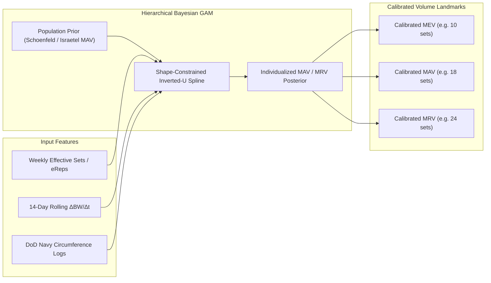
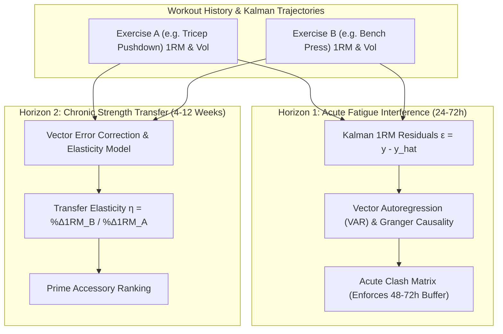
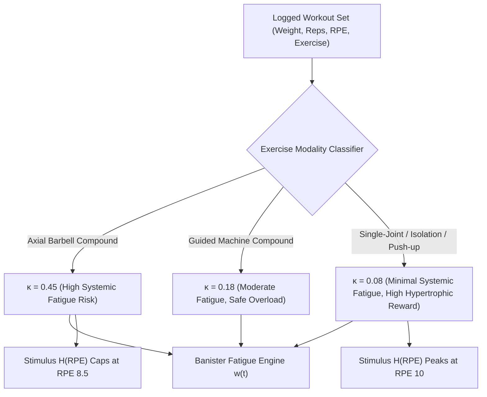
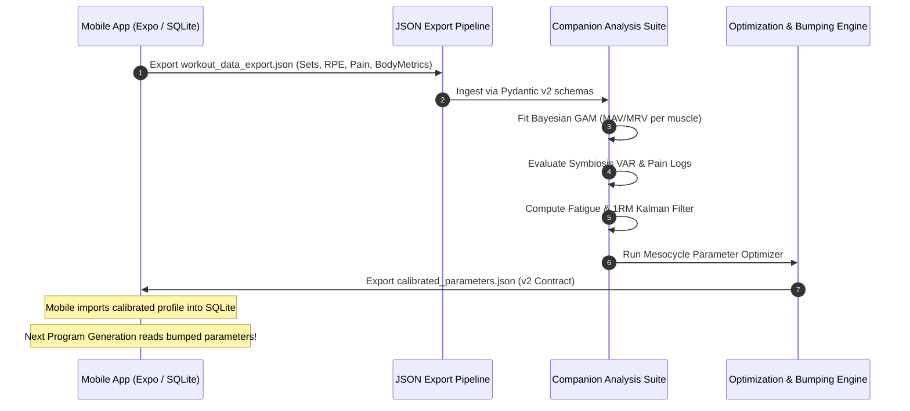
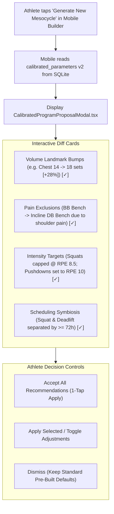
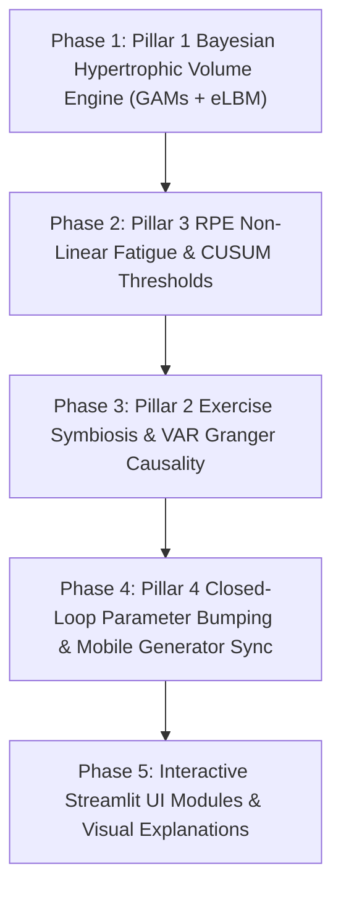

# Companion Analysis Suite — Advanced Modeling & Intelligent Auto-Programming Specification

## Executive Summary & USP Vision

The primary Unique Selling Proposition (USP) of the **Workout Suite** is closing the loop between longitudinal sports science analytics and active in-gym workout prescription. Rather than acting as a passive dashboard or a generic workout template provider, the Companion Suite functions as an **individualized exercise physiologist and data-driven coach**.

By ingesting high-resolution workout logs (sets, reps, RPE/RIR, gear tare, fatigue markers, pain incidents) and longitudinal body composition measurements (daily bodyweight, Navy tape circumferences, eLBM), the Companion Suite:
1. Quantifies the lifter's individual **Hypertrophic Volume Landmarks** (MEV, MAV, MRV) per muscle group.
2. Identifies **Exercise Symbiosis & Synergist Interference** (e.g., compound-to-isolation carryover, axial spinal fatigue).
3. Evaluates the physiological impact of **Chronic Average RPE** and proximity-to-failure on strength adaptations versus overreaching.
4. **Automatically bumps calibration parameters and generation constraints in the mobile app**, ensuring that newly generated mesocycles reflect the lifter's unique volume tolerance, remove pain-provoking movements, and optimize exercise sequencing.

---

## Pillar 1: Individual Hypertrophic Volume Landmarks & Effective Reps Optimization

### 1.1 Exercise Science Foundation
- **The Dose-Response Relationship**: Research demonstrates an inverted-U / sigmoidal dose-response relationship between weekly set volume and muscle hypertrophy (Schoenfeld et al., 2017, 2021).
  - **MEV (Minimum Effective Volume)**: The minimum stimulus required to trigger measurable muscle protein synthesis and net hypertrophy (typically ~6–10 hard sets/muscle/week).
  - **MAV (Maximum Adaptive Volume)**: The volume range yielding maximal muscle growth (~12–22 hard sets/muscle/week).
  - **MRV (Maximum Recoverable Volume)**: The threshold beyond which accumulated muscular damage and systemic fatigue exceed recovery capacity (~20–30+ sets/muscle/week), resulting in diminished or negative net adaptations.
- **Effective Repetitions (Option B: Pure Effective Reps Summation)**: According to motor unit recruitment research (Beardsley, 2018; Fisher et al., 2020), hypertrophy is stimulated predominantly by repetitions performed within ~0–4 reps of momentary muscular failure ($\text{RIR} \le 4$, $\text{RPE} \ge 6$) under maximum involuntary motor unit recruitment.
  
  Rather than applying arbitrary set multipliers (e.g. counting a drop set as $1.5\times$ working sets), the engine implements **Pure Effective Reps Summation** parameterized by the mobile app's logged `set_type`:
  
  1. **Standard Working Sets (`set_type = 'working'`)**:
     $$\text{eReps} = \max\left(0, \min(5, \text{Reps} - \text{RIR})\right) \quad \text{for sets where } \text{RIR} \le 4 \text{ (or } \text{RPE} \ge 6)$$
     *(A set of 10 reps @ 1 RIR yields 4 eReps; @ 0 RIR yields 5 eReps).*
  2. **Myo-Rep & Rest-Pause Clusters (`set_type = 'myorep'` or `'dc'`)**:
     - *Activation Set*: Evaluated via standard working set rule (yielding up to 5 eReps at RPE 10).
     - *Mini-Sets* (performed after brief $\le 30\text{s}$ rest): Because PCr resynthesis is incomplete and high-threshold motor units remain recruited from rep 1, **100% of mini-set repetitions are counted as effective reps**:
       $$\text{eReps}_{\text{mini}} = \text{Reps}_{\text{mini}}$$
       *(An activation set of 10 @ 0 RIR + 3 mini-sets of 3 reps yields $5 + 3 + 3 + 3 = 14\text{ eReps}$ from a single cluster!)*
  3. **Drop Sets (`set_type = 'drop'`)**:
     - Following an immediate weight reduction ($0\text{s}$ rest timer), the muscle enters fatigue immediately. All drop repetitions taken to failure ($\text{RIR} \le 1$) are credited as full effective reps.
  4. **AMRAP Sets (`set_type = 'amrap'`)**:
     - Taken to volitional muscular failure ($\text{RIR} = 0$), crediting the standard physiological ceiling of 5 effective reps ($\text{eReps} = 5$). No arbitrary bonus reps are added.
  5. **Warmup Sets (`set_type = 'warmup'`)**:
     $$\text{eReps} = 0 \quad (\text{zero hypertrophic credit})$$

- **Confounding Variables**:
  - **Caloric Balance**: Hypertrophic response is heavily modulated by energy status ($\Delta BW / \Delta t$). A lifter in a 300 kcal/day surplus exhibits higher MRV than when in a 500 kcal/day deficit.
  - **Inter-Individual Heterogeneity**: Genetic differences in satellite cell proliferation, muscle fiber type distribution (Type I vs Type II), and tendon stiffness cause individual MAV to deviate widely from cohort means (Hubal et al., 2005; Damas et al., 2018).

### 1.2 Machine Learning & Statistical Modeling Architecture

#### Why Deep Neural Networks / LLMs Are Inappropriate Here:
- **Data Scarcity**: A dedicated lifter logs anthropometry (tape measurements) once every 1–4 weeks, yielding only 12–50 observations per year. Deep neural networks (Transformers, LSTMs) require tens of thousands of data points and will severely overfit to acute water shifts, creatine loading, or measurement error.
- **Lack of Inductive Bias**: Unconstrained black-box models can predict unphysiological artifacts (e.g., that 100 sets per week produces infinite muscle growth).

#### Selected Model: Hierarchical Bayesian Generalized Additive Model (GAM) with Shape-Constrained Priors
We model muscle-group-specific hypertrophy as an inverted-U response surface:

$$\Delta Y_{m, t} \sim \mathcal{N}\left(\mu_{m, t}, \sigma_m^2\right)$$

$$\mu_{m, t} = \beta_{0, m} + f_m\left(V_{m, t}\right) + \beta_{\text{cal}} \left(\frac{\Delta BW}{\Delta t}\right)_{14\text{d}} + \beta_{\text{sleep}} \bar{S}_t$$

Where:
- $\Delta Y_{m, t}$: The hypertrophy observation for muscle group $m$ across observation window $t$. We utilize a dual-target approach:
  1. **Whole-Body eLBM ($\Delta\text{eLBM}$)**: Derived from smoothed bodyweight and DoD Navy body fat formula using waist, neck, and hip circumferences.
  2. **Muscle-Specific Fat-Corrected Girth ($\Delta\text{Girth}_{m, \text{adj}}$)**: Uses regional limb circumference logs (`bicep_left_cm` / `bicep_right_cm` for Arms; `chest_cm` for Chest/Back; `thigh_left_cm` / `thigh_right_cm` for Quads/Hamstrings), adjusted for changes in overall adiposity:
     $$\text{Girth}_{m, \text{adj}} = \text{Limb}_{m, t} \cdot \sqrt{\frac{1 - BF\%_t / 100}{1 - BF\%_{\text{baseline}} / 100}}$$
- $V_{m, t}$: **Unweighted Weekly Effective Reps** completed for muscle group $m$ (counting primary exercises as $1.0$ and secondary synergists as $0.5$). In accordance with data-driven modeling (Option B), weekly effective reps are aggregated without artificial per-session "junk volume" step-down discounts (e.g. 8-set caps). Instead, the non-linear Bayesian spline $f_m(V)$ and individual MRV saturation point naturally capture diminishing returns directly from empirical body composition changes.
- $f_m(V)$: Non-linear dose-response spline constrained to be concave-down ($\frac{d^2 f}{dV^2} < 0$) with zero response at zero volume ($f(0) = 0$).
- $\left(\frac{\Delta BW}{\Delta t}\right)_{14\text{d}}$: 14-day rolling bodyweight slope acting as a caloric balance covariate (derived from `recovery_modifier.py`).
- $\bar{S}_t$: Rolling sleep and subjective recovery score.



#### Key Advantages:
1. **Priors Handle the Cold Start**: For new users with $< 8$ weeks of data, the model relies on evidence-based population priors (e.g., $\text{MAV} \sim \mathcal{N}(14, 4^2)$ sets/week).
2. **Bayesian Uncertainty Envelope**: As measurement pairs accumulate, posterior distributions narrow, providing a credible interval for the lifter's true individual MAV.

---

### 1.3 Sparse Anthropometry Fallback: Hybrid Strength-Endurance Surrogate (Option A)

While lifters log bodyweight multiple times per week, tape circumferences (waist, neck, limbs) are frequently recorded at irregular intervals ($2–6\text{ weeks}$ or longer). To prevent volume landmark optimization from freezing when tape data is sparse ($\Delta t > 30\text{ days}$), the engine implements a **Hybrid Strength-Endurance Surrogate**:

When tape measurements are recent ($\Delta t \le 14\text{ days}$), $\Delta Y_{m, t}$ is driven $100\%$ by physical anthropometry ($\Delta\text{eLBM}$ and fat-adjusted girth). As time elapses without new tape entries, the engine exponentially blends in a validated neuromuscular proxy:

$$\Delta \tilde{Y}_{m, t} = w_{\text{tape}}(t) \cdot \Delta Y_{m, \text{anthro}} + \left(1 - w_{\text{tape}}(t)\right) \cdot \Delta Y_{m, \text{surrogate}}$$

$$w_{\text{tape}}(t) = \exp\left(-\frac{\max(0, \Delta t - 14)}{21}\right)$$

Where the **Neuromuscular Hypertrophy Surrogate** is formulated from the Tier 2 Kalman state vector:

$$\Delta Y_{m, \text{surrogate}} = \alpha_1 \cdot \dot{x}_{0, m}(t) + \alpha_2 \cdot \Delta k_{m, t} + \alpha_3 \cdot \Delta \text{WorkloadCapacity}_{m, t}$$

- $\dot{x}_{0, m}(t)$: Kalman log-1RM velocity across primary exercises for muscle $m$ (after initial 6-week motor learning stabilization).
- $\Delta k_{m, t}$: Drift in repetition endurance exponent $k$ (improvements in submaximal rep capacity at fixed load indicate local muscular hypertrophy and glycogen storage).
- $\Delta \text{WorkloadCapacity}_{m, t}$: Gain in standardized weekly tonnage completed at $\text{RPE} \le 8.5$.

This ensures the Bayesian volume engine adapts continuously during active mesocycles while seamlessly incorporating high-fidelity ground truth whenever the lifter logs their tape measurements.

---

## Pillar 2: Exercise Symbiosis, Synergist Overlap & Dual-Horizon Transfer

### 2.1 Exercise Science Foundation: The Dual-Horizon Dynamics
Exercise interactions in resistance training occur across two distinct physiological horizons:

1. **Horizon 1: Acute Fatigue Interference ($24–72\text{ hours}$)**:
   - *Synergist & Stabilizer Exhaustion*: Multi-joint compound movements (e.g., Barbell Bench Press) recruit primary movers (Pectoralis Major) and synergists (Triceps Brachii, Anterior Deltoids). Programming heavy Tricep Pushdowns 24h prior to Bench Press degrades triceps rate of force development (RFD) and compromises lockout strength.
   - *Axial Spinal Interference*: Heavy Squats and Deadlifts compete for spinal erector recovery and CNS bandwidth. Scheduling deadlifts the day after heavy squats reduces squat bar velocity and elevates lumbar shear injury risk.
   - *Antagonist Potentiation*: Alternating antagonist pairings (e.g., Bench Press + Chest-Supported Row) can enhance force production through reciprocal inhibition and reduced passive elastic stiffness.

2. **Horizon 2: Chronic Adaptation Carryover & Weak-Point Transfer ($4–12\text{ weeks}$)**:
   - *Biomechanical Force Transfer*: Does building a bigger/stronger tricep directly translate to a bigger Bench Press 1RM? For athletes limited by lockout strength, tricep isolation gains exhibit high positive transfer. For lifters limited off the chest, chest flyes or paused bench show superior transfer.
   - *Accessory ROI*: Quantifying which accessory exercises actually "move the needle" on main compound lifts enables the system to purge low-yield volume and focus training economy.

---

### 2.2 Machine Learning & Statistical Modeling Architecture



#### Horizon 1 Modeling: Graph-Constrained Vector Autoregression (VAR) & Residual Granger Causality
To quantify acute interference, we analyze the **detrended Kalman performance residuals**:

$$\epsilon_{i, t} = y_{i, t} - \hat{y}_{i, t}^{\text{Kalman}}$$

Where $\hat{y}_{i, t}^{\text{Kalman}}$ is the expected performance predicted by the Tier 2 Kalman Filter. If $\epsilon_{i, t} < 0$, the athlete underperformed their baseline capability.

We formulate a bivariate autoregressive lag model across training sessions:

$$\epsilon_{B, t} = \alpha_B + \sum_{l=1}^L \gamma_l \epsilon_{B, t-l} + \sum_{l=1}^L \delta_l \left(V_{A, t-l} \times \bar{\text{RPE}}_{A, t-l}\right) + u_{B, t}$$

Where:
- $V_{A, t-l}$: Volume load or effective reps completed in Exercise $A$ at lag $l$ (e.g., 24h, 48h, 72h prior).
- $\delta_l$: **Acute Interference Coefficient**. If $\delta_l < 0$ with $p < 0.05$ (Granger causality), Exercise $A$ exerts statistically significant acute interference on Exercise $B$ at lag $l$.

#### Horizon 2 Modeling: Cointegration & Strength Transfer Elasticity
To evaluate long-term carryover from accessory movements to primary compound lifts, we estimate the **Strength Transfer Elasticity** ($\eta_{A \to B}$):

$$\Delta \ln\left(1\text{RM}_{B, t}\right) = \mu_B + \sum_{k=1}^K \alpha_k \Delta \ln\left(1\text{RM}_{B, t-k}\right) + \sum_{k=0}^K \eta_{A \to B}^{(k)} \Delta \ln\left(1\text{RM}_{A, t-k}\right) + \nu_t$$

Where:
- $\eta_{A \to B} = \sum_k \eta_{A \to B}^{(k)}$ represents the **long-term elasticity coefficient**:
  $$\eta_{A \to B} \approx \frac{\% \Delta 1\text{RM}_B}{\% \Delta 1\text{RM}_A}$$
- **Interpretation**:
  - $\eta > +0.25$ ($p < 0.05$): **High-Yield Prime Accessory**. Gains in Exercise $A$ reliably accelerate progression in Compound $B$.
  - $0.05 \le \eta \le 0.25$: **Moderate Synergist**. Meaningful contribution; ideal secondary movement.
  - $\eta \approx 0$ or negative: **Non-Transferring Accessory**. Gains in Exercise $A$ do not contribute to Compound $B$'s 1RM (primarily hyper-localized hypertrophy or technique artifact).

#### Biomechanical Knowledge Graph Backbone:
The Companion Suite initializes the network using the exercise catalog's existing taxonomy (`muscle_group`, `secondary_muscles`, `is_compound` in `companion/src/ingestion/schemas.py`). The model estimates the empirical weights $(\delta_l, \eta)$:

| Quadrant | Acute Clash Risk ($\delta$) | Long-Term Transfer ($\eta$) | Classification | Algorithmic Prescription in Program Generator |
| :--- | :--- | :--- | :--- | :--- |
| **Q1** | Low ($\delta \approx 0$) | High ($\eta > 0.25$) | **Prime Synergist** | Prioritize in newly generated templates (e.g. Incline DB Bench for Bench Press). |
| **Q2** | High ($\delta < -0.15$) | High ($\eta > 0.25$) | **High-Yield / Buffer Required** | Retain in program, but enforce $\ge 48–72\text{h}$ separation or sequence post-compound. |
| **Q3** | Low ($\delta \approx 0$) | Low ($\eta \approx 0$) | **Pure Hypertrophy Isolation** | Program for targeted muscle volume without expecting 1RM compound carryover. |
| **Q4** | High ($\delta < -0.15$) | Low ($\eta \le 0$) | **Detrimental Overlap** | Flag conflict; recommend swapping for an alternative in the variant tree. |

---

## Pillar 3: Chronic RPE Dynamics, Proximity-to-Failure & Stimulus-to-Fatigue Ratio (SFR)

### 3.1 Modern Exercise Science Foundation: The Failure vs. Modality Nuance
- **The Modern Failure Hypertrophy Research**: Recent meta-regressions and trials (Robinson et al., 2023; Refalo et al., 2023; Coleman et al., 2024; Wolf et al., 2023) show that training closer to momentary muscular failure (RPE 9.5–10 / 0–0.5 RIR) elicits a measurable, statistically significant per-set hypertrophic advantage by maximizing high-threshold motor unit recruitment and spatial mechanical tension.
- **The Stimulus-to-Fatigue Ratio (SFR) Bifurcation**:
  The physiological cost of failure depends fundamentally on **stability, axial spinal loading, and muscle mass involved**:
  1. **Heavy Axial Multi-Joint Compounds** (Barbell Back Squats, Conventional Deadlifts, Bent-Over Rows):
     - Taking these to RPE 10 causes severe technique degradation, prolonged spinal erector fatigue, and elevated autonomic/CNS stress requiring 72+ hours to recover (Morán-Navarro et al., 2017; Pareja-Blanco et al., 2017). For these movements, RPE 7.5–8.5 provides ~95% of the stimulus with a fraction of the systemic recovery debt.
  2. **High-Stability Machines, Single-Joint Isolations & Bodyweight** (Machine Chest Press, Hack Squats, Cable Lateral Raises, Leg Curls, Push-ups):
     - With zero axial spinal shear and guided movement paths, muscular failure is localized and safe. The lifter experiences maximum spatial mechanical tension without systemic burnout. Recovery is rapid (24–36h), making RPE 10 (and beyond-failure techniques like myo-reps and drop sets) exceptionally high-SFR and beneficial for hypertrophy.

### 3.2 Machine Learning & Statistical Modeling Architecture

#### Modality-Conditioned Stimulus and Fatigue Impulse Modeling:
Instead of a uniform exponential penalty that punishes all RPE 10 sets identically, we formulate an **exercise-conditioned Stimulus-to-Fatigue Model**:

1. **Hypertrophic Stimulus Multiplier** $H(\text{RPE}, e)$:
   - For **Isolations, Machines, and Bodyweight** (`is_compound = False` or `category in ['machine', 'cable', 'bodyweight']`):
     $$H(\text{RPE}, e) = \frac{1}{1 + \exp\left(-1.5 \cdot (\text{RPE} - 8.0)\right)}$$
     *(Monotonically increases right up to RPE 10.0, rewarding the lifter for pushing to failure on safe movements).*
   - For **Axial Barbell Compounds** (`is_compound = True` and `category = 'barbell'`):
     $$H(\text{RPE}, e) = 1.0 - 0.2 \cdot \max(0, \text{RPE} - 9.0)^2$$
     *(Plateaus at RPE 8.5–9.0; diminishes past RPE 9.2 due to technical breakdown and loss of bar velocity).*

2. **Modality-Conditioned Fatigue Impulse** $\Phi(\text{RPE}, e)$:
   $$\Phi(\text{RPE}, e) = \exp\left(\kappa(e) \cdot \max(0, \text{RPE} - 7.0)\right)$$

   Where the fatigue growth exponent $\kappa(e)$ is determined by the exercise's biomechanical profile:
   - $\kappa_{\text{axial\_compound}} = 0.45$ (e.g., Squat/Deadlift: RPE 10 triples fatigue impulse, $\Phi \approx 3.86$).
   - $\kappa_{\text{free\_compound}} = 0.30$ (e.g., Dumbbell Press, Pull-ups: $\Phi \approx 2.45$).
   - $\kappa_{\text{machine\_compound}} = 0.18$ (e.g., Hack Squat, Leg Press, Machine Row: $\Phi \approx 1.71$).
   - $\kappa_{\text{isolation\_bodyweight}} = 0.08$ (e.g., Lateral Raises, Curls, Tricep Pushdowns, Push-ups: $\Phi \approx 1.27$ — negligible systemic fatigue penalty even at absolute failure).



#### Dynamic Deload & Overreaching Alerts:
The Companion Suite's deload triggers (`mesocycle_analyzer.py`) evaluate **systemic, multi-joint fatigue**, not localized isolation failure:
1. **Systemic Fatigue Index**: Evaluated predominantly on axial compound lifts where $\kappa \ge 0.30$. Taking Leg Extensions to RPE 10 will **not** trigger an overreaching warning.
2. **Iso-Load RPE Drift on Key Compound Lifts**: A steep rise in RPE at constant load on primary multi-joint movements ($\Delta\text{RPE}_{\text{drift}} > 1.5$) indicates accumulated neuromuscular exhaustion.
3. **Chronic High RPE on Compounds**: If rolling 21-day average RPE on *compound movements* exceeds 8.8, the engine recommends capping compound intensity or initiating a deload, while allowing isolation work to remain near failure.

---

## Pillar 4: Autonomous Closed-Loop Program Tailoring (The USP)

### 4.1 System Integration & "Parameter Bumping" Workflow

The end-to-end vision is a continuous feedback loop:



### 4.2 Parameter Bumping Rules for Mobile Program Generation

When the user taps **"Generate New Program / Mesocycle"** in the mobile app, the mobile `ProgramRecommenderEngine` reads from `calibrated_params` and `calibrated_profile`:

1. **Volume Landmark Bumping**:
   - If the Bayesian GAM shows the user thrives on higher volume (e.g., Chest MAV estimated at 18 sets instead of default 14), the generator sets initial prescribed volume to $15 \text{ sets}$ progressing to $19 \text{ sets}$ across the 5-week accumulation block.
   - If a muscle group exhibited premature fatigue or negative $\Delta\text{eLBM}$ slope at high volume, baseline volume is bumped downward.

2. **Pain-Aware Exercise Blacklisting & Cooldown**:
   - Ingests `pain_reports` table from mobile:
     $$\text{PainScore}(e) = \sum_{p \in \text{Reports}(e)} \text{Severity}(p) \cdot e^{-\lambda (t - t_p)} \cdot \mathbb{I}(\text{Type} = \text{joint})$$
   - If an exercise accumulates $\ge 2$ joint pain events with severity $\ge 5$ within the last 60 days:
     - The exercise is **blacklisted** from new program generation for a cooldown duration of **2 complete mesocycles** (~10–12 weeks).
     - The generator queries the `parent_exercise_id` variant tree in the exercise catalog to select an anatomically friendly alternative (e.g., replacing Barbell Back Squat with Safety Squat Bar Squat or Leg Press; replacing Flat Barbell Bench with Incline Dumbbell Press).
     - After the cooldown period, the exercise enters a "Re-evaluation Tier" with a low starting volume and conservative RPE ceiling (max RPE 7.5).

3. **Modality-Aware RPE & Failure Prescription Bumping**:
   - The engine splits prescriptions into distinct intensity regimes:
     - **Axial Free-Weight Compounds**: Prescribed with conservative caps (`target_rpe_baseline = 7.5`, `target_rpe_cap = 8.5`, `allow_failure = false`) to safeguard spinal recovery.
     - **Machines & Single-Joint Isolations**: Prescribed with high proximity-to-failure (`target_rpe_baseline = 9.0`, `target_rpe_cap = 10.0`, `allow_failure = true`, optional drop-set or myo-rep tag) to capitalize on the superior hypertrophic stimulus documented in recent literature.

4. **Symbiosis & Sequencing Adjustments**:
   - If the VAR model detects that Exercise $A$ significantly suppresses Exercise $B$ at lag $\le 48\text{h}$, the program generator automatically places them on non-consecutive workout days or moves the isolation movement after the compound within the same session.

5. **Dynamic Progression Rule Synthesis**:
   - The engine generates customized `ProgressionRule` JSON configurations for the template exercises:
     - High endurance lifters ($k < 0.07$ from Kalman filter): Assigned Double Progression (increase reps across a broad bracket before increasing load).
     - Low endurance lifters ($k > 0.12$): Assigned Linear Progression with narrow rep brackets (e.g., 4–6 reps) to avoid high-rep metabolic failure.

---

### 4.3 Mobile App Interactive Proposal & Review UX (`CalibratedProgramProposalModal.tsx`) (Option A)

Rather than mutating the lifter's routines behind the scenes (which erodes user trust and agency), the mobile app introduces an explicit **Calibrated Mesocycle Proposal Modal** (`CalibratedProgramProposalModal.tsx`) triggered whenever the athlete generates a new program block or imports an updated `calibrated_parameters.json` v2 payload:



#### Modal Design Specifications:
1. **Clear Rationale Disclosure**: Every proposed change explains *why* it was generated (e.g., *"Based on 8 weeks of continuing positive eLBM slope with low fatigue, your Chest MAV has been elevated to 18 sets"* or *"BB Bench excluded for 2 cycles due to 3 reported shoulder pain events"*).
2. **Granular Control**: Each card includes an individual toggle switch. If a lifter still wants to perform Barbell Bench Press despite a pain recommendation, they can uncheck the substitution with one tap.
3. **Audit Trail Provenance**: When applied, generated templates and prescriptions store `calibration_provenance = 'companion_v2'`, visually marked with a discreet amber science badge in the template overview.

---

## Pillar 5: Data Contracts & Schema Extensions

To support this closed-loop integration without violating existing contracts, we define **Calibrated Parameters Schema v2** (`schemas/calibrated_parameters.schema.json`):

```json
{
  "version": "2.0.0",
  "exported_at": "2026-10-16T18:00:00Z",
  "athlete_summary": {
    "systemic_recovery_score": 0.88,
    "rolling_caloric_balance_kg_week": 0.18,
    "recommended_mesocycle_length_weeks": 5
  },
  "muscle_group_landmarks": [
    {
      "muscle_group": "chest",
      "calibrated_mev_sets": 10,
      "calibrated_mav_sets": 18,
      "calibrated_mrv_sets": 23,
      "weekly_effective_reps_target": 72,
      "confidence": 0.85
    },
    {
      "muscle_group": "quads",
      "calibrated_mev_sets": 8,
      "calibrated_mav_sets": 14,
      "calibrated_mrv_sets": 18,
      "weekly_effective_reps_target": 56,
      "confidence": 0.78
    }
  ],
  "pain_exclusions": [
    {
      "exercise_id": "ex_bb_bench_press",
      "reason": "Recurrent anterior shoulder joint pain (severity 7/10)",
      "cooldown_mesocycles_remaining": 2,
      "recommended_substitutes": ["ex_db_incline_bench", "ex_weighted_dips"]
    }
  ],
  "symbiosis_relationships": [
    {
      "source_exercise_id": "ex_deadlift",
      "target_exercise_id": "ex_squat",
      "acute_clash_risk": "high",
      "minimum_buffer_hours": 72,
      "transfer_elasticity": 0.12,
      "classification": "high_yield_buffer_required"
    },
    {
      "source_exercise_id": "ex_tricep_pushdown",
      "target_exercise_id": "ex_bb_bench_press",
      "acute_clash_risk": "low",
      "minimum_buffer_hours": 24,
      "transfer_elasticity": 0.32,
      "classification": "prime_synergist"
    }
  ],
  "exercise_parameters": [
    {
      "exercise_id": "ex_squat",
      "calibrated_1rm": 162.5,
      "calibrated_k": 0.082,
      "cov_p00": 0.0012,
      "cov_p11": 0.00008,
      "target_rpe_baseline": 7.5,
      "target_rpe_cap": 8.5,
      "allow_failure": false
    },
    {
      "exercise_id": "ex_tricep_pushdown",
      "calibrated_1rm": 45.0,
      "calibrated_k": 0.115,
      "cov_p00": 0.0020,
      "cov_p11": 0.00012,
      "target_rpe_baseline": 9.0,
      "target_rpe_cap": 10.0,
      "allow_failure": true
    }
  ]
}
```

---

## Phased Implementation Roadmap



1. **Phase 1: Bayesian Volume Landmarks Engine**:
   - Implement `companion/src/models/volume_hypertrophy_gam.py`.
   - Calculate rolling 14-day eLBM and regional fat-adjusted girths from Navy tape inputs.
   - Implement hybrid strength-endurance surrogate fallback for periods with sparse tape logs ($\Delta t > 14\text{d}$).
   - Fit shape-constrained spline to estimate individual MEV/MAV/MRV per muscle group.
2. **Phase 2: RPE-Modulated Fatigue Engine**:
   - Enhance `companion/src/models/fatigue_banister.py` with modality-conditioned exponential RPE multiplier $\Phi(\text{RPE}, e)$.
   - Add CUSUM change-point alert for chronic high RPE ($> 8.8$) on compound multi-joint movements.
3. **Phase 3: Exercise Symbiosis & Dual-Horizon Analysis**:
   - Implement `companion/src/models/exercise_symbiosis.py` using statsmodels VAR / Granger causality on Kalman residuals (Horizon 1).
   - Implement Cointegration & Vector Error Correction (VECM) for long-term Strength Transfer Elasticity $\eta$ (Horizon 2).
4. **Phase 4: Closed-Loop Contract & Mobile Ingestion**:
   - Update `schemas/calibrated_parameters.schema.json` to v2.0.0 (synchronizing `companion/src/ingestion/schemas.py`).
   - Update `mobile/src/services/ProgramRecommenderEngine.ts` to ingest muscle volume landmarks, pain exclusions, and dynamic RPE caps.
   - Implement `CalibratedProgramProposalModal.tsx` in the mobile app for transparent, interactive athlete review of recommended changes.
5. **Phase 5: Dashboard Visualization**:
   - Add 3 interactive Plotly views to `companion/src/ui/`:
     - Volume vs $\Delta\text{eLBM}$ Inverted-U Curve with shaded MAV credible interval.
     - Dual-Horizon Symbiosis Matrix (Acute Clash Risk vs Strength Transfer Elasticity).
     - Longitudinal RPE vs Kalman 1RM Adaptation overlay.