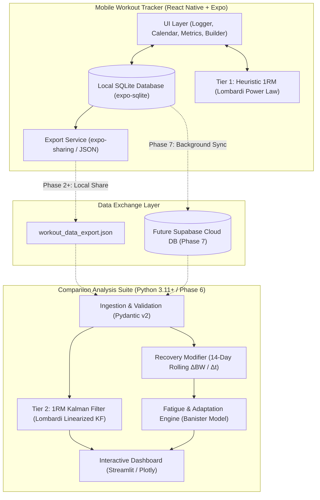
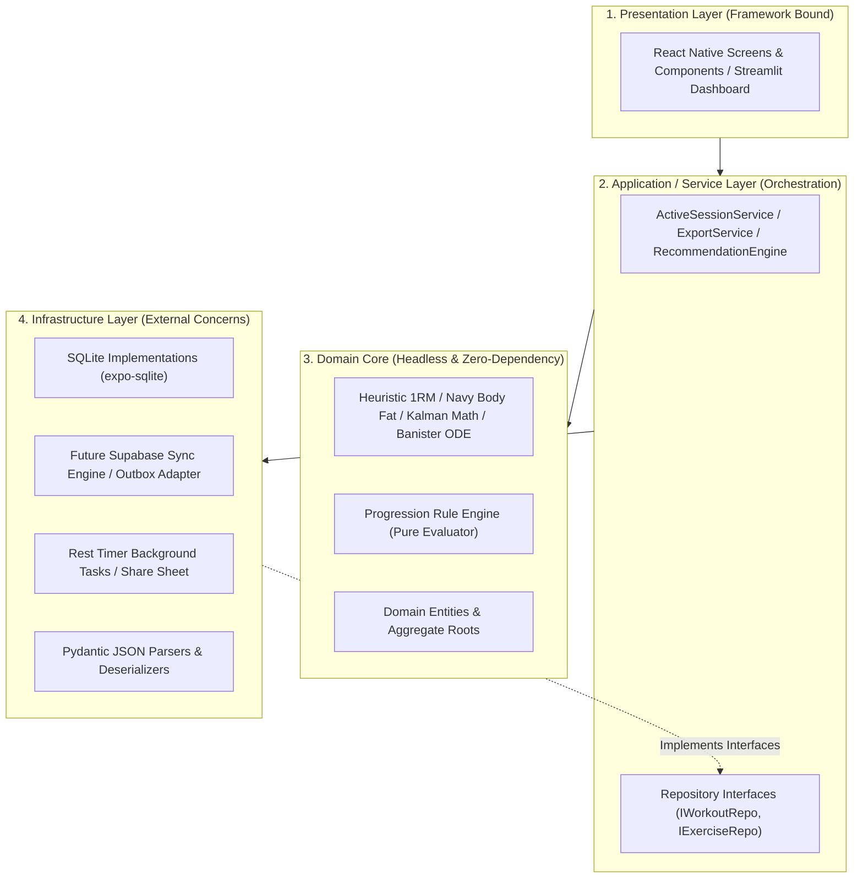

# Workout Suite — High-Level Architecture Documentation

## 1. System Purpose & Vision
The **Workout Suite** is a unified, local-first system designed for strength athletes and lifters to track resistance training data and execute data-driven, physiologically grounded fatigue and adaptation analysis.

The system is partitioned into two major subsystems connected by a standardized data exchange pipeline:
1. **Mobile Workout Tracker (iOS & Android)**: High-speed, offline-first mobile app for friction-free in-gym logging, routine management, rest timing, body metric tracking, and immediate performance heuristics.
2. **Companion Analysis Suite (Desktop / Web)**: Advanced Python analytics engine that ingests historical training logs to run an adaptive Kalman filter for individualized 1RM and endurance estimation, and a Banister two-component impulse-response model for fatigue and adaptation modeling.

---

## 2. Major Subsystems & Responsibilities

### 2.1 Subsystem 1: Mobile Workout Tracker
- **Responsibility**: In-gym capture, real-time feedback, routine management, and data import/export.
- **Boundaries**: Strictly client-side on mobile devices. Does not execute heavy multi-year matrix optimizations. All weight values stored internally in **kilograms** (canonical unit); display conversion to lbs is performed at the presentation layer.
- **Key Modules**:
  - `ActiveLogger`: Dynamic set management with set type tagging (working 'Reg', warmup 'Warm', drop 'Drop', myorep 'Myo', dc 'DC', amrap 'AMRAP'), per-set notes, ghosting placeholders from the most recent global session, set-type-specific rest timers (0s for drop, 10s for myorep, 30s for dc), superset/giant set grouping, Plate Calculator popover, in-session 1-tap exercise substitution, 1-tap implement and bar switcher (`change-gear-button-<id>`), dumbbell per-hand input with auto-doubled backend math, unilateral independent limb logging (`reps_right`), small-font gear subtext badge, total system load tracking for bodyweight/assisted movements (`is_bodyweight = 1`), dual-load persistence (ADR-026: storing both `raw_input_weight` and normalized effective `weight` in kg), 350ms input debouncing with blur/unmount flush (ADR-041), isolated wall-clock duration ticking (`WorkoutDurationTicker`), in-session pain reporting (`PainReportModal.tsx`, ADR-068: joint vs muscle classification, 1–10 severity rating, automatic remaining set pruning when severity > 6, and physiotherapist medical disclaimer), screen wake-lock via `expo-keep-awake`, input keyboard ergonomics with `selectTextOnFocus={true}`, quick-stepper pills (`±1`, `±2.5`, `±5`), haptic set completion (`expo-haptics`), and 1-tap warm-up ladder generator (`⚡ WARM-UP`).
  - `WarmupEstimator`: Deterministic warm-up ladder generator (`warmupEstimator.ts`, ADR-069) with barbell plate quantization ($L_{\text{final}} = m \cdot \lfloor L/m + 0.5 \rfloor$), 4-step progressive loading (empty bar, 50%, 70%, 87.5% diagnostic single), ternary rating adjustment ('light': $+2.5\%$ to $+5\%$, 'normal': $0\%$, 'hard': $-5\%$ to $-7.5\%$), and Helms RPE overshoot step-down.
  - `RestTimerService`: Background rest timing service (`restTimerService.ts`) synchronizing countdown timestamps with native push notifications (`expo-notifications`) and tactile completion vibrations (`expo-haptics`).
  - `OnboardingWizard`: 3-step first-launch onboarding modal (`OnboardingWizardModal.tsx`) configuring units (`kg`/`lbs`), default bar weight (`20kg`/`15kg` / `45lbs`/`35lbs`), intensity metric (`RPE`/`RIR`), equipment profile (`commercial_gym`, `garage_gym`, `dumbbells_only`), and starter program synthesis or CSV migration.
  - `WorkloadAnalysis`: Workload, Volume Landmarks, and Intensity Intelligence service (`workloadAnalysisService.ts`) and full-screen inspection modal (`WorkloadDeepDiveModal.tsx`), supporting weekly Monday–Sunday aggregation, dual effort/load intensity distributions, and volume landmark evaluation defaulting to **Hypertrophic Effective Reps** ($20–48\text{ eReps}$ MAV) with a toggle to Working Sets and rating coverage disclosure (ADR-064).
  - `CalendarAgenda`: Accordion calendar and day agenda view (`CalendarScreen.tsx`) featuring a default collapsed current-week row (`initialExpanded = false`) expandable on demand to full Monday-start 7-column monthly grids via toggle buttons and handle bar, completed workout badges, day agenda listings, and drill-down inspection of sessions (`SessionDetailModal.tsx`) showing volume tonnage, duration, set counts, top e1RM per exercise, deterministic superset badge notation (`SS A1`, `SS A2`), and immediate post-workout summary presentation.
  - `UserSettings`: Preferences manager (`SettingsScreen.tsx`) supporting instant toggles for Weight Unit System (`kg` / `lbs`), Intensity Metric (`RPE` / `RIR`), Pure Utility Mode (`pure_utility_mode` per ADR-024), peer-reviewed scientific citations (Epley, Brzycki, DOTS, Navy Tape, Banister), and medical/privacy disclosures.
  - `RootNavigation`: Lightweight bottom tab navigation (`App.tsx`) organizing the app into 4 dedicated hubs: `HOME (🏠)`, `WORKOUT (⚡)`, `PROFILE (👤)`, and `SETTINGS (⚙️)`, featuring state-preserving display toggling (ADR-028), Android hardware `BackHandler` back-stack interception, and in-progress session indicators.
  - `HomeScreen`: Central training hub (`HomeScreen.tsx`) presenting a Quick Status Dashboard (active program swatch, next scheduled workout preview card without start buttons, weekly metrics: workouts this week, tonnage, streak), an interactive accordion calendar agenda, and performance intelligence analytics with interactive DOTS Progression and Symmetry Radar modal triggers (`SBDBalanceRadarChart.tsx`).
  - `WorkoutTabRouter`: Smart session router (`WorkoutTabRouter.tsx`) dynamically resolving State A (in-progress active session via `ActiveLoggerScreen`), State B (active program pre-flight screen with circular template sequencing `(lastIndex + 1) % N`, exercise previews, and 1-tap start), and State C (no active program empty-state). Serves as the sole authoritative gateway to launch workout sessions.
  - `CrashRecoveryService`: Write-through persistence of in-progress sessions (`status = 'in_progress'`); on app relaunch, detects interrupted workouts and prompts Resume / Discard.
  - `PlateCalculatorService`: Headless pure calculation of barbell plate distribution (25, 20, 15, 10, 5, 2.5, 1.25 kg) based on tare weight (20 kg standard or specialty bar) and user plate inventory.
  - `GearInventory`: Equipment inventory management (`GearInventoryScreen.tsx`, `GearInventoryService.ts`) for custom barbells with tare weights (15 kg technique bar, 20 kg Olympic, 25 kg trap bar, 29 kg SSB) and custom machine cable mechanical ratios (defaults: 1:1 for rows/pulldowns, 2:1 for functional trainers per ADR-025, ADR-040). Accessible from `UserProfileScreen` under the Profile tab and selectable across 3 levels: exercise catalog default tare, template prescriptions, and in-gym active logger.
  - `ExerciseLibrary`: Catalog management (`ExerciseLibraryScreen.tsx`), custom movement creator/editor (`ExerciseFormModal.tsx`), and variant hierarchy exploration (`parent_exercise_id` self-referencing tree per ADR-012), integrated into Settings and ActiveLogger.
  - `ExerciseSubstitutionService`: Recommends compatible movements during active workouts via `parent_exercise_id` variant tree, transfers rep prescriptions, pulls ghost numbers, and prompts session-only vs permanent template update.
  - `ProgramManager`: Multi-day training program splits (e.g., Upper/Lower, PPL) in `programs` table with program accent colors (`color_hex`), daily `workout_templates`, target rep brackets (`target_reps_min` / `target_reps_max`), target RPE/RIR, and superset groupings.
  - `ProgramCloneService`: Deep cloning and presets protection service (`programCloneService.ts`) guarding pre-built and synthesized archetypes by auto-cloning as custom (`prog_custom_<ts>_<hash>`) when an edit is initiated.
  - `ProgramOverview`: Full CRUD program builder (`ProgramOverviewScreen.tsx`) supporting template creation/reordering/deletion, exercise creation/swapping/deletion, prescription editing (`PrescriptionEditorModal.tsx`), superset pairing/unpairing, and ProgressionBuilderModal integration.
  - `ProgramBlockService`: Tracks active meso-cycle date intervals (`program_blocks`) linked to `programs.id`, powers calendar swap indicators, and generates vertical shaded bands on charts.
  - `ExerciseInspection`: Deep-dive exercise analytics (`ExerciseDetailScreen.tsx`), Rep-Max PR Board (`PRBoardTable.tsx`) with dynamic monotonic upper envelope modeling (`repMaxEnvelope.ts` per ADR-043), All-Time/Block date scoping and session drill-down, allometric strength standard tier badges and demographic percentile bell curves (`SBDStandardsCard.tsx`), 3-axis SBD symmetry and balance radar chart (`SBDBalanceRadarChart.tsx`), and application service orchestration (`ExerciseInspectionService.ts`).
  - `ProgressionEngine`: Evaluates built-in schemes (LP, Double Progression, DDP) and executes user-defined IF/THEN/ELSE rule builder scripts from the `progression_rules` table. Generates interactive proposal banners before the next session ("Target hit! Increase weight to 82.5 kg? [Accept / Dismiss]") so the lifter retains full control.
  - `StrengthStandardsService`: Evaluates SBD e1RM against non-linear allometric and empirical bodyweight standards; outputs classification tier (Untrained to Elite), continuous normalized score (0–100+), delta kilograms to next tier, and DOTS coefficient.
  - `UserProfileService`: Manages user demographics (sex, height, birthdate) and Training Mentality matrix (`fury`, `precision`, `get_out`) with cross-stack schema synchronization across SQLite, JSON exports, and companion Pydantic models.
  - `ProgramRecommenderEngine`: Evaluates athlete profile and synthesizes optimal splits (Full Body, Upper/Lower, PPL), set volumes, RPE targets, progression rules, and dense 15-minute routines (4 exercises in 2 antagonist pairs, 8 total sets).
  - `BodyMetrics & Plots`: Anthropometry logging (`BodyMetricsScreen.tsx` for weight, waist, neck, limbs with live DoD Navy BF% calculation, live eLBM estimation, and 7-day rolling average banner) and longitudinal analytics suite (`PlotsScreen.tsx`, `timeSpanUtils.ts`, and `ProgramEraShadedChart.tsx` for e1RM progression, bodyweight SMA/EMA smoothing, body fat %, estimated Lean Body Mass (eLBM), anatomical circumferences, and Monday-bucketed weekly volume tonnage bars with multi-timespan filtering: All data, Year, 3 months, Month, Week, and meso-cycle program era shading).
  - `DatabaseService`: SQLite schema management with `PRAGMA user_version` migrations, and local CRUD operations.
  - `ExportService`: Packages SQLite state into standardized JSON payloads via OS share sheet.
  - `ImportService`: Parses training history and body composition from external apps via pure RFC 4180 tokenizer (`csvImportParser.ts`) supporting Strong CSV, Hevy CSV, Liftosaur CSV, StrengthLog Training CSV, StrengthLog Body Composition CSV, and generic CSVs. Features automated exercise catalog matching, alias mapping, custom fallback creation, duplicate session detection, `imported_from` provenance tagging, date range filtering, 1-tap bundled evaluation presets for Expo Go, and interactive wizard (`ImportScreen.tsx`) integrated into Settings.
  - `CalibratedParamService`: Imports `calibrated_parameters.json` from the companion suite; writes per-exercise $(1\text{RM}, k)$, projected 10RM, SFR score/tier, swap recommendation, optimal rest seconds, and asymmetry ratio to SQLite `calibrated_params` (schema v5), and caches `muscle_landmarks` and `program_audits` in `user_settings` for dynamic consumption in Workload Deep Dive.

### 2.2 Subsystem 2: Companion Analysis Suite
- **Responsibility**: Scientific modeling, historical parameter estimation, calibrated parameter export, and decision recommendations.
- **Boundaries**: Operates on exported data payloads or cloud database connections.
- **Key Modules**:
  - `DataIngestion`: Validates JSON structure using Pydantic models (`companion/src/ingestion/schemas.py`).
  - `Kalman1RMFilter`: Implements the state-space formulation tracking $\mathbf{x}_t = [\ln(1\text{RM}_t), k_t]^T$, accounting for high-rep noise and lift biomechanics (`companion/src/models/kalman_1rm.py`).
  - `FatigueAdaptationModel`: Calculates daily training stimulus, updates Banister impulse-response differential equations, and models net preparedness (`companion/src/models/fatigue_banister.py`).
  - `RecoveryEngine`: Computes the 14-day rolling bodyweight slope ($\Delta BW / \Delta t$) to modulate fatigue decay constants ($\tau_2$), and evaluates 28-day anthropometric partitioning ($P$-Ratio proxy: $\beta_{\text{eLBM}} / \beta_{\text{BW}}$) to flag `CALORIC_OVERSHOOT` (`companion/src/models/recovery_modifier.py`).
  - `RecommendationEngine`: Generates ACWR alerts (overload readiness, deload advisories, under-stimulation warnings) and evaluates deterministic program parameter audits (`REST_TOO_SHORT`, `JUNK_VOLUME`, `AXIAL_BOTTLENECK`, `REP_MONOTONY`) (`companion/src/models/recommendations.py`).
  - `MesocycleAnalyzer`: Formulates optimal mesocycle accumulation length ($L_{\text{opt}}$) as a survival analysis and change-point detection problem combining Kalman e1RM gain velocity stall ($\dot{x}_0(u) \le 0$), iso-load RPE drift ($\Delta\text{RPE}_{\text{drift}} > 0$), and Page's CUSUM systemic underperformance ($C_t^-$), with empirical Banister boundary segmentation and conjugate Normal-Normal Bayesian updating (`companion/src/models/mesocycle_analyzer.py`).
  - `HypertrophySignals`: Extracts hypertrophic effective repetitions ($e\text{Reps}$), TUT-adjusted implicit inter-set rest intervals ($\Delta t_{\text{rest}}$), multi-set intra-session fatigue decay slopes ($\delta_{\text{drop}}$), and true 10-Repetition Maximum projections ($\text{e10RM}_t = \exp(x_{0,t}) \cdot 10^{-k_t}$) (`companion/src/analysis/hypertrophy_signals.py`).
  - `MuscleLandmarks`: Splits systemic Banister readiness into 12 localized peripheral muscle-group scores ($\tau_{2,m} = 0.65 \cdot \tau_2$), routes direct (1.0x) and synergist (0.5x) volume credits, applies category-weighted systemic fatigue multipliers ($m_{\text{sys}} = 1.35$ for barbell compound, $1.00$ for dumbbell/bodyweight compound, $0.65$ for isolation/machine), and solves for individualized $[ \text{MEV}, \text{MAV}, \text{MRV} ]$ volume landmarks via constrained quadratic dose-response regression with Bayesian prior blending and energy balance scaling (`companion/src/analysis/muscle_landmarks.py`).
  - `SFREvaluator`: Evaluates empirical Stimulus-to-Fatigue Ratio ($\text{SFR}_{\text{ex}} \in [0, 100]$), severe joint pain guardrails ($\text{severity} \ge 5 \implies \text{POOR\_SWAP\_RECOMMENDED}$), variant tree substitutions ranked by lowest joint pain and lowest $m_{\text{sys}}$, and unilateral limb repetition asymmetry detection ($> 12\%$ over $\ge 3$ sessions) (`companion/src/analysis/sfr_evaluator.py`).
  - `CalibratedParamExporter`: Serializes per-exercise $(1\text{RM}, k)$, projected 10RM, SFR tiers, swap IDs, asymmetry ratios, 12-muscle volume landmarks, and program audits to `calibrated_parameters.json` for mobile import (`companion/src/export/param_exporter.py`).
  - `VisualizationDashboard`: Interactive Streamlit dashboard (`companion/src/ui/app.py`) with rich Plotly charts (`companion/src/ui/charts.py`): Kalman 1RM trajectory with ±1 SD uncertainty envelope and distinct crimson star markers (★) for tested actual 1RMs vs amber diamonds for submaximal sets, repetition endurance drift ($k_t$), Banister impulse-response curves (Fitness/Fatigue/Readiness), longitudinal bodyweight OLS slope, 2-panel Mesocycle Survival & Fatigue Curve with shaded 90% Bayesian credible interval deload window, 12-Muscle Volume Landmarks vs Weekly Sets, and Exercise Stimulus-to-Fatigue Ratio (SFR) Matrix.

---

## 3. Dual-Tier 1RM Architecture

To balance real-time gym responsiveness with rigorous statistical modeling:
1. **Tier 1 (Mobile Fast Heuristic)**:
   - Evaluates submaximal sets instantly using Lombardi's power law ($w \cdot r_{\text{eff}}^{0.10}$) or pre-loaded calibrated $(1\text{RM}, k)$ parameters.
   - For deadlift exercises evaluated under static linear heuristic equations (e.g., Epley / Brzycki), a **+10% compensatory multiplier** applies strictly to counter the non-stretch-shortening cycle fatigue profile (concentric-only start).
   - Zero latency; runs synchronously on the mobile device during set entry.
2. **Tier 2 (Companion Adaptive Kalman Filter & Banister Engine)**:
   - Evaluates session data using **single top-set selection** (`max_session_sets = 1`, ADR-067) ranked by highest projected e1RM ($w \cdot r_{\text{eff}}^k$), completely eliminating warmup singles, ramp-up touches, and back-off fatigue noise while offering optional multi-set processing.
   - Processes complete longitudinal training series per exercise via **consolidated single daily batch evaluation** per session date, eliminating intra-day micro-sawtoothing and artificial noise inflation.
   - Enforces a **3-stage gating pipeline**: Intra-session peak reference gate (rejecting sets $< 65\%$ max weight or $< 82\%$ peak heuristic 1RM), asymmetric Mahalanobis innovation gate with Huber M-estimation variance scaling, and a physical lower-bound floor ($x_0 \ge \ln(w) + 0.03 \ln(\text{reps})$) ensuring estimated 1RM strictly exceeds working loads.
   - Applies **dual-defense boundary regularization** for $k \in [0.03, 0.16]$: Soft Tikhonov anchor on $k_{\text{prior}}$ prevents drift during constant-rep brackets, and Simon's covariance-weighted projection adjusts $\ln(1\text{RM})$ along the conditional Gaussian distribution upon boundary contact with covariance conditioning.
   - Maintains numerical stability via **Joseph stabilized covariance formulation**.
   - Integrates Banister fitness-fatigue differential equations via **scale-invariant unit-gain EWMA** with diminishing returns saturation per exercise ($\kappa_{\text{ex}} = 4.0$) and bounded daily impulses ($[0, 100]$), strictly constraining $P(t), F(t) \in [0, 100]$ and generating actionable normalized Readiness ($[0, 100]$).

---

## 4. Primary Data Flows & Persistence

1. **Active Workout Execution**:
   - User opens app $\rightarrow$ Resume/Discard check for interrupted sessions $\rightarrow$ Selects template or empty workout $\rightarrow$ Exercises loaded with ghosted previous session weights/reps (global scope) $\rightarrow$ User checks off set (write-through to SQLite) $\rightarrow$ Rest timer initiates (suppressed within superset groups).
2. **Data Export & Ingestion (Step 2.3 & ADR-061)**:
   - User taps "Export Data (JSON)" in Settings $\rightarrow$ `ExportService` serializes all 12 SQLite tables (including `pain_reports` for joint/muscle discomfort tracking with cascading foreign keys to workouts and exercises, `calibrated_params` with posterior covariances `cov_p00`/`cov_p11`, and `body_metrics` with `imported_from` provenance and optional/null bodyweight for circumference-only anthropometric logs per ADR-061) into canonical JSON conforming to `schemas/workout_export.schema.json` with ADR-026 dual-load preservation $\rightarrow$ Writes to cache via `expo-file-system` $\rightarrow$ Triggers native OS share sheet via `expo-sharing` $\rightarrow$ Shared payload is ingested by Companion and validated strictly by Pydantic v2 data models with backward-compatible zero-sentinel coercion.

3. **Data Import & Evaluation**:
   - User taps "Import Data" in Settings $\rightarrow$ Chooses file picker, clipboard paste, or 1-tap "Load Evaluation Dummy Data" preset (Last 3 Months / All Time) $\rightarrow$ `ImportService` auto-detects Strong, Hevy, Liftosaur, or StrengthLog (training or body comp) $\rightarrow$ Skips unperformed routine template sets $\rightarrow$ Previews matched exercises and duplicate workouts with optional date filtering $\rightarrow$ Writes imported workouts and sets to SQLite inside a single transaction, or updates anthropometric records in `body_metrics` with `imported_from` provenance.
4. **Analytical Processing**:
   - JSON data ingested into Pandas DataFrames $\rightarrow$ Kalman filter updates $(1\text{RM}_t, k_t)$ per exercise $\rightarrow$ Stimulus computed $\rightarrow$ Bodyweight slope computed $\rightarrow$ Banister differential equations integrated $\rightarrow$ Readiness & deload signals rendered on dashboard.
5. **Calibrated Parameter Sync**:
   - Companion exports `calibrated_parameters.json` $\rightarrow$ User transfers file to mobile $\rightarrow$ `CalibratedParamService` writes per-exercise $(1\text{RM}, k)$ and covariance parameters to `calibrated_params` table $\rightarrow$ Tier 1 heuristic upgrades from default $k = 0.10$ to individualized $k$.
6. **Tiered Cloud Ingestion & Direct Coach Overwrite (Phase 7 & ADR-069)**:
   - **Batched Session Ingestion**: Local-first workout logging writes exclusively to SQLite during training; completed sessions are batched and uploaded in a single compressed transaction (`POST /api/v1/sessions`).
   - **Dual Storage Path**: Free tier transmits pseudonymous statistical tuples `(exercise_id, weight_kg, reps, rpe, user_sex, bodyweight_kg)` directly into an analytical data lake for global baseline calibration; Premium/Business tiers sync full relational accounts in PostgreSQL.
   - **One-Time Upgrade Backfill**: Upgrading from Free to Premium triggers an automated bulk sync of the user's complete local SQLite history to their new cloud account.
   - **Coach Direct Overwrite**: Business tier coaches can push programs and prescription adjustments directly to an athlete's device, automatically updating the active program without manual confirmation steps.

---

## 5. Architectural Modularity, Layering & Boundary Rules

To guarantee long-term maintainability, independent testability, and seamless progression from Phases 1–5 local SQLite to Phase 7 cloud synchronization, the system enforces **Clean / Hexagonal Architecture (Ports and Adapters)** across both subsystems.

### 5.1 Strict Inward Dependency Rule
- **Domain Core**: Contains business rules, biological and mathematical models, and entity models. It has **zero dependencies** on UI libraries, React Native, Streamlit, or SQLite drivers.
- **Application Services**: Orchestrates user actions by calling Domain functions and invoking Repository interfaces.
- **Presentation**: Dumb, reactive view layer (React Native components / Streamlit UI) that handles user input and renders ViewModel state. Never invokes database queries directly.
- **Infrastructure**: Adapters for SQLite, device notifications, file systems, and network services. Implements interfaces defined by the Application layer.

### 5.2 Headless Domain Logic
All calculation engines are implemented as **pure, side-effect-free functions**:
- Tier 1 e1RM calculation: `(weight, reps, rpe, calibratedK?) => e1RM`
- SBD strength standard evaluation: `(e1RM, bodyweight, gender, liftType) => { tier, continuousScore, nextTierKgNeeded }`
- Powerlifting DOTS score: `(totalKg, bodyweightKg, gender) => dotsPoints`
- Plate loading calculator: `(targetWeight, barTareKg, plateInventory) => { platesPerSide: number[], remainderKg: number }`
- Effective set load normalizer: `(enteredWeight, loadMode, isBodyweight, currentBodyweight, addedWeight, cableRatio?) => { effectiveWeightKg: number, rawInputWeight: number }` (ADR-026)
- Profile program synthesizer: `(profile, exerciseCatalog) => { template, templateExercises, progressionRules }`
- Progression engine: `(rule, setHistory) => nextPrescription`
- Body composition: `(gender, measurements, height) => bodyFatPercentage`
- Unit conversion: `(value, fromUnit, toUnit) => convertedValue`
- Kalman state updates: `(prior_state, obs_matrix) => posterior_state`
- Banister impulse integration: `(daily_stimulus, tau1, tau2) => preparedness`

*Result*: 100% of domain math can be unit-tested in under 200ms with zero simulator/emulator overhead.

### 5.3 Repository Pattern & Storage Decoupling
UI screens never execute SQL statements or import `expo-sqlite` directly. All data access is mediated through domain repository interfaces (`IWorkoutRepository`, `IExerciseRepository`, `IBodyMetricsRepository`, `IPainReportRepository`):
- **Testing**: Screens and services can be tested against in-memory mock repositories without file I/O.
- **Offline-First Zero-Latency Invariant (Phase 7 Cloud Synchronization)**:
  - Directly replacing `SQLiteWorkoutRepository` with a network-bound `SupabaseWorkoutRepository` under UI components is strictly prohibited. In basement gym environments with intermittent or non-existent cellular coverage, awaiting HTTP roundtrips on set check-offs (`CrashRecoveryService` write-through) destroys user experience and violates zero-latency responsiveness.
  - The local embedded SQLite database remains the **sole source of truth** for all Presentation screens, custom hooks, and active workout sessions.
  - Cloud integration in Phase 7 is implemented as an asynchronous **Sync Engine & Outbox Service** (`SyncEngine`). The engine observes local SQLite changes (via an outbox queue and metadata), pushes pending mutations to Supabase PostgreSQL when online, and applies remote changes down to SQLite in the background without blocking the UI thread.

### 5.4 Vertical Feature Slicing
The mobile client is partitioned into self-contained feature slices (`features/logger`, `features/inspection`, `features/progression`, `features/bodyMetrics`, `features/templates`, `features/import`) rather than horizontal directories. Each slice exposes a public interface via its root `index.ts`. Cross-feature coupling is prohibited.

### 5.5 Schema-First Data Contract
The data exchange contract between TypeScript and Python is governed by a canonical JSON schema (`schemas/workout_export.schema.json`):
- TypeScript export types and Python Pydantic models are bound to this shared specification.
- Continuous Integration runs automated contract tests that validate exported JSON fixtures against Pydantic models to eliminate cross-stack schema drift.

### 5.6 Architectural Fitness Functions
Boundaries are automatically enforced via tooling:
- **Lint Boundaries**: `eslint-plugin-boundaries` forbids Presentation or Domain layers from importing Infrastructure or database packages directly.
- **Strict Typing**: TypeScript (`tsc --noEmit --strict`) and Python (`mypy --strict`) prevent implicit untyped leakage across boundaries.

---

## 6. Development, Build, & Validation Commands

All commands must be executed within their respective workspace directories to eliminate dependency bleed and working-directory confusion (see `AGENTS.md` Section 8).

### Mobile App (React Native / Expo) — Working Directory: `mobile/`
*Strict Rule: NEVER run `npm` or place `package.json` at the repository root.*
- Install dependencies: `npm install` (or from root: `npm --prefix mobile install`)
- Start Expo development server: `npx expo start`
- Run on Android: `npx expo run:android` or scan QR via Expo Go
- Run on iOS: Scan QR via Expo Go on iPhone
- Lint & Typecheck: `npm run lint` / `npx tsc --noEmit`
- Run test suite: `npm test`

### Companion Analysis Program (Python 3.11+) — Working Directory: `companion/`
*Strict Rule: All Python tools MUST run inside the virtual environment `companion/.venv`.*
- Initialize virtual environment: `python -m venv .venv`
- Activate virtual environment:
  - Windows: `.\.venv\Scripts\Activate.ps1`
  - POSIX / macOS / Linux: `source .venv/bin/activate`
- Install dependencies: `pip install -r requirements.txt`
- Run dashboard: `streamlit run src/ui/app.py`
- Run tests: `pytest`
- Typecheck: `mypy src`
- Lint & Format: `flake8 src tests` / `black --check src tests`

