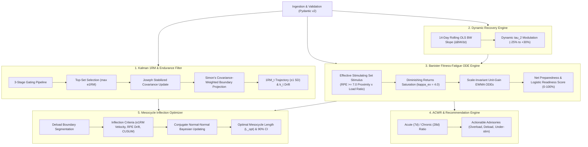

# Workout Suite — Data Specifications & Companion Analytics Map

## 1. Executive Summary & Architecture Overview

The **Workout Suite** is a local-first system designed for strength athletes and lifters. It is partitioned into two major subsystems connected by a standardized, version-controlled JSON data exchange pipeline (`schemas/workout_export.schema.json` and `schemas/calibrated_parameters.schema.json`):

1. **Mobile Workout Tracker (React Native + Expo + SQLite)**:
   - High-speed, offline-first mobile client for in-gym execution, dynamic set logging, rest timing, anthropometric logging, gear configuration, and immediate heuristic feedback (Tier 1 Lombardi 1RM, U.S. Navy body fat %, weekly volume landmarks, and SBD strength standards).
2. **Companion Analysis Suite (Python 3.11+ + Streamlit + Plotly)**:
   - Scientific analytics engine executing computationally intensive longitudinal modeling: Tier 2 Adaptive Linear Kalman Filter for individualized 1RM and repetition fatigue ($k$) tracking, Banister two-component impulse-response modeling for fitness-fatigue dynamics, 14-day rolling OLS bodyweight slope for dynamic recovery modulation, Acute:Chronic Workload Ratio (ACWR) decision advisories, and Bayesian mesocycle accumulation length optimization ($L_{\text{opt}}$).

```mermaid
flowchart LR
    subgraph MobileApp ["Mobile Tracker (In-Gym Capture)"]
        WS["workout_sets (load, reps, RPE, tags)"]
        BM["body_metrics (weight, circumferences)"]
        PR["pain_reports (joint vs muscle, 1-10)"]
        EX["exercises & gear_inventory"]
        UP["user_profiles (sex, height, mentality)"]
    end

    subgraph Exchange ["Data Contract Layer"]
        ExportJSON["workout_data_export.json\n(Pydantic v2 / Strict Schema)"]
        CalibJSON["calibrated_parameters.json\n(1RM, k, cov_p00, cov_p11)"]
    end

    subgraph CompanionSuite ["Companion Analysis Suite (Scientific Engine)"]
        KF["Tier 2 Kalman Filter (1RM_t, k_t)"]
        BAN["Banister Impulse-Response (P, F, Readiness)"]
        REC["Dynamic Recovery (14d OLS BW Slope)"]
        ACWR["ACWR & Training Advisories"]
        MESO["Mesocycle Optimizer (L_opt Bayesian)"]
    end

    MobileApp -->|"Settings > Export Data"| ExportJSON
    ExportJSON --> CompanionSuite
    CompanionSuite -->|"Export Calibrated Params"| CalibJSON
    CalibJSON -->|"Settings > Import Calibrated"| MobileApp
```

---

## 2. Comprehensive Inventory of Stored Data

All training and anthropometric data is stored locally in SQLite (`mobile/src/database/schema.ts`) and serialized into canonical JSON export payloads (`schemas/workout_export.schema.json`, `companion/src/ingestion/schemas.py`).

### 2.1 Exercise Sets (`workout_sets` / `WorkoutSet`)

The fundamental atomic unit of training volume. Implements **ADR-026 dual-weight persistence** to preserve both what the lifter typed on the screen and the exact physical load handled.

| Field Name | Type / Format | Nullable | Description & Physiological Context |
| :--- | :--- | :---: | :--- |
| `id` | `TEXT` (UUID) | No | Primary key. Unique identifier for the completed set. |
| `workout_id` | `TEXT` (FK) | No | Foreign key linking to parent `workouts.id`. Cascades on delete. |
| `exercise_id` | `TEXT` (FK) | No | Foreign key linking to catalog movement in `exercises.id`. |
| `gear_id` | `TEXT` (FK) | Yes | Foreign key to `gear_inventory.id` for specialty bars or custom cable stacks. |
| `set_number` | `INTEGER` | No | 1-based sequential execution index for this movement within the session. |
| `weight` | `REAL` (kg) | No | **Normalized effective mechanical load in kilograms** (ADR-026). Stored in canonical kg; accounts for dumbbell auto-doubling (`load_mode = 'per_hand'`), machine pulley ratios (e.g. 2:1 ratio), bar tare weight, and added weight. Used for all 1RM and fatigue calculations. |
| `raw_input_weight` | `REAL` (kg/lbs) | No | **Exact user-typed load** in the UI prior to unit scaling or mechanical multipliers (ADR-026). Prevents rounding drift and guarantees fidelity upon user re-inspection. |
| `added_weight` | `REAL` (kg) | Yes | External added load (e.g. $+10\text{ kg}$ on a weighted dip/chin-up belt) or negative assistance load (e.g. $-15\text{ kg}$ on an assisted pull-up machine). |
| `reps` | `INTEGER` | No | Repetitions completed. For unilateral movements, represents left limb repetitions. |
| `reps_right` | `INTEGER` | Yes | Right limb repetitions for unilateral movements (`is_unilateral = 1`). `NULL` for bilateral lifts. Allows tracking limb asymmetries. |
| `rpe` | `REAL` (0.0–10.0) | Yes | Rate of Perceived Exertion (Borg CR10 modified for resistance training, 0.5 step resolution). Quantifies proximity to failure ($10 = \text{max effort / 0 RIR}$, $9.5 = \text{maybe 1 rep left}$, $9 = \text{1 RIR}$, $8 = \text{2 RIR}$, $7 = \text{3 RIR}$). |
| `rir` | `REAL` (0.0–10.0) | Yes | Reps in Reserve. Direct inverse representation of RPE ($\text{RIR} = 10.0 - \text{RPE}$). Both are supported and bidirectionally converted at the UI boundary. |
| `set_type` | `TEXT` (Enum) | No | Classification tag governing how the set is processed in fatigue, volume, and rest calculations:  • `working`: Standard working set. • `warmup`: Ramp-up set. Automatically excluded from 1RM, volume, and fatigue. • `drop`: Drop set (reduced load, 0s rest timer). • `myorep`: Rest-pause activation or mini-set (10s rest timer). • `dc`: Doggcrapp rest-pause set (11–15 deep-breath rest-pause reps, 30s rest timer). • `amrap`: "As Many Reps As Possible" / test to failure (automatically assigned 0 RIR / RPE 10.0). |
| `set_notes` | `TEXT` | Yes | Free-text annotations per set (e.g., "grip slipped", "beltless", "elbow sleeve on"). |
| `exercise_group_id`| `TEXT` (UUID) | Yes | Superset, giant set, or antagonist pairing ID. Suppresses rest timers between grouped movements until the final exercise in the group is completed. |
| `created_at` | `TEXT` (ISO 8601)| No | Timestamp when the set was marked completed in the active session. |

---

### 2.2 Workout Sessions (`workouts` / `Workout`)

Encapsulates complete training sessions.

| Field Name | Type / Format | Nullable | Description & Purpose |
| :--- | :--- | :---: | :--- |
| `id` | `TEXT` (UUID) | No | Primary key. Unique identifier for the workout. |
| `template_id` | `TEXT` (FK) | Yes | Foreign key to `workout_templates.id` if initiated from a routine; `NULL` for ad-hoc workouts. |
| `date` | `TEXT` (YYYY-MM-DD)| No | Calendar date of the session. Canonical grouping key for daily batch evaluation. |
| `name` | `TEXT` | No | Session title (e.g. "Upper Power A", "Legs Hypertrophy"). |
| `notes` | `TEXT` | Yes | Session-level athlete notes (overall fatigue, gym conditions, sleep quality). |
| `started_at` | `TEXT` (ISO 8601)| No | Wall-clock timestamp when session commenced. |
| `duration_seconds` | `INTEGER` | Yes | Active workout elapsed duration in seconds. Ticked independently of app re-renders. |
| `status` | `TEXT` (Enum) | No | Lifecycle status: `in_progress`, `completed`, or `discarded`. Powers crash recovery on app restart. |
| `completed_at` | `TEXT` (ISO 8601)| Yes | Wall-clock timestamp when workout was finished. |
| `imported_from` | `TEXT` | Yes | Provenance source if imported (`strong`, `hevy`, `liftosaur`, `strengthlog`, `fitnotes`, `csv`). |

---

### 2.3 Body Composition & Anthropometry (`body_metrics` / `BodyMetric`)

Longitudinal body composition and circumference tracking. Implements **ADR-061** permitting circumference-only entries when bodyweight is not recorded.

| Field Name | Type / Format | Nullable | Unit | Description & Biological Significance |
| :--- | :--- | :---: | :---: | :--- |
| `id` | `TEXT` (UUID) | No | — | Primary key. |
| `date` | `TEXT` (YYYY-MM-DD)| No | — | Calendar date of measurement. |
| `bodyweight` | `REAL NOT NULL` in SQLite; nullable in the domain/export contract | **Yes** at the domain boundary | kg | Morning fasted bodyweight in canonical kilograms. SQLite stores `0` as a legacy missing-value sentinel; repository reads and JSON exports normalize it to `null` (ADR-061). |
| `body_fat_manual` | `REAL` | Yes | % | Manually logged body fat percentage from external devices (DXA, skinfold calipers, InBody BIA). |
| `waist_cm` | `REAL` | Yes | cm | Waist circumference measured horizontally at the midpoint between the lowest rib and iliac crest (or navel). Primary predictor for abdominal adiposity and U.S. Navy body fat equation. |
| `neck_cm` | `REAL` | Yes | cm | Neck circumference measured just inferior to the laryngeal prominence (Adam's apple). Used in U.S. Navy body density estimation. |
| `hip_cm` | `REAL` | Yes | cm | Hip circumference measured at the maximal anterior-posterior diameter across the gluteal muscles. **Required for female U.S. Navy body fat formula**. |
| `bicep_cm` | `REAL` | Yes | cm | Upper arm circumference (flexed or relaxed at peak girth). Hypertrophy tracking. |
| `chest_cm` | `REAL` | Yes | cm | Chest circumference measured at the mid-sternum / nipple line. |
| `thigh_cm` | `REAL` | Yes | cm | Mid-thigh circumference measured midway between inguinal crease and proximal border of patella. |
| `calf_cm` | `REAL` | Yes | cm | Maximum standing calf circumference. |
| `navy_body_fat` | `REAL` | Yes | % | **Automated U.S. Navy formula result** calculated from height, neck, waist (and hip for females). Clamped to physiological range $[2.0\%, 70.0\%]$. |
| `imported_from` | `TEXT` | Yes | — | Provenance tag if imported from external health platform (e.g. StrengthLog body comp, Apple Health). |

---

### 2.4 Pain & Discomfort Reports (`pain_reports` / `PainReport`)

Tracks acute musculoskeletal discomfort and joint wear during or after training (ADR-068).

| Field Name | Type / Format | Nullable | Description & Actionable Rules |
| :--- | :--- | :---: | :--- |
| `id` | `TEXT` (UUID) | No | Primary key. |
| `workout_id` | `TEXT` (FK) | No | Cascading foreign key to `workouts.id`. |
| `exercise_id` | `TEXT` (FK) | No | Cascading foreign key to `exercises.id`. |
| `set_id` | `TEXT` (FK) | Yes | Optional foreign key to `workout_sets.id` identifying the exact set where pain occurred. |
| `pain_type` | `TEXT` (Enum) | No | Clinical anatomical category:  • `joint`: Articular, capsule, ligamentous, or tendinous discomfort. • `muscle`: Muscle belly strain or acute spasm. |
| `severity` | `INTEGER` (1–10) | No | Visual Analog Scale (VAS) pain rating from 1 (mild awareness) to 10 (incapacitating). **Rule: Severity $> 6$ automatically triggers pruning/removal of remaining unlogged sets for that exercise**. |
| `notes` | `TEXT` | Yes | Free-text description of pain sensation (sharp, dull ache, pinching, clicking). |
| `created_at` | `TEXT` (ISO 8601)| No | UTC timestamp of report creation. |

---

### 2.5 Catalog Exercises & Gear Metadata (`exercises`, `gear_inventory`)

Movement kinematics, load mechanics, and equipment tare specifications.

- **`exercises`**:
  - `muscle_group`: Primary agonist target (Chest, Back, Quads, Hamstrings, Glutes, Shoulders, Biceps, Triceps, Forearms, Calves, Abs, Traps). Receives $1.0$ set volume credit.
  - `secondary_muscles`: Synergist/assisting muscle groups receiving $0.5$ set volume credit in weekly workload analysis.
  - `category`: Implement class (`Barbell`, `Dumbbell`, `Cable`, `Bodyweight`, `Machine`, `Other`).
  - `is_compound` ($0/1$): Distinguishes multi-joint compound movements from single-joint isolations.
  - `is_bodyweight` ($0/1$): Triggers total system load tracking (athlete bodyweight $+$ added load).
  - `is_unilateral` ($0/1$): Flags independent limb loading (`reps_right` logging).
  - `load_mode`: `total` vs `per_hand` (per-hand automatically doubles dumbbell load for bilateral work).
  - `default_cable_ratio`: Mechanical pulley advantage ratio (e.g. $1.0$ for 1:1, $0.5$ for 2:1 functional trainers).
  - `default_bar_weight_kg`: Barbell tare weight (standard $20.0\text{ kg}$).
  - `standard_lift_type`: Standard powerlifting benchmark class (`squat`, `bench`, `deadlift`, `ohp`, `row`) for SBD standards and DOTS benchmarking.
  - `parent_exercise_id`: Variant tree hierarchy (powers in-gym 1-tap exercise substitution, e.g. Incline DB Bench $\to$ Flat DB Bench).
  - `default_rest_seconds`: Prescribed rest timer duration (default 120s).
- **`gear_inventory`**:
  - Custom equipment inventory with custom tare weights ($15\text{ kg}$ technique bar, $25\text{ kg}$ trap bar, $29\text{ kg}$ Safety Squat Bar) and custom pulley ratios.

---

### 2.6 User Demographic & Psychological Profile (`user_profiles`)

User physiological baseline and psychological training preferences.

| Field Name | Type / Values | Description & Mathematical Use |
| :--- | :--- | :--- |
| `gender` | `male` / `female` | Required for U.S. Navy body density equations, DOTS coefficient polynomials, and strength standards. |
| `height_cm` | `REAL` (cm) | Required for U.S. Navy body fat formula and allometric height-to-weight scaling. |
| `birthdate` | `TEXT` (YYYY-MM-DD)| Chronological age computation (junior/master strength standards). |
| `training_mentality` | `fury` / `precision` / `get_out` | Governs auto-synthesized routines:  • `fury`: High intensity/RPE, low volume. • `precision`: Technical, RIR-governed, standard volume. • `get_out`: Time-compressed 15-minute superset routines. |
| `primary_goal` | `strength`, `hypertrophy`, etc. | Targets rep brackets and progression rules. |
| `preferred_days_per_week` | `INTEGER` (1–7) | Split synthesis (Full Body vs Upper/Lower vs PPL). |
| `equipment_access` | `commercial_gym`, `garage_gym`, etc.| Movement filter for catalog prescriptions. |

---

### 2.7 Calibrated Parameters (`calibrated_params` / `CalibratedParameter`)

Bridge between Companion Kalman engine and Mobile Fast Heuristic.

| Field Name | Type / Format | Description |
| :--- | :--- | :--- |
| `exercise_id` | `TEXT` (FK) | Unique foreign key to `exercises.id`. |
| `calibrated_1rm` | `REAL` (kg) | Estimated true 1RM strength in kilograms ($\exp(x_0)$). |
| `calibrated_k` | `REAL` (0.03–0.16) | Athlete's individualized repetition endurance fatigue exponent ($k$). |
| `cov_p00` | `REAL` | Error covariance variance $P[0,0]$ for $\ln(1\text{RM})$ uncertainty. |
| `cov_p11` | `REAL` | Error covariance variance $P[1,1]$ for $k$ uncertainty. |
| `calibrated_at` | `TEXT` (ISO 8601)| Calibration generation timestamp. |

---

## 3. What We Currently Calculate in the Companion Suite

The **Companion Analysis Suite** (`companion/src/`) is an analytical environment built with Python 3.11+, NumPy, SciPy, Pandas, Streamlit, and Plotly. It executes five primary mathematical models:

---

### 3.1 Tier 2 Adaptive Linear Kalman Filter (`kalman_1rm.py`)

Estimates true unfatigued 1-Repetition Maximum strength ($\text{1RM}_t$) and movement-specific repetition endurance ($k_t$).

#### Mathematical Formulation
- **State Vector**:
  $$\mathbf{x}_t = \begin{bmatrix} \ln(\text{1RM}_t) \\ k_t \end{bmatrix} \in \mathbb{R}^2$$
- **Linearized Lombardi Power Law**:
  Lombardi's empirical power law states $w = \text{1RM} \cdot r_{\text{eff}}^{-k}$. Taking natural logarithms linearizes the measurement equation:
  $$y_t = \ln(w_t) = \ln(\text{1RM}_t) - k_t \ln(r_{\text{eff}, t}) + v_t = \mathbf{H}_t \mathbf{x}_t + v_t$$
  where measurement matrix $\mathbf{H}_t = \begin{bmatrix} 1 & -\ln(r_{\text{eff}, t}) \end{bmatrix}$.
- **Effective Repetitions ($r_{\text{eff}}$)**:
  $$r_{\text{eff}} = \text{reps} + \text{RIR} = \text{reps} + (10.0 - \text{RPE})$$
  - Failure/AMRAP sets: $\text{RIR} = 0 \implies r_{\text{eff}} = \text{reps}$.
  - Tested 1RMs without explicit rating: $\text{reps} = 1 \implies \text{RIR} = 0 \implies r_{\text{eff}} = 1.0$.
  - Unrated working sets: Mapped to configurable fallback (default $2.0\text{ RIR} / 8.0\text{ RPE}$).
- **Dynamic Quadratic Measurement Noise**:
  Repetition endurance predictions become noisy at high repetitions. The measurement noise variance $R_t$ quadratically amplifies with effective repetitions:
  $$R_t = \sigma_{\text{base}}^2 \cdot (1 + \lambda \cdot r_{\text{eff}}^2)$$
  where $\sigma_{\text{base}} \approx 0.045$ (~4.5% biological noise) and $\lambda \approx 0.030$. A 10-rep set has $\sim 4\times$ the variance of a 1-rep test and is downweighted.
- **Single Top-Set Selection (`max_session_sets = 1`, ADR-067)**:
  Filters all sets in a workout session to isolate the single highest projected e1RM set:
  $$\text{Top Set} = \arg\max_{s} \left( w_s \cdot r_{\text{eff}, s}^{k_{\text{prior}}} \right)$$
  Warmup singles, ramp-ups, and back-off sets are filtered out.
- **3-Stage Gating Pipeline (Outlier Rejection)**:
  1. *Intra-session reference gate*: Rejects sets with load $<65\%$ of max session weight or projected e1RM $<82\%$ of session peak.
  2. *Asymmetric Huber M-estimation*: Downweights sets with severe negative innovations (bad days, illness) without penalizing legitimate breakthrough performances.
  3. *Physical load floor*: Enforces $x_0 \ge \ln(w) + 0.03 \ln(\text{reps})$, preventing the estimated 1RM from dropping below the actual load lifted.
- **Dual-Defense Boundary Regularization ($k \in [0.03, 0.16]$)**:
  - *Soft Tikhonov anchor*: Pulls $k$ gently towards population lift priors (bench: 0.085, squat: 0.095, deadlift: 0.075, default: 0.10) to prevent unconstrained drift during fixed-rep training.
  - *Simon's covariance-weighted state projection*: If $k$ contacts boundary limits, adjusts $\ln(\text{1RM})$ along the conditional Gaussian distribution:
    $$\hat{x}_0 \leftarrow \hat{x}_0 + \frac{P_{01}}{P_{11}} (k_{\text{boundary}} - \hat{x}_1)$$
- **Joseph Stabilized Covariance Update**:
  Maintains numerical symmetry and positive semi-definiteness:
  $$\mathbf{P}_{t|t} = (\mathbf{I} - \mathbf{K}_t \mathbf{H}_t) \mathbf{P}_{t|t-1} (\mathbf{I} - \mathbf{K}_t \mathbf{H}_t)^T + \mathbf{K}_t R_t \mathbf{K}_t^T$$

#### Outputs & Visualizations
- True 1RM trajectory curve with $\pm 1\text{ SD}$ credible uncertainty corridor: $\left[ \exp(x_0 - \sqrt{P_{00}}), \exp(x_0 + \sqrt{P_{00}}) \right]$.
- Tested actual 1RM sets displayed as **crimson stars (★)** vs submaximal estimates as **amber diamonds (◆)**.
- Repetition endurance trajectory ($k_t$) showing athlete fatigue resistance changes over months.
- Serialized export to `calibrated_parameters.json` for mobile synchronization.

---

### 3.2 Banister Two-Component Impulse-Response Engine (`fatigue_banister.py`)

Models the antagonistic interplay between fitness adaptation and fatigue accumulation over time.

#### Mathematical Formulation
- **Effective Stimulating Set Stimulus**:
  Sets below RPE 7.0 ($\text{RIR} > 3$) fail to recruit high-threshold motor units and produce zero stimulus:
  $$\text{Stimulus}_{\text{set}} = \begin{cases} 
  \left( 1.0 + \frac{\text{eff\_rpe} - 7.0}{3.0} \right) \cdot \frac{\text{weight}}{\text{1RM}} & \text{if } \text{eff\_rpe} \ge 7.0 \\ 
  0.0 & \text{if } \text{eff\_rpe} < 7.0 
  \end{cases}$$
  - RPE 7.0: scalar $= 1.0$.
  - RPE 8.5: scalar $= 1.5$.
  - RPE 10.0: scalar $= 2.0$.
- **Diminishing Returns Saturation ($\kappa_{\text{ex}} = 4.0$)**:
  $$\text{Stimulus}_{\text{exercise}} = \kappa_{\text{ex}} \cdot \left( 1 - \exp\left( -\frac{\sum \text{Stimulus}_{\text{set}}}{\kappa_{\text{ex}}} \right) \right)$$
  Caps effective stimulus per movement to prevent volume accumulation artifacts.
- **Scale-Invariant Unit-Gain EWMA ODE Discretization**:
  Prevents mathematical divergence by bounding fitness and fatigue strictly to $[0, 100]$:
  $$P(t) = P(t-1) \cdot \exp\left(-\frac{1}{\tau_1}\right) + \left( 1 - \exp\left(-\frac{1}{\tau_1}\right) \right) \cdot S_{\text{fitness}}(t)$$
  $$F(t) = F(t-1) \cdot \exp\left(-\frac{1}{\tau_2(t)}\right) + \left( 1 - \exp\left(-\frac{1}{\tau_2(t)}\right) \right) \cdot S_{\text{fatigue}}(t)$$
  - $\tau_1 = 42\text{ days}$ (slow-decaying structural fitness).
  - $\tau_2(t) \approx 8–15\text{ days}$ (fast-decaying acute fatigue, dynamically modulated).
- **Net Preparedness & Logistic Readiness**:
  $$\text{Preparedness}(t) = k_1 P(t) - k_2 F(t) = 1.0 \cdot P(t) - 1.25 \cdot F(t) \in [-100, +100]$$
  $$\text{Readiness}(t) = \frac{100}{1 + \exp\left( -\frac{\text{Preparedness}(t)}{\max(12.0, 0.35 \cdot P(t))} \right)} \in [0\%, 100\%]$$

#### Outputs & Visualizations
- Interactive multi-line chart rendering Daily Stimulus spikes, Fitness $P(t)$ (cyan), Fatigue $F(t)$ (magenta), Net Preparedness (green/red fill), and Logistic Readiness Score.

---

### 3.3 Dynamic Recovery & Energy Balance Engine (`recovery_modifier.py`)

Implements **ADR-003**: Biological recoverability is dictated by caloric balance.

#### Mathematical Formulation
- **14-Day Rolling Ordinary Least Squares (OLS) Bodyweight Slope**:
  $$\beta = \frac{\sum (t_i - \bar{t})(BW_i - \bar{BW})}{\sum (t_i - \bar{t})^2} \quad [\text{kg/day}]$$
  $$\text{Weekly Slope } \frac{\Delta BW}{\Delta t} = \beta \cdot 7.0 \quad [\text{kg/week}]$$
- **Energy Balance Classification**:
  - `SURPLUS`: Slope $> +0.10\text{ kg/week}$.
  - `DEFICIT`: Slope $< -0.10\text{ kg/week}$.
  - `MAINTENANCE`: $-0.10 \le \text{Slope} \le +0.10\text{ kg/week}$.
  - `INSUFFICIENT_DATA`: $<2$ measurements in the 14-day window.
- **Dynamic $\tau_2$ Modulation**:
  - Caloric Surplus (anabolic environment, glycogen repletion, elevated mTOR): Fatigue decays up to 25% faster ($\tau_2 \downarrow 8.25\text{ days}$).
  - Caloric Deficit (catabolic state, impaired glycogen resynthesis): Fatigue decays up to 30% slower ($\tau_2 \uparrow 14.3\text{ days}$).

#### Outputs & Visualizations
- Longitudinal bodyweight scatter with rolling OLS trendlines.
- Dynamic $\tau_2$ curve overlaid against baseline 11.0 days.

---

### 3.4 ACWR & Actionable Decision Advisories (`recommendations.py`)

Monitors workload spikes to safeguard against non-functional overreaching and injury.

#### Mathematical Formulation
- **Acute Workload ($A_t$)**: 7-day rolling mean of daily training stimulus.
- **Chronic Workload ($C_t$)**: 28-day rolling mean of daily training stimulus.
- **Acute:Chronic Workload Ratio**: $\text{ACWR} = A_t / C_t$.
- **Advisory Classification Matrix**:
  - `OPTIMAL_OVERLOAD` ($0.80 \le \text{ACWR} \le 1.30$, $\text{Preparedness} \ge 0$): Recommend $+2.5\%$ load or $+1$ rep.
  - `OVERREACHING` ($1.30 < \text{ACWR} \le 1.50$): Acute fatigue high. Hold volume steady.
  - `DELOAD_WARNING` ($\text{ACWR} \ge 1.50$ OR $\text{Preparedness} < -15$ with $F > 2P$): High injury risk. Recommend 1-week deload ($-30\%$ volume, $-10\%$ load).
  - `UNDER_STIMULATION` ($\text{ACWR} < 0.80$): Stimulus insufficient. Recommend adding 1–2 working sets.
  - `MAINTENANCE`: Baseline steady state.

---

### 3.5 Mesocycle Optimizer ($L_{\text{opt}}$) & Inflection Analyzer (`mesocycle_analyzer.py` / ADR-066)

Estimates individualized optimal mesocycle accumulation length (in weeks) using survival analysis, change-point detection, and Bayesian inference.

#### Mathematical Formulation
- **Deload Trough Segmentation**: Identifies accumulation blocks between deloads based on rolling stimulus drops below 55% of chronic average, 5+ consecutive zero-stimulus days, or a 12-week upper cap.
- **Three-Point Change-Point Detection**:
  1. *Kalman e1RM velocity stall*: Weekly marginal gain velocity $\dot{x}_0(u) \le 0$.
  2. *Iso-load RPE drift*: Logged RPE minus expected baseline increases ($\Delta\text{RPE}_{\text{drift}} > 0$).
  3. *Page's CUSUM systemic underperformance*: Cumulative sum of negative performance residuals $C_t^-$.
- **Conjugate Normal-Normal Bayesian Updating**:
  - Prior: $\mathcal{N}(\mu_0 = 5.5, \sigma_0^2 = 1.5^2)$ weeks.
  - Posterior: Combines prior with empirical inflection points across detected blocks to output optimal accumulation weeks ($L_{\text{opt}}$) and 90% Bayesian Credible Interval.
- **Deficit Adjustment**: Proportional compression of optimal weeks when the athlete is in a caloric deficit.
- **Confidence Scoring**: $0–100\%$ score reflecting sample mesocycle count, Kalman history depth, and explicit RPE coverage.

---

## 4. Mobile vs Companion: Complementary Calculations Matrix

| Analytical Domain | Mobile Tracker (In-Gym Fast Heuristics) | Companion Suite (Scientific Engine) |
| :--- | :--- | :--- |
| **1RM Estimation** | **Tier 1 Heuristic**: Instant Lombardi ($w \cdot r_{\text{eff}}^{0.10}$), Epley, Brzycki; Deadlift $+10\%$ compensatory boost; upgraded by calibrated $(1\text{RM}, k)$ import. | **Tier 2 Kalman Filter**: Longitudinal state-space model ($\ln(1\text{RM}_t), k_t$), quadratic noise, Joseph update, Simon's boundary projection. |
| **Fatigue Modeling** | Not modeled longitudinally (in-session RIR/RPE display only). | **Banister Two-Component ODE**: Stimulus saturation ($\kappa = 4.0$), unit-gain EWMA, Fitness $P(t)$, Fatigue $F(t)$, Net Preparedness, Readiness. |
| **Recovery Modulation**| Fast 7-day rolling SMA and EMA of bodyweight. | **14-day rolling OLS slope**: $\Delta BW / \Delta t$ (kg/week), energy balance classification, dynamic $\tau_2$ modulation. |
| **Workload & Planning**| **Weekly Workload Deep Dive**: Mon–Sun aggregation, Direct (1.0) + Indirect (0.5) sets, Hypertrophic eReps, Volume Landmarks (MV/MEV/MAV/MRV). | **ACWR & Mesocycle Optimizer**: 7d/28d ratio, structured overload/deload advisories, Bayesian accumulation length $L_{\text{opt}}$ and 90% CI. |
| **Strength Benchmarks**| **Allometric Standards**: SBD continuous score ($0–100+$), demographic percentiles, DOTS score, SBD Balance Radar coordinates. | Evaluates repetition fatigue slope ($k$) across lift types; focuses on adaptation velocity rather than static tier tables. |
| **Body Composition** | U.S. Navy Body Fat %, estimated Lean Body Mass (eLBM), Fat Mass (FM). | Ingests Navy BF% and bodyweight to evaluate recovery and nutritional state. |
| **Equipment & Mechanics**| Plate Calculator (bar tare + plate breakdown), dumbbell auto-doubling (`per_hand`), pulley ratio adjustment. | Ingests normalized effective mechanical load in kg (`weight`). |

---

## 5. Critical Assessment: Identified Gaps & Future Opportunities

Based on an exhaustive review of our schema definitions, SQLite persistence, and mathematical implementations, here is the structured assessment of **what is currently missing** and how it can be addressed in future phases:

### 5.1 Training Data Gaps (Inputs We Do Not Currently Capture)

1. **Rep Cadence / Velocity / Time Under Tension (TUT)**:
   - *Status*: We record reps and load, but not concentric duration, eccentric tempo (e.g. 3-0-1-0), or Mean Concentric Velocity (m/s).
   - *Opportunity*: Velocity-Based Training (VBT) integration or bar-speed tracking to estimate proximity to failure without subjective RPE bias.
2. **Session-Level RPE (sRPE) & Global Exertion**:
   - *Status*: RPE is logged exclusively at the set level. We do not prompt for a whole-session rating of exertion (Foster's CR10 scale).
   - *Opportunity*: Foster's Session-RPE ($\text{sRPE} \times \text{duration in minutes}$) is the sports science gold standard for training monotony and strain.
3. **Actual Elapsed Rest Intervals**:
   - *Status*: We have a countdown rest timer and timestamps (`created_at`), but we do not explicitly store the actual elapsed rest seconds between sets.
   - *Opportunity*: Quantify intra-set recovery density and density-based fatigue.
4. **Subjective Pre-Workout Readiness Survey**:
   - *Status*: Athletes start workouts directly without logging pre-session state.
   - *Opportunity*: A 15-second 1–5 pre-flight survey (Sleep Quality, Muscle Soreness/DOMS, Mental Stress, Hydration) would provide an immediate baseline for autoregulation before lifting.
5. **Technique Modifications & Accommodating Resistance**:
   - *Status*: Partial reps, paused reps, tempo reps, lifting straps, belts, knee wraps, chains, or resistance bands can only be noted in free-text `set_notes`.
   - *Opportunity*: Structured modifier flags to avoid distorting raw 1RM models.

---

### 5.2 Body & Health Data Gaps (Inputs We Do Not Currently Capture)

1. **Direct Caloric & Macronutrient Intake**:
   - *Status*: Caloric balance is inferred *entirely* from the 14-day rolling bodyweight slope.
   - *Opportunity*: Integration with dietary logs (daily calories, protein in g/kg) to separate lean mass gains from fat accumulation and validate metabolic adaptation.
2. **Autonomic Biomarkers (HRV, Resting Heart Rate)**:
   - *Status*: No cardiovascular or wearable data integration.
   - *Opportunity*: Resting Heart Rate (RHR) and Heart Rate Variability (HRV - RMSSD via Apple Health / Health Connect) provide objective physiological markers of parasympathetic recovery.
3. **Sleep Duration & Sleep Architecture**:
   - *Status*: No sleep data captured.
   - *Opportunity*: Total sleep hours, deep sleep, and sleep efficiency dramatically modulate muscular protein synthesis and CNS recovery.
4. **Menstrual Cycle Phase Tracking**:
   - *Status*: Female athlete profiles store biological sex, but not menstrual cycle phases.
   - *Opportunity*: Follicular vs luteal phases impact fluid retention (distorting bodyweight slope), joint laxity, and acute strength expression.

---

### 5.3 Companion Analytical Gaps (Calculations Not Yet Implemented)

1. **Foster's Training Monotony & Strain Index**:
   - *Formulation*:
     $$\text{Daily Load} = \text{sRPE} \times \text{Duration (mins)}$$
     $$\text{Monotony} = \frac{\text{Mean 7-Day Load}}{\text{Standard Deviation of 7-Day Load}}$$
     $$\text{Strain} = \text{Weekly Load} \times \text{Monotony}$$
   - *Significance*: High monotony ($>2.0$) combined with high strain is the single strongest clinical predictor of overtraining syndrome, burnout, and upper respiratory tract infections.
2. **Empirical Stimulus-to-Fatigue Ratio (SFR) per Exercise**:
   - *Concept*: Compare an exercise's stimulus contribution against its associated pain reports and local fatigue.
   - *Significance*: Identifies "junk movements" causing high joint wear or systemic fatigue relative to their hypertrophic yield, and suggests substitutions.
3. **Hypertrophy Regression (Volume vs Circumference Correlation)**:
   - *Concept*: We record weekly muscle set volumes and anatomical circumferences (bicep, chest, thigh, calf, waist), but Companion does not yet run a longitudinal regression linking specific weekly volume brackets to localized circumference growth.
   - *Significance*: Empirically validates an individual athlete's personalized MEV and MAV.
4. **Dynamic TDEE Solver (Total Daily Energy Expenditure)**:
   - *Concept*: Invert the bodyweight slope and body composition changes to estimate the athlete's true daily energy expenditure in kcal/day.
5. **Split-Level / Muscle-Group-Specific Banister Tracking**:
   - *Concept*: Current Banister modeling is whole-body systemic. Upper-body pushes and lower-body squats contribute to the same global fatigue pool.
   - *Significance*: Muscle-group-specific readiness would tell a lifter: *"Your quadriceps are at 45% readiness, but your chest and triceps have recovered to 92% readiness — today is optimal for Push."*
6. **Mathematical Parameter Fitting ($\tau_1, \tau_2, k_1, k_2$)**:
   - *Concept*: $\tau_1 = 42\text{d}$ and $\tau_2 = 11\text{d}$ are currently fixed population constants.
   - *Significance*: A numerical solver (e.g. Nelder-Mead / L-BFGS-B) could optimize $\tau_1$ and $\tau_2$ directly against historical 1RM performance residuals to find the athlete's exact physiological recovery fingerprint.
7. **Pain Report Trend & Pre-Hab Warning Engine**:
   - *Concept*: Cross-reference `pain_reports` with rapid volume acceleration to detect early-stage tendinopathy patterns before injuries become acute.
