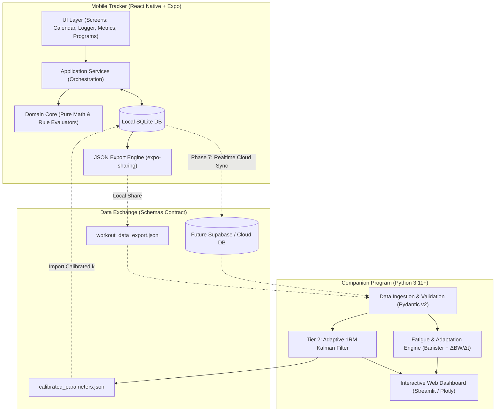

> **Historical reference:** This document contains past plans, audits, or proposals with mixed completion status. Its agent instructions, verification gates, and unchecked items do not assign current work. Follow the latest user request, root `AGENTS.md`, and [current documentation guidance](../README.md). Verify implementation claims against source.


### How This Plan Is Optimized for Gemini Flash 3.8

1. **Strict Layer Isolation per Step**: Flash models excel when a task is confined to **one architectural layer** (e.g., pure TypeScript math, SQLite repositories, or React Native UI) rather than mixing database DDL, business logic, and UI state in a single prompt.
2. **File-Count Capping (3–6 Files per Step)**: Every step is scoped so the agent only creates or modifies a small cluster of files, preventing context degradation or unfinished stubs.
3. **Deterministic CLI Verification Gates**: Flash models can hallucinate "completion" unless forced to run a concrete CLI command (`npx jest`, `npx tsc --noEmit`, `pytest`). Every single step now ends with an explicit **Verification Gate** using headless unit tests or in-memory/mock repositories before any UI is attached.
4. **Modern API Guardrails**: Explicitly mandates modern `expo-sqlite` (`openDatabaseAsync`, `execAsync`, `runAsync`, `getAllAsync`) and incorporates `raw_input_weight` alongside canonical `weight` so SQLite aggregations remain fast and accurate.

You can either copy-paste the markdown block below directly into `IMPLEMENTATION_PLAN.md`, or give it to Antigravity to overwrite the file.

---

```markdown
# Workout Suite — Agentic Implementation Plan (Flash 3.8 Optimized)

This implementation plan translates the requirements in `Rough_sketch.md`, `1RM_calculation.txt`, and `docs/ARCHITECTURE.md` into an atomic, bottom-up execution blueprint designed specifically for **agentic engineering with Gemini Flash 3.8**.

---

## 0. Agentic Execution Rules (Read Before Every Step)

To ensure 100% reliability and zero broken builds when executing with Gemini Flash 3.8:
1. **One Step Per Prompt**: Never combine multiple steps into a single agent execution turn.
2. **Strict Working Directories**:
   - Never create a `package.json` or `node_modules` in the repository root (`/`).
   - Run all mobile commands inside `mobile/` (e.g., `cd mobile && npx tsc --noEmit`).
   - Run all companion commands inside `companion/` using `companion/.venv`.
3. **Bottom-Up Layering**: Always implement and unit-test **Domain Math & Types** $\rightarrow$ **Repository Interfaces & SQLite Adapters** $\rightarrow$ **Application Services** $\rightarrow$ **Presentation UI**.
4. **Mandatory Verification Gate**: A step is **NOT** complete until its specific CLI verification command (`jest`, `tsc`, `pytest`, or `mypy`) executes with zero errors and `docs/CODEMAP.md` is updated.

---

## 1. System Architecture Overview

The system follows a **local-first hexagonal architecture**: the mobile tracker operates entirely offline using an on-device SQLite database (`expo-sqlite`), while heavy state-space modeling runs in the Python Companion Suite.



---

## 2. Canonical Relational SQLite Schema

All weight values in `workout_sets.weight` are stored in **kilograms as the canonical effective mechanical load** (accounting for dumbbell doubling, bar tare, cable ratios, or bodyweight). The exact number typed by the user in the UI is preserved in `raw_input_weight`. Schema versioning uses `PRAGMA user_version`.

```sql
-- Core Exercises Library
CREATE TABLE exercises (
    id TEXT PRIMARY KEY,
    name TEXT NOT NULL,
    muscle_group TEXT NOT NULL,
    category TEXT NOT NULL,                  -- 'Barbell' | 'Dumbbell' | 'Cable' | 'Bodyweight' | 'Machine'
    is_compound INTEGER NOT NULL DEFAULT 0,  -- 1 = Compound, 0 = Isolation
    is_bodyweight INTEGER NOT NULL DEFAULT 0,-- 1 = Bodyweight/Assisted (calculates total system load), 0 = External
    is_unilateral INTEGER NOT NULL DEFAULT 0,-- 1 = Unilateral movement (independent limb logging)
    load_mode TEXT NOT NULL DEFAULT 'total', -- 'total' (barbell/machine) | 'per_hand' (dumbbell: auto-doubled)
    default_cable_ratio REAL DEFAULT 1.0,    -- 1.0 (1:1 rows/pulldowns), 0.5 (2:1 functional trainers)
    default_bar_weight_kg REAL DEFAULT 20.0, -- Default tare bar weight (20.0 kg standard Olympic)
    is_custom INTEGER NOT NULL DEFAULT 0,
    parent_exercise_id TEXT REFERENCES exercises(id) ON DELETE SET NULL,
    standard_lift_type TEXT,                 -- 'squat' | 'bench' | 'deadlift' | 'ohp' | 'row' | NULL
    default_rest_seconds INTEGER NOT NULL DEFAULT 120
);

-- Gear & Equipment Inventory (Specialty barbells, custom machine/cable ratios)
CREATE TABLE gear_inventory (
    id TEXT PRIMARY KEY,
    name TEXT NOT NULL,                      -- e.g. "Safety Squat Bar", "Trap Bar", "Gym B Dual Pulley"
    type TEXT NOT NULL,                      -- 'barbell' | 'cable_machine' | 'plate_loaded_machine'
    tare_weight_kg REAL NOT NULL DEFAULT 20.0,
    cable_ratio REAL NOT NULL DEFAULT 1.0,   -- Mechanical ratio (1.0 = 1:1, 0.5 = 2:1)
    is_default INTEGER NOT NULL DEFAULT 0,
    notes TEXT
);

-- Training Programs / Meso-Cycle Splits
CREATE TABLE programs (
    id TEXT PRIMARY KEY,
    name TEXT NOT NULL,
    color_hex TEXT NOT NULL DEFAULT '#3B82F6',
    notes TEXT,
    created_at TEXT NOT NULL
);

-- Workout Templates / Routines (Daily sessions within a program)
CREATE TABLE workout_templates (
    id TEXT PRIMARY KEY,
    program_id TEXT REFERENCES programs(id) ON DELETE CASCADE,
    name TEXT NOT NULL,
    notes TEXT,
    order_index INTEGER NOT NULL DEFAULT 0,
    created_at TEXT NOT NULL
);

-- Active Program Meso-Cycles / Training Eras
CREATE TABLE program_blocks (
    id TEXT PRIMARY KEY,
    program_id TEXT NOT NULL REFERENCES programs(id) ON DELETE CASCADE,
    start_date TEXT NOT NULL,                -- ISO8601: YYYY-MM-DD
    end_date TEXT                            -- NULL if currently active
);

CREATE TABLE template_exercises (
    id TEXT PRIMARY KEY,
    template_id TEXT NOT NULL REFERENCES workout_templates(id) ON DELETE CASCADE,
    exercise_id TEXT NOT NULL REFERENCES exercises(id),
    gear_id TEXT REFERENCES gear_inventory(id) ON DELETE SET NULL,
    target_sets INTEGER,
    target_reps_min INTEGER,
    target_reps_max INTEGER,
    target_rpe REAL,
    target_rir REAL,
    order_index INTEGER NOT NULL,
    exercise_group_id TEXT                   -- Links exercises in a superset/giant set group
);

-- Progression Rules (declarative condition-action engine)
CREATE TABLE progression_rules (
    id TEXT PRIMARY KEY,
    template_exercise_id TEXT NOT NULL REFERENCES template_exercises(id) ON DELETE CASCADE,
    priority INTEGER NOT NULL DEFAULT 0,
    rule_json TEXT NOT NULL                  -- Serialized JSON: { conditions: [...], actions: [...] }
);

-- Completed / In-Progress Workouts
CREATE TABLE workouts (
    id TEXT PRIMARY KEY,
    template_id TEXT REFERENCES workout_templates(id),
    date TEXT NOT NULL,                      -- ISO8601: YYYY-MM-DD
    name TEXT NOT NULL,
    notes TEXT,
    started_at TEXT NOT NULL,                -- ISO8601 timestamp
    duration_seconds INTEGER,
    status TEXT NOT NULL DEFAULT 'in_progress', -- 'in_progress' | 'completed' | 'discarded'
    completed_at TEXT,
    imported_from TEXT                       -- 'strong' | 'hevy' | 'csv' | NULL
);

-- Exercise Sets Logged
CREATE TABLE workout_sets (
    id TEXT PRIMARY KEY,
    workout_id TEXT NOT NULL REFERENCES workouts(id) ON DELETE CASCADE,
    exercise_id TEXT NOT NULL REFERENCES exercises(id),
    gear_id TEXT REFERENCES gear_inventory(id) ON DELETE SET NULL,
    set_number INTEGER NOT NULL,
    weight REAL NOT NULL,                    -- Canonical effective mechanical load in kg
    raw_input_weight REAL NOT NULL,          -- Exact number typed by user (in kg) prior to ratio/dumbbell multiplier
    added_weight REAL,                       -- External added/assisted delta in kg (+10 belt, -15 assist)
    reps INTEGER NOT NULL,                   -- Reps completed (or Left limb reps if unilateral)
    reps_right INTEGER,                      -- Optional: Right limb reps if unilateral (NULL if bilateral)
    rpe REAL,                                -- 6.0 - 10.0 (half-value increments)
    rir REAL,                                -- 0.0 - 4.0 (half-value increments)
    set_type TEXT NOT NULL DEFAULT 'working',-- 'warmup' | 'working' | 'drop' | 'myorep' | 'failure'
    set_notes TEXT,
    exercise_group_id TEXT,
    created_at TEXT NOT NULL
);

-- Body Composition & Anthropometry
CREATE TABLE body_metrics (
    id TEXT PRIMARY KEY,
    date TEXT NOT NULL,                      -- ISO8601: YYYY-MM-DD
    bodyweight REAL NOT NULL,                -- Canonical kg
    body_fat_manual REAL,
    waist_cm REAL,
    neck_cm REAL,
    hip_cm REAL,
    bicep_cm REAL,
    chest_cm REAL,
    thigh_cm REAL,
    calf_cm REAL,
    navy_body_fat REAL
);

-- Calibrated 1RM Parameters (imported from Companion Suite)
CREATE TABLE calibrated_params (
    id TEXT PRIMARY KEY,
    exercise_id TEXT NOT NULL REFERENCES exercises(id) ON DELETE CASCADE,
    calibrated_1rm REAL NOT NULL,
    calibrated_k REAL NOT NULL,
    calibrated_at TEXT NOT NULL,
    UNIQUE(exercise_id)
);

-- App Settings (key-value flags)
CREATE TABLE user_settings (
    key TEXT PRIMARY KEY,
    value TEXT NOT NULL
    -- Keys: 'intensity_metric' ('RPE' | 'RIR'), 'unit_system' ('kg' | 'lbs'), 'pure_utility_mode' ('1' | '0')
);

-- User Psychological Profile, Goals & Constraints Matrix
CREATE TABLE user_profiles (
    id TEXT PRIMARY KEY,
    gender TEXT NOT NULL,                    -- 'male' | 'female'
    birthdate TEXT,
    height_cm REAL,
    training_enjoyment TEXT NOT NULL DEFAULT 'neutral', -- 'enthusiast' | 'neutral' | 'minimalist'
    intensity_style TEXT NOT NULL DEFAULT 'balanced',   -- 'high_intensity_low_volume' | 'volume_accumulation' | 'balanced'
    primary_goal TEXT NOT NULL DEFAULT 'hypertrophy',   -- 'strength' | 'hypertrophy' | 'powerbuilding' | 'endurance' | 'longevity'
    secondary_goals TEXT,                    -- JSON array
    preferred_days_per_week INTEGER NOT NULL DEFAULT 4,
    preferred_session_duration_mins INTEGER NOT NULL DEFAULT 60,
    equipment_access TEXT NOT NULL DEFAULT 'commercial_gym',
    created_at TEXT NOT NULL,
    updated_at TEXT NOT NULL
);

-- Pre-Seeded SBD Strength Standards Benchmarks
CREATE TABLE strength_standards (
    id TEXT PRIMARY KEY,
    lift_type TEXT NOT NULL,                 -- 'squat' | 'bench' | 'deadlift' | 'ohp' | 'row'
    gender TEXT NOT NULL,                    -- 'male' | 'female'
    bodyweight_kg REAL NOT NULL,
    untrained_1rm REAL NOT NULL,
    novice_1rm REAL NOT NULL,
    intermediate_1rm REAL NOT NULL,
    advanced_1rm REAL NOT NULL,
    elite_1rm REAL NOT NULL
);

```

---

## 3. Step-by-Step Atomic Execution Plan

### Implementation Progress & Milestone Tracker

| Phase | Step | Name | Status | Verified Deliverables |
| :--- | :--- | :--- | :--- | :--- |
| **Phase 0** | **0.1** | **Monorepo Governance & Canonical JSON Schemas** | **`[x] COMPLETED`** | Section 8 in `AGENTS.md`, ADR-026/027 in `docs/DECISIONS.md`, `workout_export.schema.json`, `calibrated_parameters.schema.json` validated |
| | **0.2** | **Mobile Expo TypeScript & Jest Harness** | **`[x] COMPLETED`** | Expo SDK init, strict tsconfig, ts-jest, `src/core/types/index.ts`, smoke tests verified |
| | **0.3** | **Companion Python 3.11+ & Pytest Harness** | **`[x] COMPLETED`** | `pyproject.toml`, `requirements.txt`, Pydantic v2 `schemas.py`, 8/8 pytest suite, strict mypy verified |
| **Phase 1** | **1.1** | **Domain Core Math** | **`[x] COMPLETED`** | `unitConversion.ts`, `heuristic1rm.ts`, `loadNormalizer.ts`, `plateCalculator.ts`, 75 unit tests verified |
| | **1.2** | **Repository Interfaces & In-Memory Mocks** | **`[x] COMPLETED`** | `IExerciseRepository`, `IWorkoutRepository`, `IGearRepository`, `IUserSettingsRepository`, 4 in-memory mocks, 62 unit tests verified |
| | **1.3** | **SQLite Schema & Concrete Repositories** | **`[x] COMPLETED`** | `schema.ts`, 46 default exercises seed, 6 gear items seed, 4 SQLite repositories, 52 unit tests verified |
| | **1.4** | **Core Logger Application Services** | **`[x] COMPLETED`** | `activeSessionService.ts`, `restTimerService.ts`, `exerciseSubstitutionService.ts`, `crashRecoveryService.ts`, 50 unit tests verified |
| | **1.5** | **Active Workout Logger UI & Popovers** | **`[x] COMPLETED`** | `ActiveLoggerScreen`, `SetRowComponent`, `RestTimerBanner`, `PlateCalculatorModal`, `ExerciseSubstitutionModal`, `CrashRecoveryDialog`, 16 unit tests verified |
| | **1.6** | **Calendar View, Basic Settings & Root Navigation** | **`[x] COMPLETED`** | Calendar agenda, session detail modal, basic settings toggles, bottom tab navigation, 275/275 mobile tests passed |
| **Phase 2** | **2.1** | **Superset Grouping & Unilateral Limb Mechanics** | **`[x] COMPLETED`** | Superset/giant set grouping/ungrouping, rest timer suppression, `SupersetBracketGroup.tsx`, dual unilateral inputs & steppers, 301/301 mobile tests passing |
| | **2.2** | **Exercise Library Manager, Variant Tree & Gear Inventory UI** | **`[x] COMPLETED`** | Gear CRUD, tare weight kg/lbs, cable ratios (1:1, 2:1), exercise catalog search/filter, variant tree (`parent_exercise_id`), 338/338 mobile tests passing |
| | **2.3** | **Standardized JSON Export Service (Contract-Verified)** | **`[x] COMPLETED`** | Full 12-table serialization, ADR-026 dual-load persistence, `expo-file-system`/`expo-sharing` 1-tap Settings integration, cross-stack verified by Jest & Pytest |
| | **2.4** | **External Data Import Engine (Strong, Hevy & Generic CSV)** | **`[x] COMPLETED`** | Zero-dependency RFC 4180 tokenizer, format auto-detection, exercise catalog matching & custom fallback, duplicate detection, `ImportScreen.tsx` wizard, 383/383 mobile tests verified |


| **Phase 3** | **3.1** | **Allometric Strength Standards, DOTS & Cohort Math Engine** | **`[x] COMPLETED`** | DOTS polynomial formula, 95-row empirical seed table, bilinear interpolation, continuous 0–100+ score, SBD symmetry, 110/110 math tests verified |
| | **3.2** | **Exercise Inspection Service & Rep-Max Record (PR Board) Queries** | **`[x] COMPLETED`** | Window-function PR queries, program block date filters, cross-variant aggregation, e1RM benchmarks, peak PR detection, 440/440 mobile tests verified |
| | **3.3** | **Exercise Inspection UI, SBD Tier Widget & Symmetry Radar** | **`[x] COMPLETED`** | `ExerciseDetailScreen`, `PRBoardTable`, `SBDStandardsCard`, `SBDBalanceRadarChart`, 451/451 mobile tests verified |
| **Phase 4** | **4.1** | **Declarative Progression Rule Engine (Pure Evaluator)** | **`[x] COMPLETED`** | Pure side-effect-free evaluator, priority sorting, DDP set-level proposals, LP/DP/DDP presets, 32/32 tests verified |
| | **4.2** | **Profile-Driven Program Synthesizer (Pure Generator)** | **`[x] COMPLETED`** | Pure multi-day split synthesis (Full Body, Upper/Lower, PPLUL, PPL), volume/exertion calibration, antagonist supersets, 20/20 tests verified |
| | **4.3** | **Programs, Templates, Meso-Cycle Blocks & Profile Repositories** | **`[x] COMPLETED`** | SQLite & Mock repositories, aggregate persistence, ProgramBlockService 1-tap swap, 49/49 new tests, 552/552 mobile tests verified |
| | **4.4** | **Questionnaire UI, Program Builder, Rule Editor & Progression UI** | **`[x] COMPLETED`** | UserProfileScreen, ProgramOverviewScreen, ProgressionBuilderModal, proposal banner, 568/568 mobile tests verified |
| **Phase 5** | **5.1** | **U.S. Navy Body Fat, Rolling Averages & Body Metrics Repository** | **`[x] COMPLETED`** | DoD metric density, Siri equation, 7-day SMA/EMA, IBodyMetricsRepository, Mock & SQLite implementations, 618/618 mobile tests verified |
| | **5.2** | **Body Metrics Screen & Longitudinal Plots with Program Era Shading** | **`[x] COMPLETED`** | Anthropometry, Navy body fat, 5-tab longitudinal charts, 644/644 mobile tests verified |
| | 5.3 | Psychological Matrix Calibration & Volume Prescriptions | `[ ] PENDING` | Mental fatigue modulation, recovery scores |
| **Phase 6** | **6.1** | **Tier 2 Adaptive Linear Kalman Filter Engine** | **`[x] COMPLETED`** | `kalman_1rm.py`, intra-session filtering, true 1RM bypass, quadratic noise scaling, 13/13 pytest, strict mypy verified |
| | **6.2** | **Dynamic Recoverability & Banister Impulse-Response Engine** | **`[x] COMPLETED`** | `recovery_modifier.py`, `fatigue_banister.py`, `recommendations.py`, 13/13 pytest, strict mypy verified |
| | **6.3** | **Calibrated Parameter Exporter & Mobile Ingestion Round-Trip** | **`[x] COMPLETED`** | `param_exporter.py`, `calibratedParamService.ts`, `SettingsScreen.tsx` JSON import, 40/40 companion & 12/12 Jest tests verified |
| | **6.4** | **Interactive Streamlit & Plotly Scientific Dashboard** | **`[x] COMPLETED`** | `app.py`, `charts.py`, 4 Plotly visualizers, 1-click calibration download, 46/46 pytest & strict mypy verified |
| **Phase 8** | **8.1** | **Blueprint Quality & Seed ID Synchronization** | **`[x] COMPLETED`** | Canonical seed IDs in 15m express (`cable_tricep_pushdown`, `bodyweight_dip`, `barbell_skull_crusher`), Full Body Day 1 axial lumbar rebalance (`machine_leg_curl`), Upper density streamlined (5 primary + 2 arm superset accessories, 16–20 working sets), 36/36 tests verified |
| | **8.2** | **Pure Dynamic Set Synthesis, Load-Gated eReps & Archetype Models** | **`[x] COMPLETED`** | Load-Gated eReps (≥85%), Goal-Derived Archetypes (I–IV), eRep quotient, zero submax junk generation |
| | **8.3** | **Deferred End-of-Meso Evolution & "Current Mood" Staging** | **`[x] COMPLETED`** | Queue mood edits for Meso N+1, multi-vector Tier/rep/rest evolution, Faz Lifts Weight Mastery, Meso N+1 diff |
| | **8.4** | **Isometric eRep Cross-Fade Mentality Transition Wave** | **`[x] COMPLETED`** | 2–3 week RPE/set cross-fade wave, eRep invariance, logger transition cues, 12/12 transitionWave, 4/4 banner, 28/28 activeLoggerRail tests verified |
| **Phase 9** | **9.1** | **Biomechanical Exercise Taxonomy & Schema v8 Migration** | `[ ] PENDING` | Axial loading, 3-tier ROM, regional biases, joint mapping, baseline SFR, cross-stack sync |
| | **9.2** | **Exercise Sentiment, Pain Correlation & Soft Affinity Engine** | `[ ] PENDING` | `exercise_preferences` table, implicit swap tracking (+5/swap), liked/disliked/blacklist flags |
| | **9.3** | **Adaptive Planner Selection & Joint-ROM Protection Router** | `[ ] PENDING` | ROM-restricted swaps on joint pain, regional bias balance, affinity scoring in synthesizer |
| | **9.4** | **Exercise Preference UI & Logger Swap Tracking Hooks** | `[ ] PENDING` | Sentiment toggles in ExerciseDetail, swap tracking hooks in ActiveLogger |
| **Phase 7** | 7.1–7.2 | Cloud Synchronization & Social Leaderboards | `[ ] PENDING` | Supabase RLS migrations, offline-first sync queue |

---

Each phase is divided into small, self-contained **Steps**. Every step specifies:

* **Scope**: The exact files to create or update.
* **Deliverables**: Concrete logic to implement.
* **Verification Gate**: The exact test/typecheck command that must pass before moving to the next step.

---

### Phase 0: Repository Governance, Contracts & Workspace Scaffolding [COMPLETED ✅]

*Goal: Establish strict workspace boundaries, canonical JSON schemas, and testing harnesses for both TypeScript and Python.*

#### Step 0.1: Monorepo Governance & Canonical JSON Schemas [COMPLETED ✅]

* **Status**: **Completed**. Verified against schema validators.
* **Scope**: `AGENTS.md`, `docs/DECISIONS.md`, `schemas/workout_export.schema.json`, `schemas/calibrated_parameters.schema.json`.
* **Deliverables**:
1. Add Section 8 ("Monorepo Execution & Working Directory Rules") to `AGENTS.md` enforcing `mobile/` and `companion/` isolation. *(Done)*
2. Add `ADR-026` to `docs/DECISIONS.md` documenting `weight` (effective mechanical load in kg) vs `raw_input_weight` (user-typed load in kg), and clarifying that the +10% deadlift adjustment applies only to static linear equations, never to the Tier 2 Kalman filter. *(Done, also ADR-027 added)*
3. Create `schemas/workout_export.schema.json` (JSON Schema Draft 7) matching Section 2 tables. *(Done)*
4. Create `schemas/calibrated_parameters.schema.json` for companion-exported $(1\text{RM}, k)$ parameters. *(Done)*


* **Verification Gate**: Validate that both `.schema.json` files parse as valid JSON via `python -m json.tool schemas/workout_export.schema.json > /dev/null`. *(Verified: Exit code 0)*

#### Step 0.2: Mobile Expo TypeScript & Jest Harness Initialization [COMPLETED ✅]

* **Status**: **Completed**. Verified with `npx tsc --noEmit` and `npx jest`.
* **Scope**: `mobile/package.json`, `mobile/tsconfig.json`, `mobile/jest.config.js`, `mobile/src/core/types/index.ts`.
* **Deliverables**:
1. Initialize the Expo TypeScript project inside `mobile/` with strict TypeScript (`"strict": true`). *(Done)*
2. Configure Jest (`ts-jest`) for fast headless unit testing of `mobile/src/core/` and `mobile/src/services/`. *(Done)*
3. Define all core TypeScript interfaces and enums in `mobile/src/core/types/index.ts` matching the SQLite schema and domain entities. *(Done)*


* **Verification Gate**: Run `cd mobile && npx tsc --noEmit && npx jest --passWithNoTests`. *(Verified: 3 tests passed in 0.7s, tsc exited 0)*

#### Step 0.3: Companion Python 3.11+ & Pytest Harness Initialization [COMPLETED ✅]

* **Status**: **Completed**. Verified with `pytest` and `mypy --strict`.
* **Scope**: `companion/pyproject.toml`, `companion/requirements.txt`, `companion/src/ingestion/schemas.py`, `companion/tests/test_schemas.py`.
* **Deliverables**:
1. Create `companion/pyproject.toml` and `companion/requirements.txt` (`pydantic>=2.6`, `numpy>=1.26`, `scipy>=1.12`, `pandas>=2.2`, `streamlit>=1.32`, `plotly>=5.20`, `pytest>=8.0`, `mypy>=1.8`). *(Done)*
2. Implement Pydantic v2 models in `companion/src/ingestion/schemas.py` mirroring `schemas/workout_export.schema.json` and `schemas/calibrated_parameters.schema.json`. *(Done)*
3. Write unit tests in `companion/tests/test_schemas.py` verifying valid and invalid mock JSON payloads against the Pydantic models. *(Done)*


* **Verification Gate**: Run `pytest companion/tests/test_schemas.py` and `mypy --strict companion/src/ingestion/schemas.py`. *(Verified: 8/8 pytest tests passed in 0.10s, mypy --strict 0 issues)*

---

### Phase 1: Foundation & Minimum Viable Logger (Core In-Gym Tracking)

*Goal: Build a zero-latency workout logger that lifters can immediately use in the gym with crash recovery and cognitive offloading tools.*

#### Step 1.1: Domain Core Math (1RM Heuristic, Load Normalizer, Plate Solver, Units) [COMPLETED ✅]

* **Status**: **Completed**. Verified with `npx jest src/core/math` and `npx tsc --noEmit`.
* **Scope**: `mobile/src/core/math/unitConversion.ts`, `mobile/src/core/math/heuristic1rm.ts`, `mobile/src/core/math/loadNormalizer.ts`, `mobile/src/core/math/plateCalculator.ts`, `mobile/src/core/math/__tests__/`.
* **Deliverables**:
1. `unitConversion.ts`: Pure `kgToLbs`, `lbsToKg`, and display formatting helpers. *(Done)*
2. `heuristic1rm.ts`: Computes $r_{\text{eff}} = \text{reps} + \text{RIR}$ (or $10 - \text{RPE}$, clamped $\ge 1.0$) and Lombardi $\text{e1RM} = w \cdot r_{\text{eff}}^{k}$ (default $k = 0.10$, or custom calibrated $k$). *(Done)*
3. `loadNormalizer.ts`: Pure function computing `{ effectiveWeightKg, rawInputWeightKg, addedWeightKg }` across `per_hand` dumbbells (2x multiplier), `cable_ratio` (e.g., 0.5x for 2:1 pulley), and `is_bodyweight` (`bodyweightKg + addedWeightKg`). *(Done)*
4. `plateCalculator.ts`: Pure greedy solver returning `{ platesPerSide: number[], remainderKg: number }` given target weight, bar tare weight (default 20 kg), and available plate denominations (`[25, 20, 15, 10, 5, 2.5, 1.25]`). *(Done)*


* **Verification Gate**: Run `cd mobile && npx jest src/core/math && npx tsc --noEmit`. All edge cases (0 reps, RIR > 3, odd plate remainders, assisted pull-ups with negative added weight) must pass. *(Verified: 75/75 tests passed in 1.45s, tsc exited 0)*

#### Step 1.2: Repository Interfaces & In-Memory Mock Repositories [COMPLETED ✅]

* **Status**: **Completed**. Verified with `npx jest src/database/mocks` and `npx tsc --noEmit`.
* **Scope**: `mobile/src/domain/repositories/IExerciseRepository.ts`, `IWorkoutRepository.ts`, `IGearRepository.ts`, `IUserSettingsRepository.ts`, and `mobile/src/database/mocks/`.
* **Deliverables**:
1. Define clean async TypeScript interfaces for CRUD, global ghost-set lookup (`getMostRecentCompletedSetsForExercise(exerciseId)`), and crash recovery (`getInProgressWorkout()`). *(Done)*
2. Implement in-memory mock repositories in `mobile/src/database/mocks/` with unit tests verifying repository contract behavior (allowing services and UI to be tested without native SQLite binaries). *(Done)*


* **Verification Gate**: Run `cd mobile && npx jest src/database/mocks && npx tsc --noEmit`. *(Verified: 62/62 tests passed in 1.62s, tsc exited 0)*


#### Step 1.3: SQLite Schema Migrations, Seed Catalog & Concrete Repositories [COMPLETED ✅]

* **Status**: **Completed**. Verified with `npx tsc --noEmit` and Jest SQL query generation & mapping tests against mocked SQLite driver.
* **Scope**: `mobile/src/database/schema.ts`, `mobile/src/database/seeds/defaultExercises.ts`, `mobile/src/database/repositories/SQLiteExerciseRepository.ts`, `SQLiteWorkoutRepository.ts`, `SQLiteGearRepository.ts`, `SQLiteUserSettingsRepository.ts`.
* **Deliverables**:
1. Implement `schema.ts` using the modern Expo SDK `expo-sqlite` async API (`openDatabaseAsync`, `execAsync`, `runAsync`, `getAllAsync`, `getFirstAsync`) with `PRAGMA journal_mode = WAL;`, `PRAGMA foreign_keys = ON;`, and `PRAGMA user_version` migrations. *(Done)*
2. Seed 40+ foundational exercises (Barbell SBD, OHP, Rows, Dumbbell, Cable, Machine, Bodyweight) with accurate `load_mode`, `is_compound`, `is_bodyweight`, `parent_exercise_id`, and `standard_lift_type` values, plus default gear items (20 kg Olympic Bar, 29 kg SSB, 25 kg Trap Bar, 15 kg Technique Bar, 1:1 and 2:1 Cable stacks). *(Done — 46 exercises and 6 gear items seeded)*
3. Implement the concrete SQLite repositories with write-through persistence for `workout_sets`. *(Done)*


* **Verification Gate**: Run `cd mobile && npx tsc --noEmit` and unit-test SQL query generation/mapping against a mocked `SQLiteDatabase` driver in Jest. *(Verified: 52/52 driver unit tests passed, 192/192 mobile tests total, tsc exited 0)*


#### Step 1.4: Core Logger Application Services (Session, Rest Timer, Substitution, Crash Recovery) [COMPLETED ✅]

* **Status**: **Completed**. Verified with `npx jest src/services` and `npx tsc --noEmit`.
* **Scope**: `mobile/src/services/activeSessionService.ts`, `restTimerService.ts`, `exerciseSubstitutionService.ts`, `crashRecoveryService.ts`, `mobile/src/services/__tests__/`.
* **Deliverables**:
1. `activeSessionService.ts`: Orchestrates starting a session, adding/deleting/reordering sets, pre-filling ghost values from the most recent global session, normalizing weights via `loadNormalizer`, and immediately writing every edit to `IWorkoutRepository`. *(Done)*
2. `restTimerService.ts`: Pure state machine & timer manager supporting start on set completion, `+30s` / `-30s` / `Skip`, and background expiration timestamp calculation (`endTimeMs - Date.now()` so locking the phone never drifts the timer). *(Done)*
3. `exerciseSubstitutionService.ts`: Finds compatible replacement exercises via shared `parent_exercise_id` or `muscle_group`, transfers target rep brackets, and fetches ghost sets for the substitute movement. *(Done)*
4. `crashRecoveryService.ts`: Detects `status = 'in_progress'` workouts on startup and provides `resumeSession()` or `discardSession()`. *(Done)*


* **Verification Gate**: Run `cd mobile && npx jest src/services && npx tsc --noEmit`. *(Verified: 50/50 services tests passed in 3.57s, 242/242 mobile tests total, tsc exited 0)*

#### Step 1.5: Active Workout Logger UI & QoL Popovers [COMPLETED ✅]

* **Status**: **Completed**. Verified with `npx jest src/features/logger`, `npx tsc --noEmit`, and `npm run lint`.
* **Scope**: `mobile/src/features/logger/ActiveLoggerScreen.tsx`, `SetRowComponent.tsx`, `RestTimerBanner.tsx`, `PlateCalculatorModal.tsx`, `ExerciseSubstitutionModal.tsx`, `CrashRecoveryDialog.tsx`.
* **Deliverables**:
1. High-contrast OLED-friendly `ActiveLoggerScreen` with 1-tap set completion, RPE/RIR half-step inputs, set type tags (`warmup`, `working`, `drop`, `myorep`, `failure`), per-set notes, and ghost placeholders. *(Done)*
2. Dumbbell `30 kg (×2)` badge and gear subtext indicator (e.g., `Safety Squat Bar (29 kg)`). *(Done)*
3. 1-tap `PlateCalculatorModal` on barbell weight fields and 1-tap `ExerciseSubstitutionModal` ("Swap for this session only" vs "Update template permanently"). *(Done)*
4. `CrashRecoveryDialog` on launch when an interrupted workout is detected. *(Done)*


* **Verification Gate**: Run `cd mobile && npx tsc --noEmit && npm run lint`. *(Verified: 16/16 logger tests passed, 258/258 mobile tests passed total, tsc exited 0, npm run lint exited 0)*

#### Step 1.6: Calendar View, Basic Settings & Root Navigation [COMPLETED ✅]

* **Status**: **Completed**. Verified with `npx tsc --noEmit`, `npx jest`, and `npm run lint`.
* **Scope**: `mobile/src/features/calendar/CalendarScreen.tsx`, `SessionDetailModal.tsx`, `mobile/src/features/settings/SettingsScreen.tsx`, `mobile/App.tsx`.
* **Deliverables**:
1. Monthly and weekly calendar agenda showing completed workout badges and drill-down inspection of past sessions (total volume, duration, sets, e1RM). *(Done)*
2. Basic `SettingsScreen` with instant toggles for Unit System (`kg` / `lbs`), Intensity Metric (`RPE` / `RIR`), and `Pure Utility Mode`. *(Done)*
3. Bottom Tab Navigation wiring `Logger`, `Calendar`, and `Settings`. *(Done)*


* **Verification Gate**: Run `cd mobile && npx tsc --noEmit && npx jest`. *(Milestone: Phase 1 MVP is complete and usable in the gym).* *(Verified: 275/275 mobile tests passed, tsc exited 0, npm run lint exited 0)*

---

### Phase 2: Advanced Workout Mechanics, Hierarchy & Data Onboarding

*Goal: Support supersets, unilateral limb tracking, custom gear management, external CSV imports (Strong/Hevy), and standardized JSON exports.*

#### Step 2.1: Superset Grouping & Unilateral Limb Mechanics [COMPLETED ✅]

* **Status**: **Completed**. Verified with `npx jest src/services; npx tsc --noEmit` and `npm test` (301/301 mobile tests passing).
* **Scope**: `mobile/src/services/activeSessionService.ts`, `mobile/src/services/restTimerService.ts`, `mobile/src/features/logger/SupersetBracketGroup.tsx`, `SetRowComponent.tsx`.
* **Deliverables**:
1. Group/ungroup exercises into supersets or giant sets sharing an `exercise_group_id` (`groupExercises`, `ungroupExercise`, `ungroupSuperset`, `getSupersetGroups`). *(Done)*
2. Suppress automatic rest timer triggers between exercises inside a superset group; trigger the full rest timer only when the final exercise in the group completes its set (`RestTimerService.shouldTriggerForExerciseInGroup`). *(Done)*
3. Render dual rep inputs (`reps` Left, `reps_right` Right) on a single row when `exercise.is_unilateral === 1`, with independent L/R steppers in drawer and formatted ghost display (`w × L/R`). *(Done)*


* **Verification Gate**: Run `cd mobile && npx jest src/services && npx tsc --noEmit`. *(Verified: 58/58 services unit tests passed, 301/301 total mobile tests passed, tsc exited 0, lint exited 0)*

#### Step 2.2: Exercise Library Manager, Variant Tree & Gear Inventory UI [COMPLETED ✅]

* **Status**: **Completed**. Verified with `cd mobile && npx tsc --noEmit && npm run lint && npm test` (338/338 mobile tests passing).
* **Scope**: `mobile/src/services/gearInventoryService.ts`, `mobile/src/features/gear/GearInventoryScreen.tsx`, `mobile/src/features/inspection/ExerciseLibraryScreen.tsx`, `ExerciseFormModal.tsx`.
* **Deliverables**:
1. CRUD interface for `gear_inventory` (custom barbells with tare weights in kg/lbs, custom cable machines with mechanical ratios, default item toggling) and application service `GearInventoryService`. *(Done)*
2. Exercise catalog search/filter by muscle group and equipment, custom exercise creation/editing, and linking variants to a root movement via `parent_exercise_id` (ADR-012) across flat catalog and expandable variant tree views. *(Done)*
3. Full integration into `SettingsScreen.tsx` (navigation cards + full-screen modals) and `ActiveLoggerScreen.tsx` (in-gym library & variant browser). *(Done)*


* **Verification Gate**: Run `cd mobile && npx tsc --noEmit && npx jest`. *(Verified: 25/25 test suites passed, 338/338 unit tests passed, tsc exited 0, lint exited 0)*


#### Step 2.3: Standardized JSON Export Service (Contract-Verified) *(Done)*

* **Scope**: `mobile/src/services/exportService.ts`, `mobile/src/services/__tests__/exportService.test.ts`, `mobile/src/features/settings/SettingsScreen.tsx`, `schemas/fixtures/sample_workout_export.json`.
* **Deliverables**:
1. Serializes full SQLite database state across all 12 tables into the exact structure defined by `schemas/workout_export.schema.json`. *(Done)*
2. Integrates with `expo-file-system` and `expo-sharing` for 1-tap export from Settings. *(Done)*
3. Writes a sample fixture `schemas/fixtures/sample_workout_export.json` during test execution so Python contract tests can verify it. *(Done)*


* **Verification Gate**: Run `cd mobile && npx jest src/services/__tests__/exportService.test.ts` AND run `pytest companion/tests/test_schemas.py` against the generated fixture. *(Verified: 8/8 export service Jest tests passed, 347/347 full mobile suite passed, 9/9 pytest tests passed including Draft-07 jsonschema validation and Pydantic v2 validation)*


#### Step 2.4: External Data Import Engine (Strong CSV, Hevy CSV, Generic CSV) [COMPLETED ✅]

* **Status**: **Completed**. Verified with `npx jest src/core/parsers`, `npx tsc --noEmit`, and `npm test` (383/383 mobile tests passing).
* **Scope**: `mobile/src/core/parsers/csvImportParser.ts`, `mobile/src/services/importService.ts`, `mobile/src/features/import/ImportScreen.tsx`, `mobile/src/core/parsers/__tests__/`, `mobile/src/services/__tests__/importService.test.ts`, `mobile/src/features/import/__tests__/importComponents.test.ts`.
* **Deliverables**:
1. Pure, zero-dependency parsers in `csvImportParser.ts` for Strong CSV exports, Hevy CSV exports, and custom column-mapped CSVs with RFC 4180 tokenizer, `,` vs `;` auto-detection, quoted fields, multiline notes, and Imperial load conversion (`lbsToKg`). *(Done)*
2. Multi-stage exercise matching against the catalog (exact, alias table, structural inversion, fuzzy token matching), automatic custom exercise synthesis fallback with inferred muscle group and category, duplicate session detection (matching date + exercise + set count), and `imported_from` provenance tagging in `importService.ts`. *(Done)*
3. Interactive `ImportScreen.tsx` wizard with file picker (`expo-document-picker`) and direct CSV text paste, preview summary, exercise mapping review, and toggleable duplicate skipping, integrated into `SettingsScreen.tsx`. *(Done)*

* **Verification Gate**: Run `cd mobile && npx jest src/core/parsers && npx tsc --noEmit`. *(Verified: 23/23 parser tests passed in 1.18s, tsc exited 0, 383/383 mobile test suite passed in 4.76s)*

---

### Phase 3: SBD Strength Standards & Performance Intelligence

*Goal: Provide allometric strength classification tiers, powerlifting DOTS scores, Rep-Max PR boards, and balance radar charts.*

#### Step 3.1: Allometric Strength Standards, DOTS & Cohort Math Engine [COMPLETED ✅]

* **Status**: **Completed**. Verified with `npx jest src/core/math` (110/110 tests passing) and `npx tsc --noEmit`.
* **Scope**: `mobile/src/core/math/strengthStandards.ts`, `mobile/src/core/math/dotsCoefficients.ts`, `mobile/src/database/seeds/strengthStandardsSeed.ts`, `mobile/src/core/math/__tests__/`.
* **Deliverables**:
1. Official powerlifting DOTS polynomial coefficient formula in `dotsCoefficients.ts` for males and females with denominator polynomial guards and `calculateSBDTotal`. *(Done)*
2. Seeded empirical weight-bracket lookup tables (`squat`, `bench`, `deadlift`, `ohp`, `row`) across 5 tiers (`Untrained`, `Novice`, `Intermediate`, `Advanced`, `Elite`) spanning 95 rows for males and females in `strengthStandardsSeed.ts`. *(Done)*
3. Continuous normalized strength score ($0\text{--}100+$) with bilinear interpolation across bodyweight and e1RM, returning `{ tier, continuousScore, nextTierName, kgNeededForNextTier, demographicPercentile }` in `strengthStandards.ts`. *(Done)*
4. SBD symmetry and balance profiling in `calculateSBDBalanceProfile` with dominant/lagging lift classification and normalized radar coordinates. *(Done)*


* **Verification Gate**: Run `cd mobile && npx jest src/core/math && npx tsc --noEmit`. *(Verified: 110/110 tests passed, 426/426 mobile test suite passed, tsc exited 0, lint exited 0)*

#### Step 3.2: Exercise Inspection Service & Rep-Max Record (PR Board) Queries [COMPLETED ✅]

* **Status**: **Completed**. Verified with `npx jest src/services/__tests__/exerciseInspectionService.test.ts` (8/8 tests passing, 440/440 mobile tests total) and `npx tsc --noEmit`.
* **Scope**: `mobile/src/services/exerciseInspectionService.ts`, `mobile/src/database/repositories/SQLiteWorkoutRepository.ts`, `mobile/src/services/__tests__/`.
* **Deliverables**:
1. Repository query in `SQLiteWorkoutRepository.ts` and `MockWorkoutRepository.ts` extracting the heaviest load lifted per unique repetition count (`1RM`, `2RM`, `3RM`, `5RM`, `8RM`, `10RM`, `12RM`, etc.) using SQLite window functions (`PARTITION BY s.reps ORDER BY s.weight DESC`), with optional date filtering for `program_blocks` and cross-variant aggregation (`parent_exercise_id`). *(Done)*
2. Service `ExerciseInspectionService.ts` computing the set e1RM benchmark ($w \cdot r_{\text{eff}}^k$) alongside each rep record, peak e1RM record resolution, SBD standard classification integration via `evaluateStrengthStandard`, and historical volume aggregations. *(Done)*


* **Verification Gate**: Run `cd mobile && npx jest src/services/__tests__/exerciseInspectionService.test.ts && npx tsc --noEmit`. *(Verified: 8/8 tests passed in 1.4s, 440/440 mobile tests passed, tsc exited 0, lint exited 0)*

#### Step 3.3: Exercise Inspection UI, SBD Tier Widget & Symmetry Radar [COMPLETED ✅]

* **Status**: **Completed**. Verified with `npx tsc --noEmit`, `npm run lint`, and `npm test` (451/451 mobile tests passing).
* **Scope**: `mobile/src/features/inspection/ExerciseDetailScreen.tsx`, `PRBoardTable.tsx`, `SBDStandardsCard.tsx`, `SBDBalanceRadarChart.tsx`, `mobile/src/features/inspection/__tests__/exerciseInspectionComponents.test.ts`.
* **Deliverables**:
1. `ExerciseDetailScreen` displaying comprehensive exercise lifetime statistics (total sessions, total sets, lifetime tonnage in kg/lbs), the Rep-Max PR Board, and modal integration with `SessionDetailModal` upon tapping any historical PR row. *(Done)*
2. `SBDStandardsCard` showing current classification badge (Untrained, Novice, Intermediate, Advanced, Elite), progress bar to next tier (`+X.X kg needed`), demographic percentile bell curve placement rendered via `react-native-svg`, and conditional DOTS score display strictly displayed only when the athlete has logged their bodyweight. *(Done)*
3. `SBDBalanceRadarChart` visualizing 3-axis Squat, Bench, and Deadlift symmetry with concentric polygon web rings, symmetry classification badges (`Balanced Triad`, `Dominant`, `Lagging`), powerlifting SBD total load, and composite DOTS score in a dedicated modal. *(Done)*


* **Verification Gate**: Run `cd mobile && npx tsc --noEmit && npm run lint`. *(Verified: tsc exited 0, lint exited 0, 451/451 unit tests passed across 33 suites)*

---

### Phase 4: Training Psychology, Program Generation & Rule Builder

*Goal: Adapt programming to user psychology, build multi-day meso-cycle templates, and run declarative IF/THEN/ELSE progression rules.*

#### Step 4.1: Declarative Progression Rule Engine (Pure Evaluator) [COMPLETED ✅]

* **Status**: **Completed**. Verified with `npx jest src/core/rules` (32/32 tests passing) and `npx tsc --noEmit`.
* **Scope**: `mobile/src/core/rules/progressionRuleEngine.ts`, `mobile/src/core/rules/__tests__/progressionRuleEngine.test.ts`.
* **Deliverables**:
1. Pure, side-effect-free evaluator taking `(rules: ProgressionRule[], recentSessions: WorkoutSession[], currentPrescription: TemplateExercise)` and evaluating conditions (`ALL_SETS_HIT_TARGET_REPS`, `ANY_SET_HIT_TOP_REP_RANGE`, `AVERAGE_RPE_LESS_THAN`, `CONSECUTIVE_SUCCESSFUL_SESSIONS`, `CONSECUTIVE_FAILED_SESSIONS`). *(Done)*
2. Outputs deterministic proposed actions (`INCREASE_LOAD_FIXED`, `INCREASE_LOAD_PERCENT`, `DECREASE_LOAD_FIXED`, `INCREASE_TARGET_REPS`, `ADD_WORKING_SET`, `RESET_TO_BASELINE`, `TRIGGER_DELOAD`) with human-readable explanation strings. *(Done)*
3. Presets for Linear Progression (LP), Double Progression (DP), and Dynamic Double Progression (DDP). *(Done)*


* **Verification Gate**: Run `cd mobile && npx jest src/core/rules && npx tsc --noEmit`. *(Verified: 32/32 tests passed, 483/483 mobile test suite passed, tsc exited 0, lint exited 0)*

#### Step 4.2: Profile-Driven Program Synthesizer (Pure Generator) [COMPLETED ✅]

* **Status**: **Completed**. Verified with `npx jest src/core/generator` (20/20 tests passing) and `npx tsc --noEmit`.
* **Scope**: `mobile/src/core/generator/programSynthesizer.ts`, `mobile/src/core/generator/__tests__/programSynthesizer.test.ts`.
* **Deliverables**:
1. Pure generator mapping `UserProfile` (`training_enjoyment`, `intensity_style`, `primary_goal`, `preferred_days_per_week`, `preferred_session_duration_mins`, `equipment_access`) to a complete multi-day program split (Full Body, Upper/Lower, PPLUL, or PPL). *(Done)*
2. Automatically configures set counts (1–2 high-intensity sets @ RPE 9.5 vs. 3–4 volume sets @ RPE 7.5), antagonist superset pairings (`exercise_group_id`) for `minimalist` time budgets, and default `progression_rules`. *(Done)*


* **Verification Gate**: Run `cd mobile && npx jest src/core/generator && npx tsc --noEmit`. *(Verified: 20/20 tests passed, 503/503 mobile test suite passed, tsc exited 0, lint exited 0)*

#### Step 4.3: Programs, Templates, Meso-Cycle Blocks & Profile Repositories [COMPLETED ✅]

* **Status**: **Completed**. Verified with `npx jest` (552/552 tests passing across 40 test suites), `npx tsc --noEmit`, and `npm run lint`.
* **Scope**: `mobile/src/domain/repositories/IProgramRepository.ts`, `IUserProfileRepository.ts`, `mobile/src/database/repositories/SQLiteProgramRepository.ts`, `SQLiteUserProfileRepository.ts`, `mobile/src/database/mocks/MockProgramRepository.ts`, `MockUserProfileRepository.ts`, `mobile/src/services/programBlockService.ts`.
* **Deliverables**:
1. Full persistence for `programs`, `workout_templates`, `template_exercises`, `progression_rules`, `program_blocks`, and `user_profiles` with cascade deletion, JSON serialization, and aggregate fetching (`getProgramWithDetails`, `saveSynthesizedProgram`). *(Done)*
2. `programBlockService.ts`: Handles 1-tap active program swapping (closing previous `program_blocks.end_date` and opening a new block), active template querying, and date-based program block era lookup (`getBlockForDate`). *(Done)*


* **Verification Gate**: Run `cd mobile && npx jest && npx tsc --noEmit`. *(Verified: 49/49 new repository and service tests passed, 552/552 total mobile test suite passed, tsc exited 0, lint exited 0)*

#### Step 4.4: Questionnaire UI, Program Builder, Rule Editor & Interactive Progression Banner [COMPLETED ✅]

* **Status**: **Completed**. Verified with `npx tsc --noEmit`, `npm run lint`, and `npm test` (568/568 mobile tests passing across 43 test suites).
* **Scope**: `mobile/src/features/profile/UserProfileScreen.tsx`, `mobile/src/features/progression/ProgramOverviewScreen.tsx`, `ProgressionBuilderModal.tsx`, `mobile/src/features/logger/ProgressionProposalBanner.tsx`, `mobile/src/features/calendar/CalendarScreen.tsx`, `mobile/src/features/settings/SettingsScreen.tsx`, `mobile/App.tsx`, and associated feature tests.
* **Deliverables**:
1. `UserProfileScreen`: Multi-step training psychology & logistics questionnaire with biological metrics, enjoyment style, intensity preferences, equipment constraints, and 1-tap "Generate Custom Program" synthesis button. *(Done)*
2. `ProgramOverviewScreen` & `ProgressionBuilderModal`: Multi-day training split manager, program color swatches (`color_hex`), 1-tap program swapping via `ProgramBlockService`, expandable daily templates with prescribed sets/reps/RPE/superset badges, and visual IF/THEN/ELSE progression rule editor with LP, DP, and DDP presets. *(Done)*
3. `ProgressionProposalBanner` in Active Logger: OLED high-contrast logger banner rendering pending progression/deload triggers, explanation text, DDP set-level pill breakdowns, and Accept / Dismiss actions that directly update active sets. *(Done)*
4. Calendar program swap badges tinted with program `color_hex`, month/week grid swap dots, and active meso-cycle banner display. *(Done)*


* **Verification Gate**: Run `cd mobile && npx tsc --noEmit && npm run lint`. *(Verified: tsc exited 0, lint exited 0, 568/568 unit tests passed across 43 suites)*

---

### Phase 5: Anthropometry, Body Composition & Longitudinal Plotting

*Goal: Track bodyweight, U.S. Navy body fat %, circumference metrics, and render longitudinal charts with synchronized program era background shading.*

#### Step 5.1: U.S. Navy Body Fat, Rolling Averages & Body Metrics Repository [COMPLETED ✅]

* **Status**: **Completed**. Verified with `npx jest src/core/math/__tests__/navyBodyFat.test.ts` (22/22 tests passing), `npx tsc --noEmit`, and full mobile suite `npm test` (618/618 tests passing across 47 suites).
* **Scope**: `mobile/src/core/math/navyBodyFat.ts`, `mobile/src/core/math/__tests__/navyBodyFat.test.ts`, `mobile/src/domain/repositories/IBodyMetricsRepository.ts`, `mobile/src/database/repositories/SQLiteBodyMetricsRepository.ts`, `mobile/src/database/mocks/MockBodyMetricsRepository.ts`.
* **Deliverables**:
1. `navyBodyFat.ts`: Pure U.S. Navy circumference formula for males and females using official DoD metric body density and Siri's equation (in cm) + calendar-aware 7-day Simple Moving Average (SMA) and Exponential Moving Average (EMA $\alpha=0.25$) for bodyweight time-series. *(Done)*
2. `SQLiteBodyMetricsRepository` & `MockBodyMetricsRepository`: Full CRUD operations for `body_metrics` with automatic `navy_body_fat` calculation resolved from the active `user_profiles` table or explicit overrides when waist, neck, and height (plus hip for females) are present. *(Done)*


* **Verification Gate**: Run `cd mobile && npx jest src/core/math/__tests__/navyBodyFat.test.ts && npx tsc --noEmit`. *(Verified: 22/22 math tests passed, 618/618 mobile tests passed, tsc exited 0, lint exited 0)*

#### Step 5.2: Body Metrics Screen & Longitudinal Plots with Program Era Shading [COMPLETED ✅]

* **Status**: **Completed**. Verified with `npx tsc --noEmit`, `npm run lint`, full mobile test suite `npm test` (644/644 tests passing across 49 test suites), and companion test suite `pytest companion/tests` (9/9 tests passing).
* **Scope**: `mobile/src/features/bodyMetrics/BodyMetricsScreen.tsx`, `mobile/src/features/plots/PlotsScreen.tsx`, `ProgramEraShadedChart.tsx`, `mobile/src/features/plots/__tests__/plotsComponents.test.ts`, `mobile/src/features/bodyMetrics/__tests__/bodyMetricsComponents.test.ts`.
* **Deliverables**:
1. `BodyMetricsScreen`: Measurement logging for bodyweight, manual body fat %, and tape circumferences (neck, waist, hip, bicep, chest, thigh, calf) with real-time Navy formula recalculation, 7-day rolling average summary banner, historical logs list, and delete actions. Supports canonical metric cm/kg storage with automatic imperial inches/lbs conversions. *(Done)*
2. `ProgramEraShadedChart`: Reusable SVG time-series and volume bar chart wrapper rendering semi-transparent vertical background spans from `program_blocks` in each program's `color_hex`, horizontal gridlines, date markers, interactive point callouts, and support for multi-series lines and volume bars. *(Done)*
3. `PlotsScreen`: 5-tab longitudinal suite:
   - Exercise e1RM progression with Lombardi power law + RPE/RIR intensity modeling and 1-tap compound lift picker.
   - Bodyweight time series with 7-day rolling SMA and EMA smoothed trendlines.
   - Body Fat % tracking (U.S. Navy DoD metric density + manual overrides).
   - Muscle circumferences with segmented control for anatomical sites.
   - Weekly tonnage volume bars (Monday-based weeks, excluding warmups) with 4-week moving average and peak tonnage indicators. *(Done)*
4. Monorepo Integration: Inline `PlotsScreen` embedded into `HomeScreen` bottom section, modal views in `HomeScreen` and `UserProfileScreen`, and full test suites in `plotsComponents.test.ts` and `bodyMetricsComponents.test.ts`. *(Done)*


* **Verification Gate**: Run `cd mobile && npx tsc --noEmit && npm run lint`. *(Verified: tsc exited 0, lint exited 0, 644/644 unit tests passed across 49 suites)*

---

### Phase 6: Companion Scientific Analysis Suite (Python Engine & Dashboard)

*Goal: Implement the Adaptive Linear Kalman Filter for individualized $(1\text{RM}, k)$ tracking, Banister Fitness-Fatigue ODEs with $\Delta BW / \Delta t$ recovery scaling, and the Streamlit dashboard.*

#### Step 6.1: Tier 2 Adaptive Linear Kalman Filter Engine (`kalman_1rm.py`) [COMPLETED ✅]

* **Status**: **Completed**. Verified with `pytest companion/tests/test_kalman_1rm.py` (13/13 tests passing, 22/22 companion tests passing) and `mypy --strict companion/src/models/kalman_1rm.py companion/tests/test_kalman_1rm.py`.
* **Scope**: `companion/src/models/kalman_1rm.py`, `companion/src/models/__init__.py`, `companion/tests/test_kalman_1rm.py`.
* **Deliverables**:
1. Implement the exact specification from `1RM_calculation.txt`:
* Intra-session filtering: keep top 2 sets with lowest RIR per exercise per session; discard sets with $\text{RIR} > 3$, $0$ completed reps, warmup sets, or unrated intensity; break ties by highest load. *(Done)*
* State vector $\mathbf{x}_t = [\ln(1\text{RM}_t), k_t]^T$, observation $z_t = \ln(w_t)$, observation matrix $\mathbf{H}_t = [1, -\ln(r_{\text{eff}, t})]$. *(Done)*
* Quadratic measurement noise $R_t = \sigma_{\text{base}}^2 (1 + \lambda r_{\text{eff}, t}^2)$ and diagonal process noise $\mathbf{Q}$. *(Done)*
* Exercise-specific priors ($k_0 = 0.085$ bench, $0.095$ squat, $0.075$ deadlift, $0.10$ default) and post-update box-clipping constraint $k_t \in [0.03, 0.16]$. *(Done)*
* True 1RM tests ($r_{\text{eff}} = 1.0$) mathematically bypass $k$ updates ($\mathbf{H} = [1, 0]$). *(Done)*
* Zero $+10\%$ deadlift heuristic scalar applied to Kalman state per ADR-026. *(Done)*

* **Verification Gate**: Run `pytest companion/tests/test_kalman_1rm.py` and `mypy --strict companion/src/models/kalman_1rm.py`. Verify true 1RM tests ($r_{\text{eff}} = 1.0$) bypass $k$ updates and high-rep sets are discounted. *(Verified: 13/13 unit tests passed in 0.32s, 22/22 total companion tests passed, strict mypy 0 issues)*

#### Step 6.2: Dynamic Recoverability ($\Delta BW / \Delta t$) & Banister Impulse-Response Engine [COMPLETED ✅]

* **Status**: **Completed**. Verified with `pytest companion/tests/test_banister.py` (13/13 tests passing, 35/35 total companion tests passing) and `mypy --strict companion/src/models/`.
* **Scope**: `companion/src/models/recovery_modifier.py`, `companion/src/models/fatigue_banister.py`, `companion/src/models/recommendations.py`, `companion/src/models/__init__.py`, `companion/tests/test_banister.py`.
* **Deliverables**:
1. `recovery_modifier.py`: Computes 14-day rolling OLS slope of bodyweight ($\Delta BW / \Delta t$) via polynomial regression and scales fatigue decay time constant $\tau_2$ (shortened by 10–25% in caloric surplus, lengthened by 15–30% in caloric deficit). *(Done)*
2. `fatigue_banister.py`: Computes session Effective Stimulating Sets ($\text{RPE} \ge 7.0$ scaled by $\text{weight}/1\text{RM}$) and integrates daily Fitness ($P_t$, $\tau_1 \approx 42\text{d}$) and Fatigue ($F_t$, dynamic $\tau_2$) to output Net Preparedness. *(Done)*
3. `recommendations.py`: Computes Acute:Chronic Workload Ratio (ACWR) and generates structured advisories (`OPTIMAL_OVERLOAD`, `DELOAD_WARNING` if $\text{ACWR} > 1.5$, `UNDER_STIMULATION` if $\text{ACWR} < 0.8$, `OVERREACHING` if $1.3 < \text{ACWR} \le 1.5$). *(Done)*

* **Verification Gate**: Run `pytest companion/tests/test_banister.py` and `mypy --strict companion/src/models/`. *(Verified: 13/13 unit tests passed in 0.22s, 35/35 total companion tests passed, strict mypy 0 issues across all models)*

#### Step 6.3: Calibrated Parameter Exporter & Mobile Ingestion Round-Trip [COMPLETED ✅]

* **Status**: **Completed**. Verified with `pytest companion/tests/test_exporter.py` (5/5 tests passing), `npx jest src/services/__tests__/calibratedParamService.test.ts` (12/12 tests passing), and generated `dummy_data/calibrated_parameters.json`.
* **Scope**: `companion/src/export/param_exporter.py`, `companion/tests/test_exporter.py`, `mobile/src/services/calibratedParamService.ts`, `mobile/src/services/__tests__/calibratedParamService.test.ts`, `mobile/src/features/settings/SettingsScreen.tsx`.
* **Deliverables**:
1. `param_exporter.py`: Serializes the latest Kalman posterior $(1\text{RM}_t, k_t, \mathbf{P}_t)$ per exercise into `calibrated_parameters.json` validated against `schemas/calibrated_parameters.schema.json`. *(Done)*
2. `calibratedParamService.ts` (Mobile): Imports `calibrated_parameters.json` into the SQLite `calibrated_params` table and upgrades Tier 1 heuristic e1RM calculations to use individualized $k$. *(Done)*
3. `SettingsScreen.tsx`: Document-picker 1-tap integration allowing athletes to import calibrated parameter JSON files directly in Expo Go. *(Done)*

* **Verification Gate**: Run `pytest companion/tests/test_exporter.py` AND `cd mobile && npx jest src/services/__tests__/calibratedParamService.test.ts`. *(Verified: 5/5 pytest passed in 0.39s, 12/12 Jest passed in 1.57s, 701/701 mobile tests passing total)*

#### Step 6.4: Interactive Streamlit & Plotly Scientific Dashboard [COMPLETED ✅]

* **Status**: **Completed**. Verified with `mypy --strict companion/src/ui/` (0 issues across 4 source files) and `pytest companion/tests/test_ui_smoke.py` (6/6 tests passing, 46/46 companion tests total).
* **Scope**: `companion/src/ui/app.py`, `companion/src/ui/charts.py`, `companion/tests/test_ui_smoke.py`.
* **Deliverables**:
1. File uploader for `workout_data_export.json` and 1-tap bundled dummy data loader. *(Done)*
2. Interactive Plotly charts: Kalman $1\text{RM}_t$ trajectory with $\pm 1\text{ SD}$ uncertainty bands ($\text{e1RM} \cdot \sqrt{P_{0,0}}$), individualized $k_t$ endurance drift, Banister Fitness vs. Fatigue vs. Net Preparedness curves, and 14-day $\Delta BW / \Delta t$ recovery modifier plot. *(Done)*
3. 1-click download button for `calibrated_parameters.json`. *(Done)*

* **Verification Gate**: Run `mypy companion/src/ui/` and run a smoke test importing `app.py` via `pytest`. *(Verified: strict mypy clean, 46/46 pytest tests passing in 2.85s)*

---

### Phase 8: Dynamic Mesocycle Evolution, eRep-First Mentality & In-Flight Transition Architecture

*Goal: Transform Workout Suite from static program generation to an adaptive, eRep-first mesocycle evolution engine integrating Resistance Training Archetypes across the strength-hypertrophy continuum. Correct seed blueprint typos and fatigue overlaps, integrate Load-Gated eReps (≥85% 1RM) and Goal-Derived Archetype routing (Archetypes I–IV), reframe mentality profiles around stimulating effective-rep density, enable deferred end-of-mesocycle program evolution based on user mood with Faz Lifts Weight Mastery gating, and implement isometric eRep cross-fade transition waves.*

#### Step 8.1: Blueprint Quality & Seed ID Synchronization (Bugfixes & Biomechanical Balancing) [COMPLETED ✅]

* **Status**: **Completed**. Verified with `cd mobile && npx tsc --noEmit && npx jest src/core/generator/__tests__/programSynthesizer.test.ts` (36/36 tests passing) and full mobile suite `npm test` (912/912 tests passing).
* **Scope**: `mobile/src/core/generator/programSynthesizer.ts`, `mobile/src/core/generator/__tests__/programSynthesizer.test.ts`.
* **Deliverables**:
1. Correct mismatched seed exercise IDs in 15-Minute Express blueprints:
   - Replace `tricep_cable_pushdown` with canonical `cable_tricep_pushdown`.
   - Replace `bodyweight_dips` with canonical `bodyweight_dip`.
   - Replace `dumbbell_overhead_tricep_extension` fallback with `cable_tricep_pushdown` and `barbell_skull_crusher`.
2. Rebalance axial fatigue interference in Full Body split (`getFullBodyBlueprints`):
   - In Day 1 (Full Body A), swap `barbell_rdl` for `machine_leg_curl` to prevent consecutive-day spinal/lumbar fatigue collisions when Day 2 features heavy `barbell_deadlift`.
3. Streamline Upper/Lower Upper session density (`getUpperLowerBlueprints`):
   - Restructure Upper A and Upper B from 7 straight-set exercises down to 5 primary movements + 2 optional antagonist superset accessories, capping total working sets between 16–20 sets to fit standard 60-minute session budgets.

* **Verification Gate**: Run `cd mobile && npx tsc --noEmit && npx jest src/core/generator/__tests__/programSynthesizer.test.ts`.

#### Step 8.2: Pure Dynamic Set Synthesis, Load-Gated eReps & Archetype Models [COMPLETED ✅]

* **Status**: **Completed**. Verified with `cd mobile && npx tsc --noEmit && npx jest src/core/generator/__tests__/programSynthesizer.test.ts src/features/profile/__tests__/userProfileComponents.test.ts src/core/math/__tests__/effectiveReps.test.ts` (61/61 mobile tests passing) and companion pytest `companion\.venv\Scripts\pytest companion/tests/test_hypertrophy_signals.py` (14/14 tests passing).
* **Scope**: `mobile/src/core/generator/programSynthesizer.ts`, `mobile/src/core/math/effectiveReps.ts`, `companion/src/analysis/hypertrophy_signals.py`, `mobile/src/features/profile/UserProfileScreen.tsx`, `mobile/src/features/profile/__tests__/userProfileComponents.test.ts`, `docs/training_philosophies/THEORY_VOLUME_VS_EREPS.md`, `docs/training_philosophies/THEORY_INTEGRATION_AND_MESOCYCLE_ARCHITECTURE.md`.
* **Deliverables**:
1. **Load-Gated eReps Mathematical Formulation**:
   - Synchronize across both `mobile/src/core/math/effectiveReps.ts` and `companion/src/analysis/hypertrophy_signals.py`:
     Under Henneman's Size Principle, sets with heavy loads ($\ge 85\%$ 1RM) or $(\le 5\text{ reps} \land \text{RPE} \ge 8.0)$ recruit all motor units immediately from rep 1; all completed reps count as effective reps (up to 5 per set):
     $$\text{eReps}_{\text{set}} = \begin{cases} 
     \min(\text{reps}, 5) & \text{if } \frac{w}{\text{e1RM}} \ge 0.85 \lor (\text{reps} \le 5 \land \text{RPE} \ge 8.0) \\
     \max\big(0, \min(\text{reps}, \text{round}(5 - \text{RIR}))\big) & \text{otherwise}
     \end{cases}$$
2. **Submaximal Workload Policy**:
   - In [`ActiveLoggerScreen.tsx`](../../mobile/src/features/logger/ActiveLoggerScreen.tsx), trainees are permitted to log submaximal sets ($>4\text{ RIR}$, e.g. Josef Eriksson 10x10 @ 50% or Bromley 65% base sets) for tonnage/workload tracking, but they earn 0 eReps.
   - **Generator Invariant**: The program synthesizer and mesocycle engine *never* generate or recommend submaximal non-eRep sets. All synthesized sets reside strictly in the stimulating zone ($0–3\text{ RIR}$ or $\ge 85\%\text{ 1RM}$).
3. **Goal-Derived Archetype Synthesis (Archetypes I–IV)**:
   - Map user's primary/secondary goals and SBD preference ($\alpha_{\text{SBD}}$) into the 4 continuous Archetypes:
     - **Archetype I (Pure Strength)**: $70\text{–}85\%$ Tier 1 SBD anchors, top set @ RPE 8 + back-off percentage drops, linear / emerging strategies.
     - **Archetype II (Powerbuilding / Strength + Minor Hyp)**: $35\text{–}40\%$ Tier 1 + $35\text{–}40\%$ Tier 2 variants + $20\text{–}25\%$ Tier 3 accessories, Bromley 3-week AMRAP waves on primary, DDP on accessories.
     - **Archetype III (Hypertrophy + Minor Strength / Paris Butler)**: $20\text{–}25\%$ Tier 1 + $40\text{–}45\%$ Tier 2 variants + $30\text{–}35\%$ Tier 3 isolations, linear/wave on anchors, DDP on accessories.
     - **Archetype IV (Pure Hypertrophy / Helms & GVS)**: $50\text{–}60\%$ Tier 3 high-SFR machines/cables + $40\%$ Tier 2 variants, zero compulsory SBD ($0\text{–}10\%$), DDP & Myo-reps.
   - Enforce **Novice Two-Tier Bifurcation** (Tier 1 practice LP + Tier 2 driver DP) vs **Intermediate/Advanced** program profiles.
   - Enforce **Dynamic Double Progression (DDP)** over Static Double Progression (SDP) across all Tier 2 and Tier 3 exercises to prevent intra-session fatigue stalling.
4. **Reframe Mentality Profiles**:
   - Reframe `Fury`, `Precision`, and `Get Out` across domain models, UI copy, and theory documentation away from dogmatic "low volume vs high volume" set labels:
     - **Fury ⚡ (High Effort Density / Maximum Efficiency)**: Pushes close to failure ($\text{RPE } 9.5\text{–}10$ / $0\text{–}0.5\text{ RIR}$), eliminating wasted "entry reps" so each set carries $\approx 5\text{ eReps}$, requiring fewer total sets to achieve target weekly stimulus.
     - **Precision 🎯 (Technical Mastery / Controlled Proximity)**: Stays $1.5\text{–}2.5\text{ RIR}$ from failure ($\text{RPE } 7.5\text{–}8.5$) to safeguard bar velocity and technical execution, yielding $2.5\text{–}3\text{ eReps/set}$ and mathematically requiring more sets to hit the target stimulus.
     - **Get Out ⏱️ (Temporal Density / Antagonist Supersets)**: Compresses session duration through antagonist supersets and strict rest discipline.
5. **Dynamic Set Allocation**:
   - Eliminate hardcoded set counts (`compoundSetCount = 2`, `accessorySetCount = 1`, etc.).
   - Dynamically solve all working set counts via `computeTargetSetsFromExertion(targetRir, weeklyFrequency, isSkillPractice, targetWeeklyEReps)` to achieve invariant $\approx 32\text{ eReps/muscle/week}$.
6. Update `UserProfileScreen.tsx` mentality selection cards to render the new eRep-first descriptions and eliminate references to rigid set caps.

* **Verification Gate**: Run `cd mobile && npx tsc --noEmit && npx jest src/core/generator/__tests__/programSynthesizer.test.ts src/features/profile/__tests__/userProfileComponents.test.ts` and companion pytest `pytest src/tests/test_hypertrophy_signals.py`.

#### Step 8.3: Deferred End-of-Meso Evolution & "Current Mood" Staging Service [COMPLETED ✅]

* **Status**: **Completed**. Verified with `cd mobile && npx tsc --noEmit && npx jest src/services/__tests__/programEvolutionService.test.ts src/services/__tests__/mesocycleDiffFormatter.test.ts src/features/profile/__tests__/userProfileComponents.test.ts` (all 29 tests passing; full mobile suite 65/65 passing; full companion suite 118/118 passing).
* **Scope**: `mobile/src/services/programEvolutionService.ts`, `mobile/src/services/__tests__/programEvolutionService.test.ts`, `mobile/src/features/profile/UserProfileScreen.tsx`, `mobile/src/features/profile/__tests__/userProfileComponents.test.ts`, `mobile/src/services/mesocycleDiffFormatter.ts`.
* **Deliverables**:
1. Partition `UserProfileScreen.tsx` into **Athlete Demographics** (Gender, Height, Birthdate, Experience) and **Dynamic Training Mood** (Mentality, Target Session Duration, Weekly Frequency, Primary/Secondary Goals).
2. Implement **Deferred End-of-Mesocycle Program Evolution**:
   - Mid-flight mood changes do **not** alter the active, in-flight mesocycle. They are persisted to SQLite `user_profiles` with `pending_meso_mood = true`.
   - When the active mesocycle completes accumulation week $L$ (or during deload/graduation), `ProgramEvolutionService.ts` executes `evolveActiveProgramForNextMeso()` to stage Meso $N+1$.
   - Preserves `program.id`, `workout_templates.id`, `template_exercises.id`, user custom exercise substitutions, and Rep-Max PR history.
   - Closes active `program_blocks` entry and opens new meso block (`Meso N+1`).
3. **Multi-Vector Program Evolution**:
   - **Vector 1 (Tier & Axial Rebalance)**: Shift exercise allocation along the SFR/axial spectrum (e.g., Hack Squat $\leftrightarrow$ Barbell Squat).
   - **Vector 2 (Rep Brackets & Rest Timers)**: Adjust rep brackets ($3\text{–}6$ vs $8\text{–}15$) and rest intervals ($3\text{–}5\text{m}$ vs $60\text{–}90\text{s}$) to match target archetype.
   - **Vector 3 (Progression Engine Migration)**: Bromley 3-week AMRAP wave with 1%-over-cap floor rounding on Tier 1; DDP on Tier 2/3.
   - **Vector 4 (Isometric eRep Invariance)**: Adjust set counts inversely with RIR to preserve $\approx 32\text{ eReps/muscle/week}$.
4. **Faz Lifts' "Weight Mastery" Gating**:
   - Incorporate technical execution criteria: hold load progression if RPE overshoots ($\ge 9.5$) or if joint discomfort is logged ($\ge 3/5$ on joint check) to guarantee mastery before advancing weight.
5. **Deterministic Offline "What Changed & Why" Staging Banner**:
   - Wire `mesocycleDiffFormatter.ts` to render clear parameterized templates explaining Tier changes, Bromley wave activation, set adjustments, and rest period updates.
6. Update `UserProfileScreen.tsx` with 3 distinct action paths:
   - `Save Preferences Only`: Persists to `user_profiles` without altering active program.
   - `⚡ Evolve Ongoing Program for Next Meso`: Queues mood mutation via `ProgramEvolutionService` staging Meso $N+1$ upon block completion.
   - `Create Brand New Program`: Spawns a completely new multi-day split from scratch.

* **Verification Gate**: Run `cd mobile && npx tsc --noEmit && npx jest src/services/__tests__/programEvolutionService.test.ts src/services/__tests__/mesocycleDiffFormatter.test.ts`.

#### Step 8.4: Isometric eRep Cross-Fade Mentality Transition Wave [COMPLETED ✅]

* **Status**: **Completed**. Verified with `cd mobile && npx tsc --noEmit && npx jest src/core/generator/__tests__/transitionWave.test.ts src/features/logger/__tests__/mentalityTransitionBanner.test.ts src/features/logger/__tests__/activeLoggerRail.test.ts` (all 44 tests passing; full mobile suite 67/67 suites, 951/951 tests passing; full companion suite 118/118 passing).
* **Scope**: `mobile/src/core/generator/transitionWave.ts`, `mobile/src/core/generator/__tests__/transitionWave.test.ts`, `mobile/src/features/logger/MentalityTransitionBanner.tsx`, `mobile/src/features/logger/__tests__/mentalityTransitionBanner.test.ts`, `mobile/src/features/logger/ActiveLoggerScreen.tsx`, `mobile/src/features/logger/__tests__/activeLoggerRail.test.ts`.
* **Deliverables**:
1. Implement pure transition solver `calculateTransitionWave(fromMentality, toMentality, currentWeek, totalWeeks = 3, targetWeeklyEReps = 32)`:
   - Ramps proximity to failure linearly over 2–3 weeks:
     $$\text{RIR}(t) = \text{RIR}_{\text{from}} + \frac{t}{T} (\text{RIR}_{\text{to}} - \text{RIR}_{\text{from}})$$
   - Dynamically recomputes working sets so weekly stimulating reps remain invariant ($E_{\text{weekly}} \approx 30\text{–}32\text{ eReps}$):
     $$\text{Sets}(t) = \text{round}\left( \frac{E_{\text{target}}}{(5 - \text{RIR}(t)) \cdot f_{\text{week}}} \right)$$
   - Protects athletes shifting to `Fury` from a 65% stimulus crash, and protects athletes shifting to `Precision` from acute workload spikes ($\text{ACWR} > 1.5$) and extreme DOMS.
2. Active Logger Transition Banner:
   - Renders a motivational and diagnostic banner in `ActiveLoggerScreen.tsx` during transition weeks (e.g., *"Mentality Transition: Week 1 of 3 (Precision $\to$ Fury) — RPE ramping (+0.5) while 1 set is trimmed to maintain 32 weekly eReps"*).

* **Verification Gate**: Run `cd mobile && npx tsc --noEmit && npx jest src/core/generator/__tests__/transitionWave.test.ts`.

---

### Phase 9: Biomechanical Exercise Taxonomy, Joint ROM Protection & Adaptive Preference Engine

*Goal: Elevate the exercise catalog from simple muscle/equipment tags to a comprehensive biomechanical database with 3-tier ROM classifications, axial loading ratings, regional bodybuilding sub-target biases, joint loading maps, and baseline SFR scores. Create a dedicated exercise preference and sentiment learning engine that tracks liked/disliked movements, joint pain correlations, and soft affinity from manual in-logger swaps to automatically refine future mesocycle program synthesis.*

#### Step 9.1: Biomechanical Exercise Taxonomy & SQLite Schema v8 Migration

* **Status**: `[x] COMPLETED`
* **Scope**: `mobile/src/database/schema.ts`, `mobile/src/core/types/index.ts`, `mobile/src/database/seeds/defaultExercises.ts`, `schemas/workout_export.schema.json`, `companion/src/ingestion/schemas.py`.
* **Deliverables**:
1. Enrich `Exercise` entity with biomechanical descriptors:
   - `axial_loading`: `'none' | 'low' | 'moderate' | 'high'` (quantifies spinal compressive loading; e.g. Back Squat = `high`, Incline DB Press = `low`, Chest-Supported Row = `none`).
   - `rom_tier`: `'deep_stretch' | 'standard_full' | 'shortened_restricted'`
     - `deep_stretch`: Lengthened-biased, deep joint excursion under load (e.g., Deficit Squats, RDLs, Incline DB Curls, DB Flyes, Overhead Cable Extensions, Deep Dips).
     - `standard_full`: Standard active range of motion without extreme terminal stretch (e.g., Flat Barbell/DB Bench, Leg Press, Pull-Up, Standing Barbell Curl).
     - `shortened_restricted`: Restricted range of motion, partial excursion, or peak contraction/lockout focus (e.g., Pin Squats, Box Squats, Board/Floor Press, Rack Pulls, Cable Pressdowns, Leg Extension lockout).
   - `muscle_biases`: Array of regional bodybuilding sub-targets:
     - Chest: `['upper_clavicular', 'mid_sternal', 'lower_costal']`
     - Triceps: `['long_head', 'lateral_head', 'medial_head']`
     - Shoulders: `['anterior_delt', 'lateral_delt', 'posterior_delt']`
     - Back: `['iliac_lower_lats', 'thoracic_upper_lats', 'rhomboids_mid_traps', 'upper_traps', 'erectors']`
     - Quads: `['rectus_femoris', 'vastii_bulk']`
     - Hamstrings: `['lengthened_hip_hinge', 'shortened_knee_flexion']`
     - Glutes: `['upper_glute_shelf', 'glute_max_thrust']`
   - `primary_joints` & `secondary_joints`: Mechanically loaded joints (`shoulder`, `elbow`, `wrist`, `knee`, `hip`, `ankle`, `lower_back`, `neck`).
   - `baseline_sfr`: Baseline Stimulus-to-Fatigue score ($0\text{–}100$).
   - `required_gear`: Equipment tags (`['barbell', 'dumbbell', 'cable', 'machine', 'smith_machine', 'bodyweight', 'pull_up_bar', 'dip_station']`).
   - `exercise_tier`: Differentiated progression tier ($1 = \text{Neurological Anchor}$, $2 = \text{Developmental Variant}$, $3 = \text{High-SFR Isolation}$).
2. SQLite Schema v8 Migration (`mobile/src/database/schema.ts`):
   - Add columns to `exercises` table: `axial_loading`, `rom_tier`, `muscle_biases`, `secondary_joints`, `baseline_sfr`, `required_gear`, `exercise_tier`.
   - Update `PRAGMA user_version = 8`.
3. Contract Synchronization:
   - Update `schemas/workout_export.schema.json` with the new `Exercise` properties.
   - Update `companion/src/ingestion/schemas.py` Pydantic `Exercise` model with corresponding fields.
4. Update Seeds:
   - Populate all 46+ foundational exercises in `defaultExercises.ts` with explicit ROM tiers, axial ratings, regional biases, joint arrays, and baseline SFR scores.

* **Verification Gate**: Run `cd mobile && npx tsc --noEmit && npx jest src/core/generator/__tests__/programSynthesizer.test.ts` AND `pytest companion/tests/test_schemas.py`.

#### Step 9.2: Exercise Sentiment, Pain Correlation & Soft Affinity Engine

* **Status**: `[x] COMPLETED`
* **Scope**: `mobile/src/database/schema.ts`, `mobile/src/domain/repositories/IExercisePreferenceRepository.ts`, `mobile/src/database/repositories/SQLiteExercisePreferenceRepository.ts`, `mobile/src/services/exercisePreferenceService.ts`, `mobile/src/services/__tests__/exercisePreferenceService.test.ts`, `schemas/workout_export.schema.json`, `companion/src/ingestion/schemas.py`.
* **Deliverables**:
1. Create `exercise_preferences` table in SQLite Schema v8:
   ```sql
   CREATE TABLE IF NOT EXISTS exercise_preferences (
       exercise_id TEXT PRIMARY KEY REFERENCES exercises(id) ON DELETE CASCADE,
       sentiment TEXT NOT NULL DEFAULT 'neutral', -- 'liked' | 'neutral' | 'disliked' | 'blacklisted'
       swap_in_count INTEGER NOT NULL DEFAULT 0,
       swap_out_count INTEGER NOT NULL DEFAULT 0,
       affinity_score REAL NOT NULL DEFAULT 0.0,
       last_pain_reported_at TEXT,
       max_pain_severity INTEGER,
       pain_joint TEXT,
       updated_at TEXT NOT NULL
   );
   ```
2. Implement `ExercisePreferenceService.ts`:
   - `setSentiment(exerciseId, sentiment)`: Updates explicit sentiment (`liked` = $+25$ affinity, `disliked` = $-60$ affinity, `blacklisted` = $-999$ affinity / hard exclusion).
   - `recordManualSwap(swappedOutExerciseId, swappedInExerciseId)`: Increments `swap_out_count` for the discarded exercise and `swap_in_count` for the chosen substitute.
   - `calculateAffinityScore(preference)`: Computes soft affinity score:
     $$\text{affinity\_score} = \begin{cases}
     +25.0 & \text{if sentiment == 'liked'} \\
     -60.0 & \text{if sentiment == 'disliked'} \\
     -999.0 & \text{if sentiment == 'blacklisted'} \\
     \text{clamp}\big((\text{swap\_in\_count} - \text{swap\_out\_count}) \times 5.0, -20.0, 20.0\big) & \text{if sentiment == 'neutral'}
     \end{cases}$$
   - `correlatePainReport(workoutId, exerciseId, joint, severity)`: Automatically updates `last_pain_reported_at`, `max_pain_severity`, and `pain_joint` when pain is logged in `PainReportModal.tsx`.
3. Contract Synchronization:
   - Add `exercise_preferences` array to `schemas/workout_export.schema.json` and `ExportService.ts`.
   - Add `ExercisePreference` Pydantic model to `companion/src/ingestion/schemas.py`.

* **Verification Gate**: Run `cd mobile && npx tsc --noEmit && npx jest src/services/__tests__/exercisePreferenceService.test.ts`.

#### Step 9.3: Adaptive Planner Selection & Joint-ROM Protection Router

* **Status**: `[x] COMPLETED`
* **Scope**: `mobile/src/core/generator/programSynthesizer.ts`, `mobile/src/core/generator/candidateScorer.ts`, `mobile/src/services/exerciseSubstitutionService.ts`, `mobile/src/services/programEvolutionService.ts`, `mobile/src/core/generator/__tests__/programSynthesizer.test.ts`, `mobile/src/core/generator/__tests__/candidateScorer.test.ts`, `mobile/src/services/__tests__/exerciseSubstitutionService.test.ts`.
* **Deliverables**:
1. Implement Candidate Exercise Scoring Function in `programSynthesizer.ts` & `exerciseSubstitutionService.ts`:
   $$\text{CandidateScore} = \text{BaselineSFR} + \text{AffinityBonus} - \text{AxialPenalty} - \text{PainPenalty} - \text{ROMMismatchPenalty}$$
   - $\text{BaselineSFR} \in [0, 100]$.
   - $\text{AffinityBonus} = \text{affinity\_score} \in [-60, +25]$. If $\text{affinity\_score} \le -900$ (`blacklisted`), candidate is completely excluded.
   - $\text{AxialPenalty} = 30$ if `axial_loading == 'high'` and user profile has axial fatigue sensitivity or caloric deficit.
   - $\text{PainPenalty} = 60$ if exercise loads a joint that had pain reported ($\text{severity} \ge 3$) within the last 28 days.
2. **Joint-ROM Protection Router**:
   - If a lifter reports joint discomfort ($\text{severity} \ge 3$) on joint $J$:
     - Immediately penalize all exercises loading joint $J$ with $\text{rom\_tier} == \text{'deep\_stretch'}$ by $-80$ points.
     - Elevate exercises with $\text{rom\_tier} == \text{'shortened\_restricted'}$ or $\text{'standard\_full'}$ that spare terminal joint excursion (e.g. Barbell Bench Press $\to$ Floor Press or Pin Press; Squat $\to$ Box Squat; DB Flye $\to$ Cable Pressdown/Partial).
3. **Regional Muscle Bias Balancer**:
   - In Push/Pull/Legs and Upper/Lower blueprints, ensure complementary sub-targets are covered across the weekly split (e.g., Push A targets `upper_clavicular` chest + `long_head` triceps; Push B targets `mid_sternal` chest + `lateral_head` triceps).

* **Verification Gate**: Run `cd mobile && npx tsc --noEmit && npx jest src/core/generator/__tests__/programSynthesizer.test.ts src/services/__tests__/exerciseSubstitutionService.test.ts`.

#### Step 9.4: Exercise Preference UI & Logger Swap Tracking Hooks

* **Status**: `[x] COMPLETED`
* **Scope**: `mobile/src/features/inspection/ExerciseDetailScreen.tsx`, `mobile/src/features/inspection/ExerciseLibraryScreen.tsx`, `mobile/src/features/inspection/biomechanicalFormatters.ts`, `mobile/src/features/logger/ActiveLoggerScreen.tsx`, `mobile/src/features/logger/WorkoutTabRouter.tsx`, `mobile/src/context/RepositoryContext.tsx`, `mobile/App.tsx`, `mobile/src/features/inspection/__tests__/exerciseDetailScreen.test.ts`.
* **Deliverables**:
1. Exercise Detail & Library Preference Controls:
   - Render sentiment action pill row on `ExerciseDetailScreen.tsx` and in `ExerciseLibraryScreen.tsx`:
     - Heart (Liked, +25) / Neutral (0 clamped) / Dislike (-60) / Blacklist (-999 Exclude from Planner).
   - Display Biomechanical Badges: ROM Tier badge (`Deep Stretch`, `Full ROM`, `Restricted`), Axial Load badge (`High`, `Mod`, `Low`, `None`), Regional Bias chips (e.g. `Upper Chest`, `Long Head`), and Baseline SFR badge (`SFR XX/100`).
2. Logger Swap Tracking Hook:
   - In-session substitutions via `ExerciseSubstitutionModal.tsx` in `ActiveLoggerScreen.tsx` call `exercisePreferenceService.recordManualSwap(oldExerciseId, newExerciseId)` via `ExerciseSubstitutionService.applySubstitution`.
   - Discarded exercise increments `swap_out_count` and is penalized (-5.0, clamped [-20, 20]); chosen substitute increments `swap_in_count` and is boosted (+5.0, clamped [-20, 20]).
3. Backwards-compatible repository & service injection:
   - `RepositoryContext`, `App.tsx`, and `WorkoutTabRouter.tsx` unified to expose optional `exercisePreferenceRepo` and `exercisePreferenceService`.

* **Verification Gate**: Run `cd mobile && npx tsc --noEmit && npx jest src/features/inspection/__tests__/exerciseDetailScreen.test.ts`. *(Verified: 15/15 unit tests passed, 42/42 inspection tests passed, tsc exited 0)*

---

---

### Phase 7: Cloud Synchronization, Social Benchmarking & Cross-Platform Sync

*Goal: Transition from local-first to an optional connected platform via Supabase without breaking offline capability.*

#### Step 7.1: Supabase PostgreSQL Migrations & Offline-First Sync Queue

* **Scope**: `supabase/migrations/001_initial_schema.sql`, `mobile/src/database/repositories/SupabaseSyncService.ts`, `mobile/src/services/__tests__/syncService.test.ts`.
* **Deliverables**:
1. PostgreSQL DDL mirroring the canonical SQLite schema with Row-Level Security (RLS) policies per `user_id`.
2. Background sync adapter pushing local dirty rows upon network reconnection while preserving local SQLite as the primary read/write source of truth.


* **Verification Gate**: Run `cd mobile && npx jest src/services/__tests__/syncService.test.ts && npx tsc --noEmit`.

#### Step 7.2: Opt-In Peer Leaderboards & Direct Companion Cloud Ingestion

* **Scope**: `mobile/src/services/cohortBenchmarkService.ts`, `companion/src/ingestion/cloud_loader.py`.
* **Deliverables**:
1. Opt-in normalized DOTS and Strength Score friend leaderboards (completely hidden when `pure_utility_mode = '1'`).
2. Optional Supabase REST client in `companion/src/ingestion/cloud_loader.py` so the Python dashboard can pull live logs without manual JSON file transfers.


* **Verification Gate**: Run full monorepo verification suite: `cd mobile && npx tsc --noEmit && npx jest` AND `pytest companion/tests/`.

```

***