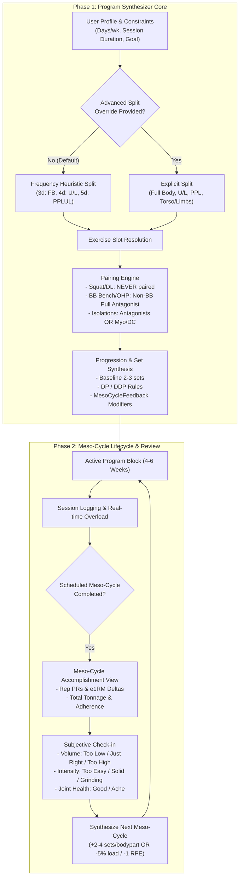

> **Historical reference:** This document contains past plans, audits, or proposals with mixed completion status. Its agent instructions, verification gates, and unchecked items do not assign current work. Follow the latest user request, root `AGENTS.md`, and [current documentation guidance](../README.md). Verify implementation claims against source.

# Engineering Blueprint: Program Synthesizer & Meso-Cycle Review System

## Executive Summary & Design Vision

This document details the engineering specifications for modernizing the **Program Generator** and introducing a **Meso-Cycle Completion & Review Lifecycle** in the Workout Suite monorepo.

The system replaces rigid, endless single-week templates and excessive volume ramps with:
1. **Set Quality & Mechanical Tension First**: A baseline foundation of 2–3 high-intent working sets progressing via Double Progression (DP) and Dynamic Double Progression (DDP).
2. **Ergonomic Pairing & Rest-Pause Rules**:
   - Heavy axial lower body lifts (Squat, Deadlift) are **strictly standalone**.
   - Upper body barbell pressing (Bench Press, Overhead Press) can be paired with **non-barbell antagonist pulling** (pull-ups, chin-ups, lat pulldowns, cable rows) for time-constrained workouts.
   - Unpaired isolations leverage **Myo-Reps** or **DC (Doggcrapp) Rest-Pause** on machines and cables (never on free-weight compounds).
3. **Meso-Cycle Accomplishment & Adaptive Feedback**:
   - Structured 4-to-6 week meso-cycle blocks.
   - An end-of-block **Accomplishment Report** (PRs broken, total tonnage, e1RM progression).
   - An intuitive check-in:
     - Volume "too low" $\rightarrow$ **+2 to +4 sets per body part per week**.
     - Intensity "grinding" $\rightarrow$ **-5% load OR -1.0 prescribed compound RPE** (when $> 8.0$).
     - Premium Companion integration hooks for deeper algorithmic calibration.

---

## Architecture Flowchart



---

## Phase 1: Generator & Synthesizer Core

### 1.1 Scope & Affected Components
- [`mobile/src/core/generator/programSynthesizer.ts`](../../mobile/src/core/generator/programSynthesizer.ts)
- [`mobile/src/core/generator/__tests__/programSynthesizer.test.ts`](../../mobile/src/core/generator/__tests__/programSynthesizer.test.ts)
- [`mobile/src/core/types/index.ts`](../../mobile/src/core/types/index.ts)

### 1.2 Data Contract Updates

```typescript
// mobile/src/core/types/index.ts & programSynthesizer.ts

export type IntensityTechnique = 'standard' | 'myo_reps' | 'dc_rest_pause';

export interface MesoCycleFeedback {
  volumeRating: 'too_low' | 'just_right' | 'too_high';
  intensityRating: 'too_easy' | 'solid' | 'grinding';
  jointAche?: boolean;
  affectedMuscleGroups?: string[];
  priorCycleId?: string;
}

export interface CompanionAnalyticsDials {
  muscleGroupSetDeltas?: Record<string, number>; // e.g. { chest: 2, quads: -1 }
  compoundRpeOffset?: number;                    // e.g. -1.0
  loadAdjustmentPercent?: number;                // e.g. -0.05
}

export interface ProgramSynthesizerOptions {
  availableExercises?: Exercise[];
  programId?: string;
  programName?: string;
  colorHex?: string;
  notes?: string;
  /**
   * Advanced split override. If omitted, automatically derived from days per week.
   */
  splitOverride?: 'full_body' | 'upper_lower' | 'pplul' | 'ppl';
  /**
   * Prior meso-cycle user feedback driving adaptive progression.
   */
  feedback?: MesoCycleFeedback;
  /**
   * Optional premium companion recommendations.
   */
  companionDials?: CompanionAnalyticsDials;
}
```

### 1.3 Algorithmic Rules & Logic

#### 1. Volume Adaptation from Feedback
- **Baseline Foundation**: Default to **2 working sets** for accessories and **3 working sets** for primary compounds (calibrated for high intent and low junk volume).
- **If `feedback.volumeRating === 'too_low'`**:
  - Add **+2 to +4 working sets per body part per week**.
  - In practice: Increase compound movements to 4 sets, or promote tertiary accessories from 2 to 3 sets.
- **If `feedback.volumeRating === 'too_high'`**:
  - Decrease **-2 to -4 sets per body part per week** (drop tertiary accessories from 3 to 2 sets, or reduce volume on high-fatigue lifts).
- **Companion Dials (if present)**:
  - If `companionDials.muscleGroupSetDeltas` exists, apply targeted per-muscle deltas rather than a flat global adjustment.

#### 2. Intensity & RPE Adaptation from Feedback
- **Default Targets**:
  - Compounds: Target RPE 8.0 (2 RIR) to 8.5 (1.5 RIR).
  - Isolations: Target RPE 8.5 to 9.5 (1 to 0 RIR).
- **If `feedback.intensityRating === 'grinding'`**:
  - If prescribed compound RPE $> 8.0$, **decrease prescribed RPE by 1.0** (e.g., $9.0 \rightarrow 8.0$).
  - If RPE is already $\le 8.0$, apply a **-5% initial working load offset** to back off CNS fatigue while reinforcing form.
- **If `feedback.intensityRating === 'too_easy'`**:
  - Tighten the rep ceiling or add $+2.5\%$ to baseline load recommendations.

#### 3. Strict Pairing & Superset Engine
- **Axial Lower Body Compound Exclusions**:
  - Exercises marked `isPrimaryCompound && (muscle_group === 'Quads' || muscle_group === 'Hamstrings' || id.includes('squat') || id.includes('deadlift'))` must **never** receive an `exercise_group_id`. Full rest intervals are mandatory.
- **Upper Body Barbell Pressing + Non-Barbell Antagonist Pairing**:
  - Barbell Bench Press (`barbell_bench_press`) and Barbell Overhead Press (`barbell_overhead_press`) **can be paired** with non-barbell pulling movements when time-efficiency is required:
    - *Bench Press* $\leftrightarrow$ *Pull-up, Chin-up, Cable Lat Pulldown, or Cable Seated Row*.
    - *Overhead Press* $\leftrightarrow$ *Lat Pulldown or Chest-Supported Dumbbell Row*.
  - Prohibit pairing Barbell Bench with Barbell Bent-Over Row (avoids lower back fatigue interference).
- **Lower Body Isolation Pairing**:
  - Leg Extension $\leftrightarrow$ Leg Curl.
  - Calf Raise $\leftrightarrow$ Hanging Knee Raise / Abdominals.
- **Unpaired Isolation Rest-Pause (Myo / DC)**:
  - For isolation movements without an antagonist slot in time-crunched templates (e.g., Cable Lateral Raises, Bicep Curls):
    - Tag with `intensity_technique: 'myo_reps'` (1 activation set + 3-4 mini-sets) or `'dc_rest_pause'` (1 set rest-paused across 15-breath intervals).
    - **Safety Gate**: Never assign rest-pause to free-weight compound movements.

---

## Phase 2: Meso-Cycle Lifecycle & Review UI

### 2.1 Scope & Affected Components
- [`mobile/src/services/programBlockService.ts`](../../mobile/src/services/programBlockService.ts)
- [`mobile/src/database/schema.ts`](../../mobile/src/database/schema.ts)
- New Screen / Modal: `mobile/src/features/progression/MesoCycleCompletionModal.tsx`
- Integration in [`mobile/src/features/home/HomeScreen.tsx`](../../mobile/src/features/home/HomeScreen.tsx) and [`mobile/src/features/progression/ProgramOverviewScreen.tsx`](../../mobile/src/features/progression/ProgramOverviewScreen.tsx)

### 2.2 Database Schema Evolution
In [`mobile/src/database/schema.ts`](../../mobile/src/database/schema.ts), add a migration for the `program_blocks` table and a `meso_cycle_reviews` table:

```sql
-- Migration v4 -> v5
ALTER TABLE program_blocks ADD COLUMN planned_weeks INTEGER NOT NULL DEFAULT 5;
ALTER TABLE program_blocks ADD COLUMN status TEXT NOT NULL DEFAULT 'active'; -- 'active', 'completed', 'abandoned'

CREATE TABLE IF NOT EXISTS meso_cycle_reviews (
    id TEXT PRIMARY KEY,
    block_id TEXT NOT NULL REFERENCES program_blocks(id) ON DELETE CASCADE,
    completed_at TEXT NOT NULL,
    total_workouts_completed INTEGER NOT NULL,
    planned_workouts INTEGER NOT NULL,
    total_tonnage_kg REAL NOT NULL,
    volume_rating TEXT NOT NULL, -- 'too_low', 'just_right', 'too_high'
    intensity_rating TEXT NOT NULL, -- 'too_easy', 'solid', 'grinding'
    joint_rating TEXT NOT NULL, -- 'healthy', 'mild_ache', 'persistent_pain'
    notes TEXT
);
```

### 2.3 Meso-Cycle Accomplishment & Review Modal (`MesoCycleCompletionModal.tsx`)

#### Screen Flow & UI Architecture:
1. **Trigger Condition**:
   - Automatically triggered when the user finishes workout $N$ of their planned block (or explicitly selects "Conclude Meso-Cycle" from the Program Overview menu).
2. **Carousel Slide 1: The Accomplishment Showcase**:
   - **Trophy Header**: *"Meso-Cycle Complete!"* with the program's accent color badge.
   - **Total Tonnage Moved**: e.g., `42,850 kg` lifted.
   - **Consistency Stat**: `20 of 20 planned sessions completed (100% adherence)`.
   - **PR Wall**: List of new rep-maxes or e1RM breakthroughs achieved during the block (e.g., *"Barbell Bench Press: +5 kg e1RM (105 kg $\rightarrow$ 110 kg)"*).
3. **Carousel Slide 2: The Adaptive Feedback Check-In**:
   - Three interactive segmented pickers:
     1. *Overall Volume*: `[ Too Low ]` | `[ (•) Just Right ]` | `[ Too High ]`
     2. *Set Intensity*: `[ Too Easy ]` | `[ (•) Solid & Hard ]` | `[ Grinding ]`
     3. *Joint & Connective Tissue*: `[ (•) Feeling Great ]` | `[ Mild Ache ]` | `[ Persistent Pain ]`
4. **Slide 3: Next Block Proposal & 1-Tap Evolution**:
   - Shows what the engine tuned:
     - *"Volume increased by +3 weekly sets across Quads & Back."*
     - *"Compounds dialed to RPE 8.0 to protect bar speed."*
   - Button: `[ Launch Next Meso-Cycle Block ]`
   - Automatically invokes `ProgramBlockService.swapActiveProgram` with the newly synthesized, calibrated program.

---

## Why Problems Are Solved This Way

### 1. Mechanical Tension vs. Volume Ramping
- *Why reject arbitrary weekly set escalation?*
  Progressive overload is primarily driven by **increasing mechanical tension** (more load or more reps with high bar speed and controlled eccentrics at close proximity to failure). Adding 1–2 junk sets every single week until an athlete is doing 25 sets causes recovery debt to outpace hypertrophic stimulus.
- *Why 2–3 sets as a baseline?*
  Empirical research demonstrates that 80%+ of the stimulus is captured in the first 2–3 hard sets of an exercise. Sets 4+ have steep diminishing returns while doubling joint wear and systemic fatigue. Starting at 2–3 sets allows sustainable progressive overload.

### 2. Selective Supersetting of Upper Body Pressing
- *Why pair Barbell Bench with Chin-ups / Cable Rows, but not Squats with Leg Curls?*
  - Squats and Deadlifts involve intense axial loading, whole-body muscular recruitment, and heavy cardiovascular and intra-abdominal bracing demands. Supersetting them impairs set quality and elevates injury risk.
  - Barbell Bench Press and Overhead Press place minimal stress on the posterior chain and respiratory system. Pairing them with non-barbell pulling (e.g., Pull-ups, Lat Pulldowns, or Chest-Supported Rows) cuts session duration by 30–40% without compromising pressing force production or lower-back stability.

### 3. Rest-Pause (Myo / DC) Safety Boundaries
- Rest-pause techniques allow high effective-rep accumulation in minimal time by bypassing the initial easy reps of subsequent sets.
- However, performing a rest-pause set to failure on a Barbell Bench or Free-Weight Squat without safety pins can result in entrapment or catastrophic form breakdown. By restricting rest-pause to machines and cables, athletes gain the intensity benefit with zero risk.

---

## Implementation Roadmap & Verification

| Step | Milestone | Files Involved | Verification Criteria |
| :--- | :--- | :--- | :--- |
| **1.1** | Define types & synthesizer options | `mobile/src/core/types/index.ts`, `programSynthesizer.ts` | TypeScript compiles with no errors. |
| **1.2** | Implement pairing rules (BB Bench/OHP + non-BB pull, exclude Squat/DL) | `programSynthesizer.ts` | Unit tests verify Squat/DL have null `exercise_group_id`, BB bench has non-BB pull group. |
| **1.3** | Implement volume (+2-4 sets) and intensity (-5% load / -1 RPE) feedback tuning | `programSynthesizer.ts` | Unit tests confirm set count adjustments and RPE decrement when grinding. |
| **1.4** | Implement Advanced split override hook | `programSynthesizer.ts` | Unit test proves `splitOverride: 'upper_lower'` produces 4-day U/L even if frequency = 3. |
| **2.1** | Schema migration for `meso_cycle_reviews` & `program_blocks.planned_weeks` | `mobile/src/database/schema.ts`, `SQLiteProgramRepository.ts` | Jest repository tests pass migration without data loss. |
| **2.2** | Meso-Cycle Completion & Review Modal component | `mobile/src/features/progression/MesoCycleCompletionModal.tsx` | UI test verifies PR aggregation and 3-question submission. |
| **2.3** | Wire completion trigger to Active Session & Program Overview | `ActiveLoggerScreen.tsx`, `ProgramOverviewScreen.tsx` | Finishing planned block prompts review modal and evolves next meso-cycle. |
