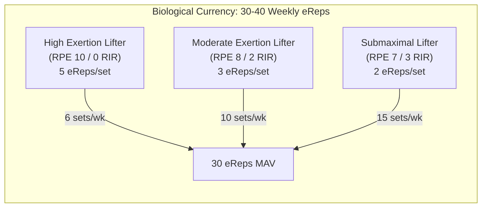
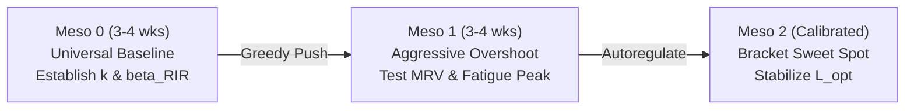
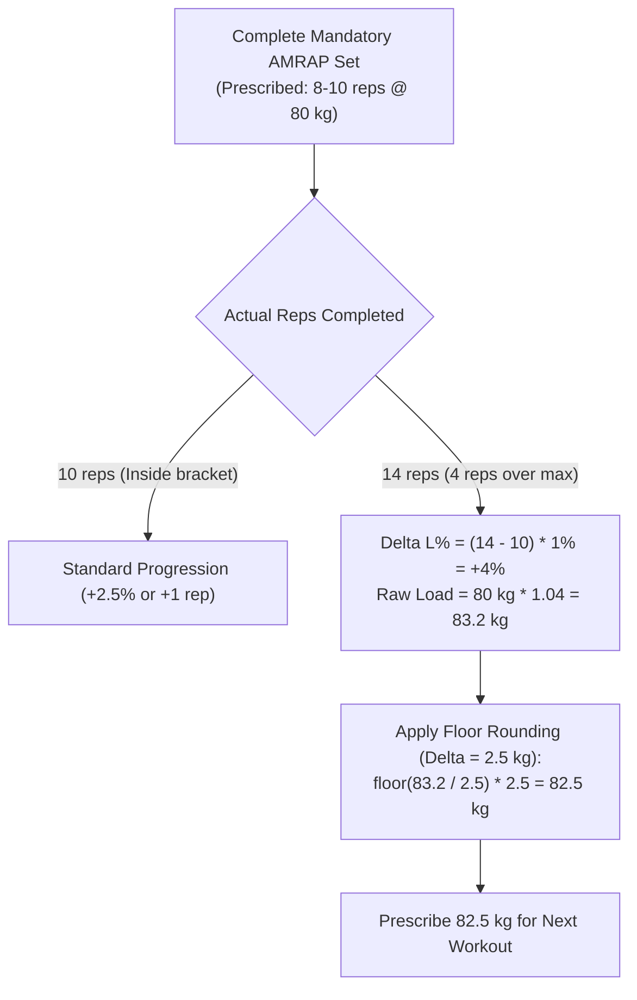
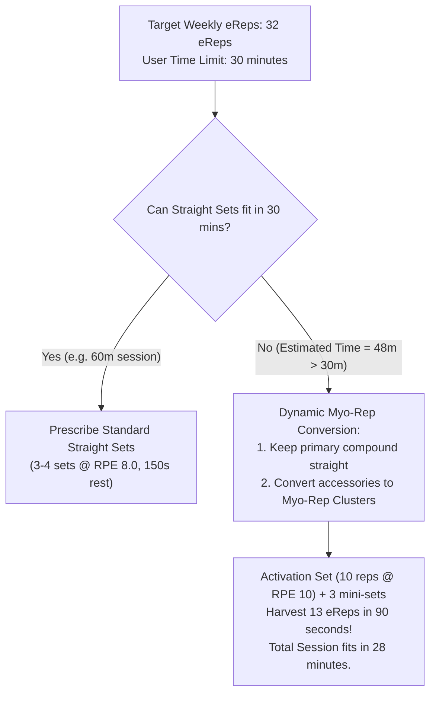
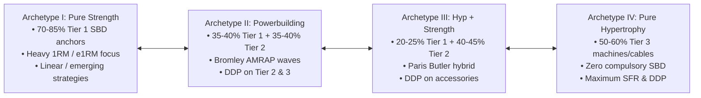
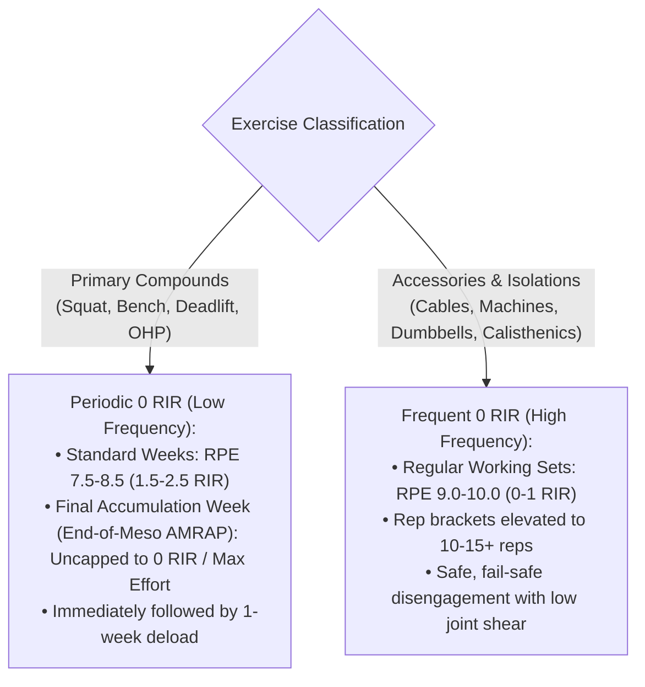
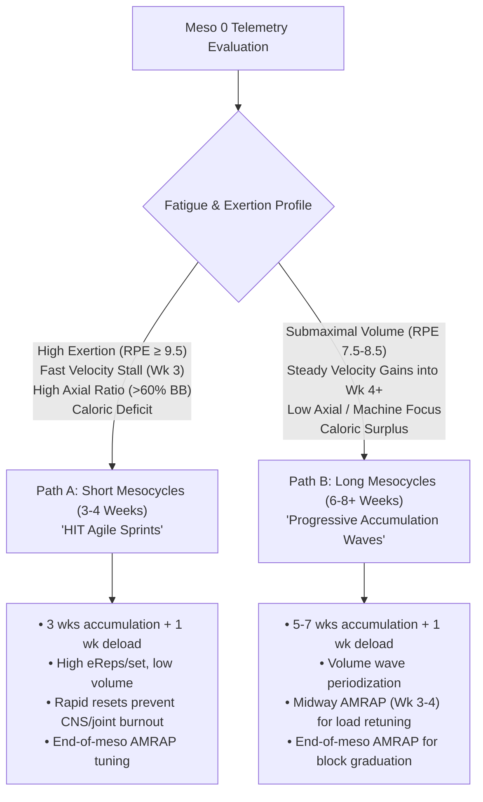
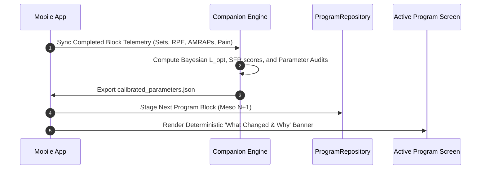

# Workout Suite: Hypertrophic Theory Integration & Adaptive Mesocycle Architecture

## 1. Executive Summary & Purpose

This document operationalizes the exercise physiology findings from [`THEORY_VOLUME_VS_EREPS.md`](file:///c:/Programmering/Eget/Workout_suite/docs/training_philosophies/THEORY_VOLUME_VS_EREPS.md) into concrete architectural patterns, generation algorithms, and lifecycle workflows for `Workout Suite`.

The resistance training literature has long been split between:
1. **The Volume Landmark School (Sets as Currency)** (Schoenfeld, Israetel): Progress is driven by accumulating "hard sets" within $1\text{–}3$ RIR ($10\text{–}20\text{ sets/week/muscle}$).
2. **The Effective Repetition School (eReps as Currency)** (Beardsley, Jones, Mentzer): Hypertrophic tension and high-threshold motor unit recruitment occur primarily during the final $\sim 5$ repetitions prior to concentric muscular failure ($25\text{–}45\text{ eReps/week/muscle}$).

### Core Architectural Synthesis
Sets are merely **containers** of variable eRep density:
- A lifter training at RPE 10 (0 RIR) earns 5 eReps per set and achieves Maximum Adaptive Volume (MAV) in $6\text{ sets/week}$.
- A lifter training at RPE 7 (3 RIR) earns only 2 eReps per set and requires $15\text{ sets/week}$ to achieve the same stimulus.



This architecture document codifies the complete training lifecycle, integrating eight core systems:
1. **Universal Initial Calibration Block (Meso 0)**: Why *all* lifters (not just beginners) start with a short (3–4 week) block to calibrate individual parameters through **greedy over/undershoot exploration**.
2. **Experience-Specific Program Synthesis**: Clarifying the bifurcation for beginners vs. standard multi-day splits for intermediate/advanced lifters.
3. **Mandatory AMRAPs (Mid-Flight & End-of-Cycle)**: Scheduled midway ($\lfloor L/2 \rfloor$) to tune loads mid-meso, and at the end of the block to establish jump-off baselines for Meso $N+1$.
4. **The 1%-Over-Cap Progression Formula with Floor Rounding**: $+1\%$ load increase per rep over the upper rep limit, strictly rounded **down** to the closest available standard implement increment.
5. **Aggressive RIR Bias Correction**: Rapidly exposing and correcting under-estimated reserve.
6. **Deterministic Offline Mesocycle Explanation Templates (Zero LLM Dependency)**: Parameterized, rule-based string templates explaining what changed and why.
7. **Time-Budgeted Myo-Rep Integration**: Converting straight sets into Myo-rep clusters only when necessary to fulfill the user's weekly eRep target within their session time limit.
8. **The SBD vs. Variety Sliding Scale & 0 RIR Periodization**: How primary/secondary goals govern SBD inclusion, high-rep accessory brackets ($10\text{–}15+$), and the periodic scheduling of 0 RIR on primary compounds at mesocycle conclusion.

---

## 2. The Eight Pillars of Workout Suite Program Architecture

### Pillar 1: Universal Meso 0 Calibration & Greedy Parameter Search

> [!IMPORTANT]
> **Meso 0 is NOT just for novices; it is a universal parameter calibration block for every new user.**

Regardless of whether an athlete is a raw beginner or a 10-year veteran, the system starts with zero historical telemetry:
- Their true repetition fatigue exponent ($k \in [0.03, 0.20]$) is unknown.
- Their central and peripheral recovery rates ($\tau_1, \tau_2$) are unknown.
- Their individual RIR accuracy bias ($\beta_{\text{RIR}}$) is unknown.
- Their systemic fatigue sensitivity multiplier ($m_{\text{sys}}$) is uncalibrated.

#### The "Greedy Exploration" Philosophy (Over- and Undershooting Early)
Traditional fitness apps use overly timid adjustments (e.g. changing 1 set every 12 weeks), taking a full year to discover an athlete's work capacity. `Workout Suite` utilizes a **greedy exploration algorithm** inspired by binary search / bisection:
1. **Meso 0 (3–4 weeks)**: Baseline discovery with a conservative anchor.
2. **Early Follow-Up (Meso 1)**: Deliberately push one parameter slightly into an overshoot (e.g. +2 sets, +2.5% load, or +0.5 RPE) to test the upper boundary of adaptation and observe the fatigue inflection point.
3. **Rapid Convergence (Meso 2+)**: As soon as the fatigue signals ($\dot{x}_0 \le 0$ or $\Delta\text{RPE}_{\text{drift}} > 0.5$) trigger, pull back to establish the optimal sweet spot ($L_{\text{opt}}$, MAV).



---

### Pillar 2: Novice Bifurcated Architecture vs. Intermediate/Advanced Programs

A critical distinction must be drawn between **motor learning tiering** and **experience profiles**:

#### A. Novice Lifters (Experience = 'beginner')
Beginners cannot safely handle high failure on complex free-weight lifts, yet low-volume $3 \times 5$ routines yield virtually zero hypertrophy. Thus, novices strictly receive the **Two-Tier Bifurcated Session Structure**:
- **Tier 1 (Neurological Practice Sets)**: Free-weight Barbell (Squat, Bench, Row, Deadlift). Prescribed as $4\text{–}5\text{ sets} \times 3\text{–}5\text{ reps @ RPE }6.5\text{–}7.5$ ($2.5\text{–}3.5\text{ RIR}$). High technical volume, zero grind, pristine bar path. Linear Progression (+2.5 kg).
- **Tier 2 (Hypertrophic Driver Sets)**: High-stability, low-axial, guided movements (Machine Chest Press, Push-Ups, Dumbbell Goblet Box Squats, Seated Leg Curls). Prescribed as $2\text{–}3\text{ sets @ RPE }8.5\text{–}9.0$ ($1\text{–}1.5\text{ RIR}$). High eRep accumulation with built-in fail-safe disengagement.

#### B. Intermediate & Advanced Lifters (Experience = 'intermediate' | 'advanced')
Experienced trainees **do not** receive the novice bifurcated template. They have automated motor schema and can safely execute high proximity to failure on standard movements. Their routines are mapped directly from their **Training Mentality** and **Goal Matrix**:
- **Fury Profile** (RPE 9.5–10): $1\text{–}2$ sets per exercise, 6–8 weekly sets per muscle, Dynamic Double Progression (DDP), heavy reliance on Rest-Pause/DC/Myo-reps.
- **Precision Profile** (RPE 7.5–8.5): $3\text{–}4$ straight sets per exercise, 12–16 weekly sets per muscle, classic Double Progression (DP).
- **Get Out Profile** (RPE 8.5–9.0): Antagonist superset pairs, 2 sets per exercise, density-optimized.

---

### Pillar 3: Mandatory AMRAP Checkpoints (Midway & End-of-Meso)

AMRAPs (As Many Reps As Possible) are **mandatory diagnostic instruments** in `Workout Suite`:
1. **Mid-Mesocycle Checkpoint ($\lfloor L/2 \rfloor$)**:
   - In Meso 0: Week 2.
   - In longer mesocycles (e.g. 6–8 weeks): Scheduled at **Week 3 or 4**.
   - **Purpose**: Mid-flight tuning. If the lifter is significantly exceeding their rep bracket, loads are adjusted mid-cycle rather than letting them waste weeks under-loaded.
2. **End-of-Meso Graduation ($L$)**:
   - Scheduled on the final accumulation week prior to deload.
   - **Purpose**: Benchmarks true progress, establishes new e1RM baselines, and determines the initial jump-off load for Meso $N+1$.

---

### Pillar 4: The 1%-Over-Cap Progression Formula with Floor Rounding

When an AMRAP set significantly exceeds the prescribed target rep range, the app applies a deterministic load escalation for subsequent workouts:

$$\Delta L_{\%} = \max\Big(0, R_{\text{actual}} - R_{\text{target\_max}}\Big) \times 1\%$$

$$\text{Raw Target Load} = \text{Current Load} \times (1 + \Delta L_{\%})$$

$$\mathbf{\text{Next Prescribed Load}} = \mathbf{\text{floor\_to\_increment}}\Big(\text{Raw Target Load},\, \Delta_{\text{gear}}\Big)$$

Where $\Delta_{\text{gear}}$ is the smallest resolved increment from [`GearInventory`](file:///c:/Programmering/Eget/Workout_suite/companion/src/ingestion/schemas.py) (or defaults: $2.5\text{ kg}$ for standard barbells, $1.25\text{ kg}$ for microplates, $2.0\text{ kg}$ or $5\text{ lbs}$ for dumbbells, $5.0\text{ kg}$ for cable pin stacks):

$$\text{floor\_to\_increment}(W, \Delta) = \lfloor W / \Delta \rfloor \times \Delta$$



#### Why Floor Rounding is Required:
- **Prevents Accidental Failure Spikes**: If an athlete hits 14 reps ($83.2\text{ kg}$ calculated) and the app rounds UP to $85.0\text{ kg}$ ($+6.25\%$), the abrupt load jump risks technical failure and acute fatigue blowout.
- **Guarantees Safe Forward Progress**: Rounding down to $82.5\text{ kg}$ guarantees a solid $+3.1\%$ progression step that the lifter is physiologically guaranteed to handle for working volume.

---

### Pillar 5: Aggressive RIR Bias Correction ($\beta_{\text{RIR}}$)

Research consistently demonstrates that trainees—especially beginners and intermediate volume accumulators—underestimate proximity to failure by $2\text{ to }4$ reps.

In `Workout Suite`, the app queries the user before their diagnostic AMRAP:
> *"With this load, how many reps do you expect to perform before failure?"* $\implies R_{\text{pred}}$

Upon set completion ($R_{\text{actual}}$):
$$\beta_{\text{RIR}} = R_{\text{actual}} - R_{\text{pred}}$$

#### Greedy Correction Protocol:
- If $\beta_{\text{RIR}} \le 1$: Trainee has accurate self-perception. Maintain prescribed RPE/RIR.
- If $\beta_{\text{RIR}} \ge 2$: Trainee has a significant sandbagging bias. The engine takes an **aggressive stance**:
  1. **Immediate Target Rep Adjustment**: For all remaining working sets in that session and the upcoming week, target rep minimums are increased by $+\lfloor \beta_{\text{RIR}} / 2 \rfloor$.
  2. **RPE Display Calibration**: If the user is prescribed RPE 8 (2 RIR), the app displays: *"Target: 10 reps @ RPE 8. Note: Based on your recent AMRAP, push 2 reps past where you normally feel fatigue starting."*
  3. Overshooting slightly is embraced: it forces the neuromuscular system into high-threshold motor unit recruitment ($5\text{ eReps}$) and quickly establishes true physiological limits.

---

### Pillar 6: Time-Budgeted Myo-Rep Integration

Intensity techniques (Myo-reps and Rest-Pause) are **temporal density accelerators**. They bypass the 7 non-stimulating entry reps of straight sets, reducing the time cost from $47\text{s/eRep}$ to $7\text{s/eRep}$.

Rather than forcing Myo-reps on everyone, `Workout Suite` treats them as a **mathematical solution to session time-budget deficits**:

$$\text{Estimated Straight-Set Duration} = \sum_{i=1}^N \Big(\text{Sets}_i \times \text{TUT}_i\Big) + \sum_{i=1}^N \Big((\text{Sets}_i - 1) \times \text{Rest}_i\Big) + \text{WarmupTime}$$



#### Rule Definition:
1. Primary compound multi-joint movements (Squats, Deadlifts, Heavy Presses) **always remain straight sets** for axial and neurological safety.
2. If estimated session duration exceeds `preferred_session_duration_mins`:
   - Identify candidate accessory/isolation exercises (cables, machines, dumbbells).
   - Convert slot to `set_type: 'myorep'` (1 activation set @ 0–1 RIR followed by 3–4 mini-sets with 10–15s rest).
   - Each Myo-rep cluster harvests $11\text{–}14\text{ eReps}$ in under $2\text{ minutes}$, enabling full MAV ($30\text{–}40\text{ eReps}$) even in strict 20–30 minute workouts.

---

### Pillar 7: Resistance Training Archetypes Continuum & SBD Focus

Exercise pool selection, progression rules, and variety are governed by where the athlete sits on the continuous **Resistance Training Archetype Continuum (Archetypes I–IV)**:



#### Continuum Parameters & Archetype Mapping:

| Archetype | Goal Configuration | SBD Anchor Ratio ($\alpha_{\text{SBD}}$) | Implement Bias | Tier 1 Model | Tier 2 & 3 Model |
| :--- | :--- | :---: | :--- | :--- | :--- |
| **Archetype I (Pure Strength)** | `primary_goal: 'strength'` (no hyp secondary) | $\ge 70\%$ ($\alpha \ge 0.70$) | Barbell, Competition Spec | Linear Progression / Top Set + Drops | Linear / DP |
| **Archetype II (Powerbuilding)** | `powerbuilding` OR `strength` + `hypertrophy` | $35\text{–}40\%$ ($0.40 \le \alpha < 0.70$) | Barbell Anchors + Machines | 3-week AMRAP wave / DP | Dynamic Double Progression (DDP) |
| **Archetype III (Hyp + Minor Strength)** | `hypertrophy` + `strength` secondary | $20\text{–}25\%$ ($0.20 \le \alpha < 0.40$) | Core Anchors + Hypertrophy Drivers | Linear / Wave on Core Anchors | Dynamic Double Progression (DDP) |
| **Archetype IV (Pure Hypertrophy)** | `hypertrophy` (no strength secondary) | $0\text{–}10\%$ ($\alpha < 0.20$) | High-SFR Cables & Machines | DP / High-SFR Compounds | Dynamic Double Progression (DDP) & Myo-reps |

#### Novice Two-Tier Bifurcation vs. Intermediate Dynamic Progression:
- **Novice Trainees (`experience_level: 'beginner'`)**: Strictly partitioned into Tier 1 Motor Practice (Linear Progression, 4 sets @ RPE 7.0 / 3.0 RIR) and Tier 2 Stimulating Drivers (Standard Double Progression, 3 sets @ RPE 9.0 / 1.0 RIR). AMRAP final week rules are omitted to protect movement mechanics.
- **Intermediate / Advanced Trainees**: Primary compounds incorporate AMRAP checkpoints and load preservation during accumulation, while **Dynamic Double Progression (DDP)** is systematically enforced across all Tier 2 and Tier 3 exercises to prevent intra-session fatigue stalling.

---

### Pillar 8: 0 RIR Periodization: Compounds vs. Accessories

Proximity to absolute muscular failure (0 RIR / RPE 10) must be periodized differently across **multi-joint axial compounds** vs. **isolated/guided accessories**:



#### 1. Primary Compounds (Squat, Bench, Deadlift, OHP, Rows):
- **Can be pushed to 0 RIR, but NOT every week.**
- Performing heavy multi-joint axial compounds to absolute concentric failure on a weekly basis causes catastrophic CNS motor inhibition, connective tissue shear, and premature burnout ($\delta_{\text{drop}} > 15\%$).
- **Prescription**: Compounds stay at **1.5 to 2.5 RIR** (RPE 7.5–8.5) during standard accumulation weeks, and are **uncapped to 0 RIR on the final accumulation week** of the mesocycle as an **End-of-Meso AMRAP Checkpoint** (or deliberate functional overreach test) immediately prior to deload.

#### 2. Secondary & Isolation Accessories (Cables, Machines, Dumbbells, Calisthenics):
- Can be safely pushed to **0 to 1 RIR on a regular, weekly basis**.
- **Elevated Rep Rule ($10\text{–}15+$)**: When accessories are pushed to 0 RIR (especially via Myo-reps, DC sets, or drop sets), rep targets expand upward to **$10\text{–}15\text{ reps}$** (or $12\text{–}20$ for calisthenics/cables).
- *Physiological rationale*: Light-to-moderate loads ($50\text{–}65\%$ 1RM) taken to failure achieve the exact same 5 effective reps as heavy loads, but with vastly lower joint shear, zero ballistic tendon shock, and superior intra-muscular metabolic occlusion.

---

## 3. Mesocycle Lifecycle: Fast Iteration $\to$ Divergent Block Horizons

### 3.1 Initial Trajectory: "Learn Fast, Iterate Early"
1. **Mesocycle 0 (Weeks 1 to 3–4)**:
   - Universal calibration cycle for all trainees.
   - Week 1: Load finding & familiarization.
   - Week 2: Mid-meso AMRAP calibration on accessory movement ($\to \beta_{\text{RIR}}$).
   - Week 3: End-of-block diagnostic AMRAP on main lift ($\to$ 1%-over-cap adjustment with floor rounding).
   - Week 4: Deload & Automated Mesocycle Staging.

### 3.2 Branching Decisions: Short vs. Long Mesocycles
Based on the Meso 0 audit, the Bayesian Mesocycle Analyzer ([`mesocycle_analyzer.py`](file:///c:/Programmering/Eget/Workout_suite/companion/src/models/mesocycle_analyzer.py)) categorizes the athlete and branches their future mesocycle length:



---

## 4. Automated Mesocycle Staging & Deterministic Offline Explanation Templates

When an active mesocycle completes its accumulation weeks, `Workout Suite` does not require manual program design from the user. It **automatically stages Meso $N+1$** and presents a transparent diff summary.

### 4.1 Automated Staging Sequence


### 4.2 Deterministic String Template Catalog (Zero LLM Dependency)

> [!IMPORTANT]
> Because `Workout Suite` runs offline without a live LLM connection, all "What Changed & Why" explanations are generated via **rule-based string templates with variable interpolation**.

The mobile client (`mobile/src/services/mesocycleDiffFormatter.ts`) and companion engine evaluate parameterized templates from a deterministic registry:

#### Template Registry:

```typescript
export interface MesocycleDiffItem {
  category: 'load' | 'exercise_swap' | 'intensity_technique' | 'block_length' | 'volume';
  title: string;
  explanation: string;
}

export const MESOCYCLE_DIFF_TEMPLATES = {
  // 1. AMRAP Load Progression (Floor Rounded)
  LOAD_INCREASE_AMRAP: (p: {
    exerciseName: string;
    actualReps: number;
    targetMax: number;
    repsOver: number;
    pctGain: number;
    oldWeightKg: number;
    newWeightKg: number;
    weekNum: number;
  }) => ({
    title: `${p.exerciseName} Load Increased (+${p.pctGain}%)`,
    explanation: `On your Week ${p.weekNum} AMRAP, you completed ${p.actualReps} reps against your ${p.targetMax} rep target (${p.repsOver} reps over). Working load increased from ${p.oldWeightKg} kg to ${p.newWeightKg} kg (rounded to nearest available plate).`,
  }),

  // 2. Exercise Substitution via SFR / Joint Discomfort
  EXERCISE_SWAP_PAIN: (p: {
    oldExerciseName: string;
    newExerciseName: string;
    painArea: string;
    painSeverity: number;
    sfrScore: number;
  }) => ({
    title: `${p.oldExerciseName} Swapped for ${p.newExerciseName}`,
    explanation: `You logged ${p.painArea} discomfort (Severity: ${p.painSeverity}/10) on ${p.oldExerciseName}. Swapped for ${p.newExerciseName}, providing high muscle stimulus (SFR: ${p.sfrScore}/100) with minimal joint stress.`,
  }),

  // 3. Exercise Substitution via Axial Bottleneck
  EXERCISE_SWAP_AXIAL: (p: {
    oldExerciseName: string;
    newExerciseName: string;
    muscleGroup: string;
  }) => ({
    title: `${p.oldExerciseName} Replaced with ${p.newExerciseName}`,
    explanation: `High spinal/axial fatigue was limiting progress on ${p.muscleGroup}. Replaced with ${p.newExerciseName} to preserve heavy mechanical tension without spinal compression.`,
  }),

  // 4. Time-Budget Myo-Rep Conversion
  CONVERT_TO_MYOREP: (p: {
    exerciseName: string;
    sessionDurationLimitMins: number;
    eRepsYield: number;
  }) => ({
    title: `${p.exerciseName} Converted to Myo-Reps`,
    explanation: `To keep your workout strictly within your ${p.sessionDurationLimitMins}-minute limit, 3 straight sets were converted into 1 Myo-rep cluster, harvesting ${p.eRepsYield} stimulating reps in under 2 minutes.`,
  }),

  // 5. Volume Escalation (Under-Stimulated Archetype A)
  VOLUME_ESCALATION: (p: {
    muscleGroup: string;
    setDelta: number;
    meanRpe: number;
    newWeeklySets: number;
  }) => ({
    title: `${p.muscleGroup} Volume Increased (+${p.setDelta} sets/week)`,
    explanation: `Your ${p.muscleGroup} recovered easily with low fatigue (mean RPE ${p.meanRpe.toFixed(1)}). Added +${p.setDelta} sets/week (new target: ${p.newWeeklySets} sets) to reach optimal growth volume.`,
  }),

  // 6. Volume Pruning (Over-Reaching Archetype B)
  VOLUME_PRUNING: (p: {
    muscleGroup: string;
    prunePct: number;
    newWeeklySets: number;
  }) => ({
    title: `${p.muscleGroup} Volume Reduced (-${p.prunePct}%)`,
    explanation: `Acute fatigue was causing performance drop-off on ${p.muscleGroup}. Pruned volume to ${p.newWeeklySets} sets/week to allow full muscular recovery between sessions.`,
  }),

  // 7. Mesocycle Block Length Adaptation
  BLOCK_LENGTH_DECISION: (p: {
    weeks: number;
    peakWeek: number;
    exertionTier: 'high' | 'moderate' | 'low';
    isDeficit: boolean;
  }) => ({
    title: `Mesocycle Length Set to ${p.weeks} Weeks`,
    explanation: `Based on your ${p.exertionTier} exertion style${p.isDeficit ? ' and caloric deficit' : ''}, your strength progression peaks around Week ${p.peakWeek} before fatigue accumulates. Scheduling a deload on Week ${p.weeks} guarantees steady progress without burnout.`,
  }),
};
```

#### Example Formatted Output in Mobile UI:
```markdown
### 🚀 Mesocycle 2 Ready: Here’s What We Adjusted

1. **Bench Press Load Increased (+3.1%)**:
   - On your Week 3 AMRAP, you completed 14 reps against your 10 rep target (4 reps over). Working load increased from 80 kg to 82.5 kg (rounded to nearest available plate).
2. **Barbell Back Squat Replaced with Hack Squat**:
   - High spinal/axial fatigue was limiting progress on Quads. Replaced with Hack Squat to preserve heavy mechanical tension without spinal compression.
3. **Lateral Raises Converted to Myo-Reps**:
   - To keep your workout strictly within your 45-minute limit, 3 straight sets were converted into 1 Myo-rep cluster, harvesting 12 stimulating reps in under 2 minutes.
4. **Mesocycle Length Set to 4 Weeks**:
   - Based on your high exertion style, your strength progression peaks around Week 3 before fatigue accumulates. Scheduling a deload on Week 4 guarantees steady progress without burnout.
```

---

## 5. Algorithmic Trade-Offs & Rationale

| Decision | Selected Algorithm / Architecture | Alternatives Considered | Rationale & Trade-offs |
| :--- | :--- | :--- | :--- |
| **Explanation Generation** | **Deterministic Parameterized String Templates** | Runtime LLM Generation | 100% offline-first, instant execution, zero cloud costs, zero API latency, zero hallucination risk, fully predictable and easily localizable. |
| **0 RIR Periodization** | **Periodic 0 RIR on compounds at meso conclusion; regular 0 RIR on accessories** | 0 RIR on all lifts every workout OR 0 RIR banned entirely | Protects spine and CNS from weekly grind on heavy compounds while allowing true failure for maximum eRep density on fail-safe machines and cables. |
| **AMRAP Load Rounding** | **Floor rounding to nearest equipment step** | Round to nearest or round up | Floor rounding ensures the athlete never faces an unmanageable load spike, eliminating premature stalling while guaranteeing progressive overload. |
| **Mid-Mesocycle AMRAP** | **Scheduled at $\lfloor L/2 \rfloor$ for $L \ge 5\text{ weeks}$** | Only end-of-block testing | Catches under-loaded lifters mid-flight and corrects load before 4 weeks of sub-optimal training are wasted. |
| **RIR Bias Correction** | **Greedy overshooting ($\ge 2$ reps bias)** | Conservative $+0.5$ rep damping | Novices waste months sandbagging. Aggressive pushes quickly discover true muscular failure thresholds without injury on stable machines. |
| **Myo-Rep Allocation** | **Dynamic time-budget constraint solver** | Fixed rule ("all accessories are Myo-reps") | Preserves straight-set motor learning and volume whenever time allows, applying intensity techniques strictly as needed. |

---

## 6. Implementation Blueprint & File References

1. **Mobile Generator**: Update [`programSynthesizer.ts`](file:///c:/Programmering/Eget/Workout_suite/mobile/src/core/generator/programSynthesizer.ts):
   - Incorporate `computeTargetSetsFromExertion` using weekly eRep targets ($32\text{ eReps}$).
   - Add time-budget calculation to dynamically assign `set_type: 'myorep'` on accessories when `estimatedDuration > preferred_duration`.
   - Implement the $\alpha_{\text{SBD}}$ filter to adjust SBD presence based on `primary_goal` and `secondary_goal`.
   - Set accessory rep brackets to $10\text{–}15$ when target RIR $\le 1.0$.
   - Preserve compound RPE at $7.5\text{–}8.5$ during accumulation, scheduling 0 RIR AMRAP on the final accumulation week.
2. **Mobile Progression Rule Engine**: Update [`progressionRuleEngine.ts`](file:///c:/Programmering/Eget/Workout_suite/mobile/src/core/rules/progressionRuleEngine.ts):
   - Add AMRAP $+1\%$-per-rep-over-cap rule evaluator with floor rounding.
   - Add midway AMRAP trigger scheduling ($\lfloor L/2 \rfloor$).
   - Add RIR bias compensation logic.
3. **Mobile Offline Diff Formatter**: Implement `mobile/src/services/mesocycleDiffFormatter.ts` using the template catalog.
4. **Companion Analytics**:
   - Update [`mesocycle_analyzer.py`](file:///c:/Programmering/Eget/Workout_suite/companion/src/models/mesocycle_analyzer.py) to set Meso 0 prior to $\mu_0 = 3.5\text{ weeks}$ and enable greedy branching.
   - Update [`recommendations.py`](file:///c:/Programmering/Eget/Workout_suite/companion/src/models/recommendations.py) to generate structured parameter audit payloads feeding directly into the diff templates.
