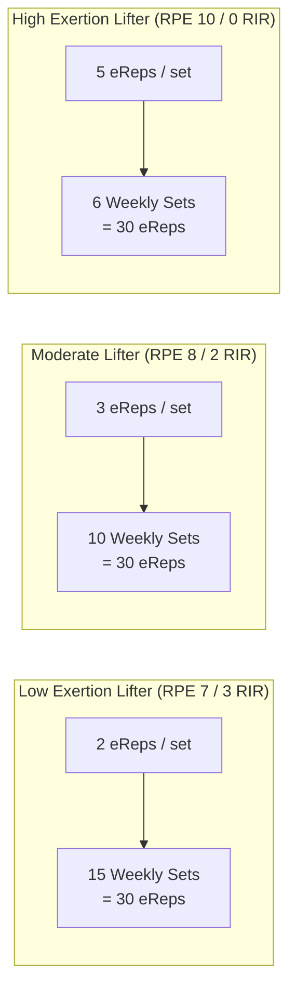
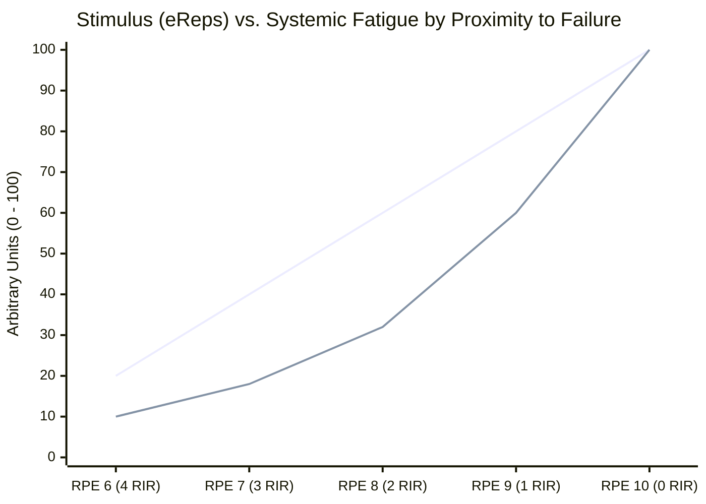
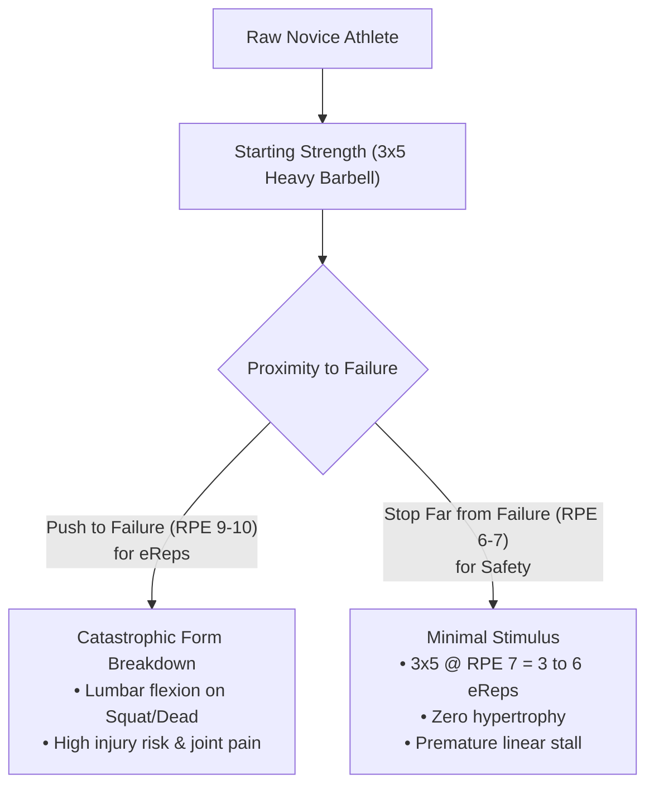
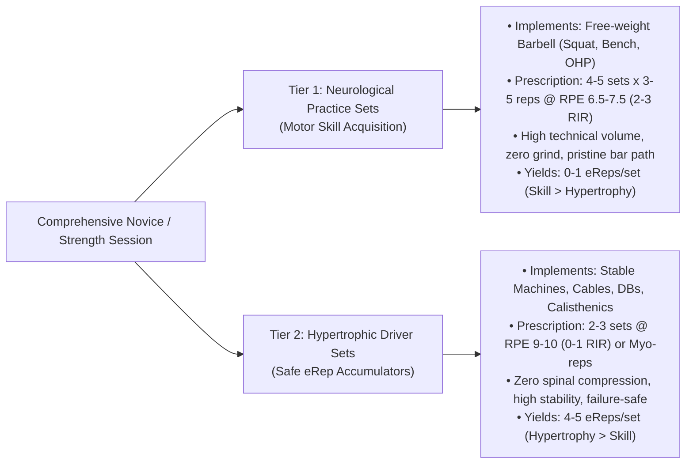
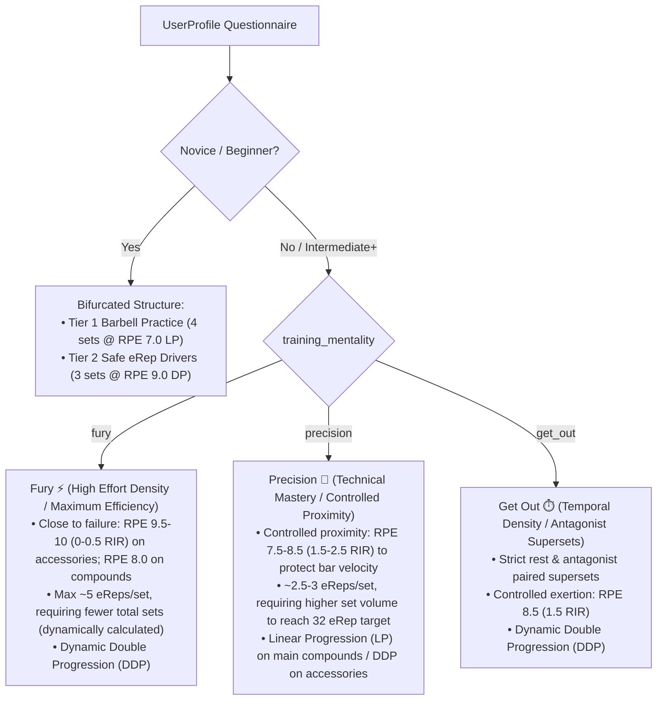
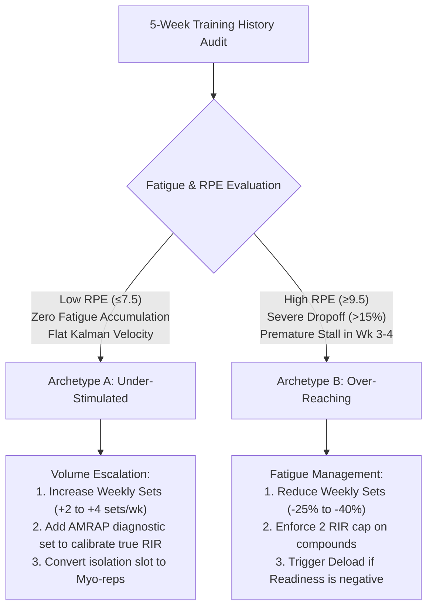

# Hypertrophic Volume vs. Effective Repetitions: A Unified Theory for Dynamic Program Synthesis & Fatigue Autoregulation

## 1. Executive Summary & Purpose

In contemporary exercise physiology, two prominent schools of thought dominate the discussion on resistance training prescription:

1. **The Volume Landmark School (Sets as Currency)**:
   - *Proponents*: Brad Schoenfeld, Mike Israetel (Renaissance Periodization), Eric Helms.
   - *Core Tenet*: Hypertrophy follows a dose-response relationship with the total number of "hard sets" per muscle group per week (MEV $\approx 6\text{–}10$, MAV $\approx 10\text{–}20$, MRV $\approx 20\text{–}25+$ sets/week), provided sets are within $1\text{–}3$ Repetitions In Reserve (RIR).
2. **The Effective Repetition School (eReps as Currency)**:
   - *Proponents*: Chris Beardsley, Arthur Jones, Mike Mentzer, Jordan Peters (TrainedByJP), Borge Fagerli.
   - *Core Tenet*: Motor unit recruitment and mechanical tension are non-linear across a set. Under submaximal loads ($< 85\%$ 1RM), only the final $\sim 4\text{–}5$ repetitions prior to concentric muscular failure recruit high-threshold motor units (Henneman's Size Principle) under slow actin-myosin cross-bridge velocities. Therefore, taking a set to true failure (0 RIR) yields 5 stimulating reps; a set stopped 4 reps short yields only 1.

### The Missing Synthesis
These two perspectives are frequently treated as mutually exclusive dogma: High-Intensity Training (HIT) vs. High-Volume Training (HVT). 

**The core thesis of this document is that the debate is an artifact of varying per-set exertion depth ($\overline{\text{RPE}}$ / $\overline{\text{RIR}}$). Both camps are optimizing for the exact same underlying biological stimulus: Weekly Effective Repetitions ($\approx 25\text{–}45\text{ eReps}$ per muscle group).**

Lifters who push every set to absolute failure (RPE 10 / 0 RIR) earn 5 eReps per set and require far fewer sets to saturate hypertrophic pathways. Conversely, lifters training at RPE 7 (3 RIR) earn only 2 eReps per set and must perform significantly more sets to reach the same threshold.

Furthermore, this document expands the unification model along two critical, often-overlooked dimensions:
1. **Intensity Techniques as Temporal Density Accelerators**: How Rest-Pause, Myo-reps, and Antagonist Paired Sets decouple eRep accumulation from total gym time, allowing time-crunched trainees to hit full MAV in 15–30 minutes, or advanced lifters to hit high eRep targets without marathon sessions.
2. **The Motor Learning vs. Hypertrophy Bifurcation**: Why traditional low-volume linear programs (e.g. *Starting Strength* 3x5) fail raw beginners by conflating motor skill acquisition with muscular hypertrophy, and how Workout Suite bifurcates session volume into submaximal "Practice Sets" (skill acquisition) and high-stability "Stimulating Drivers" (eRep accumulation).

---

## 2. The Mathematical Unification Model

### 2.1 The Set-to-eRep Exchange Rate

In `Workout Suite`, effective reps for submaximal sets ($< 85\%$ 1RM) are computed via [`calculateHypertrophicEffectiveReps`](file:///c:/Programmering/Eget/Workout_suite/mobile/src/core/math/effectiveReps.ts#L59-L161):

$$\text{eReps}_{\text{set}} = \max\Big(0, \min\big(\text{reps}, 5 - \text{RIR}\big)\Big)$$

Assuming a set has $\ge 5$ total repetitions, the yield per set directly scales with proximity to failure:

| Target RPE | Target RIR | Effective Reps per Set ($\text{eReps}_{\text{set}}$) | Relative Stimulus per Set | Subjective Description |
| :---: | :---: | :---: | :---: | :--- |
| **10.0** | **0** | **5** | $100\%$ | Absolute failure / No concentric completion possible |
| **9.0** | **1** | **4** | $80\%$ | Extreme effort / 1 technical rep left |
| **8.0** | **2** | **3** | $60\%$ | Standard hard working set / 2 reps in reserve |
| **7.0** | **3** | **2** | $40\%$ | Moderate effort / Fast bar velocity / 3 reps in reserve |
| **6.0** | **4** | **1** | $20\%$ | Low effort / High reserve / Minimal stimulus |
| **$\le 5.0$** | **$\ge 5$** | **0** | $0\%$ | Non-stimulating warm-up / Junk volume |

### 2.2 Weekly Volume Equivalence Equation

To achieve an optimal Maximum Adaptive Volume (MAV) of $\sim 30\text{ eReps}$ per muscle group per week:

$$\text{Target Weekly Sets} = \frac{\text{Target Weekly eReps}}{\text{Average eReps per Set}} = \frac{30}{\max\big(1, 5 - \overline{\text{RIR}}\big)}$$



- **The High-Intensity Trainee (RPE 10 / 0 RIR)**:
  - $30 / 5 = \mathbf{6\text{ sets/week}}$.
  - If this lifter were prescribed 16 sets at RPE 10, they would accumulate $16 \times 5 = 80\text{ eReps}$, far exceeding their Maximum Recoverable Volume (MRV), causing neuromuscular burnout and joint regression.
- **The Deliberate Volume Trainee (RPE 8 / 2 RIR)**:
  - $30 / 3 = \mathbf{10\text{ sets/week}}$.
  - Optimal balance of manageable fatigue and steady mechanical tension accumulation.
- **The Conservative / Submaximal Trainee (RPE 7 / 3 RIR)**:
  - $30 / 2 = \mathbf{15\text{ sets/week}}$.
  - Lower per-set stimulus requires higher set volume to reach the same adaptation threshold.
- **The Sandbagger / Timid Trainee (RPE 6 / 4 RIR)**:
  - $30 / 1 = \mathbf{30\text{ sets/week}}$.
  - Impractical in gym logistics and highly inefficient due to metabolic and connective tissue wear per unit of stimulus.

---

## 3. The Non-Linear Fatigue Trade-off (Stimulus vs. Fatigue)

While stimulus (eReps) scales **linearly** from RIR 4 down to RIR 0, acute and systemic fatigue scale **exponentially** as proximity to failure approaches zero:

$$\text{Fatigue Cost} \propto e^{\alpha \cdot \text{RPE}}$$



### Key Physiological Drivers:
1. **Intra-Session Dropoff ($\delta_{\text{drop}}$)**:
   - Sets taken to failure (0 RIR) cause dramatic peripheral muscle fatigue, ion imbalance ($\text{Ca}^{2+}$ desensitization), and central nervous system (CNS) motor-drive inhibition.
   - Subsequent sets of the same exercise experience steep performance drop-offs ($\delta_{\text{drop}} > 10\text{–}15\%$) unless rest intervals exceed 3–5 minutes.
2. **Peripheral Recovery Time ($\tau_{2,m}$)**:
   - High-volume submaximal training (12 sets @ RPE 7.5) causes minor microtrauma and recovers in 48 hours.
   - Moderate-volume maximal failure training (6 sets @ RPE 10) causes severe microtrauma and cellular disruption, requiring 72–96 hours for the same muscle group to recover.
3. **Connective Tissue & Axial Loading ($m_{\text{sys}}$)**:
   - Heavy compound movements (squats, deadlifts, barbell rows) carried to failure impose extreme shear and compressive loads on spinal joints and tendons.

---

## 4. Intensity Techniques as Temporal Stimulus Density Accelerators

A major practical flaw of traditional straight-set training is the **"entry rep tax"** and excessive non-stimulating gym time:
- In a traditional set of 10 reps @ 2 RIR, the first 7 reps are merely metabolic prerequisites required to fatigue low-threshold motor units. Only reps 8, 9, and 10 provide high mechanical tension under slow contraction velocities ($3\text{ eReps}$).
- The lifter then rests 2 to 3 minutes before repeating.
- **Time equation for 3 straight sets**:
  $$\text{Time} = 3 \times (40\text{s TUT}) + 2 \times (150\text{s rest}) = 420\text{ seconds (7 minutes)}$$
  $$\text{Effective Stimulus Yield} = 3 \times 3 = 9\text{ eReps} \implies \mathbf{46.7\text{ seconds per eRep}}$$

### 4.1 Bypassing the Entry Tax via Intra-Set Rest-Pause & Myo-Reps
Intensity techniques capitalize on a core neurological principle: **motor unit recruitment remains elevated for 10–20 seconds following an activation set**. 

When a trainee hits failure (0–1 RIR) on an initial activation set, all high-threshold motor units are actively recruited. If they rest only 10–15 seconds (deep breathing) and resume lifting, **every single repetition of the subsequent mini-sets is immediately performed under maximal high-threshold motor unit recruitment and slow contraction velocity**.


#### The Temporal Density Comparison:
- **Rest-Pause / Myo-Rep Protocol**:
  - Activation set: 10 reps @ RPE 10 $\to 5\text{ eReps}$ ($35\text{s}$).
  - Pause 12s $\to$ Mini-set 1: 3 reps $\to 3\text{ eReps}$ ($12\text{s}$).
  - Pause 12s $\to$ Mini-set 2: 3 reps $\to 3\text{ eReps}$ ($12\text{s}$).
  - Pause 12s $\to$ Mini-set 3: 2 reps $\to 2\text{ eReps}$ ($8\text{s}$).
  - **Total Duration**: $\sim 91\text{ seconds (1.5 minutes)}$.
  - **Total Stimulus**: $13\text{ eReps}$.
  - **Efficiency Metric**: $\mathbf{7.0\text{ seconds per eRep}}$ (**over 6x more time-efficient than straight sets**).

### 4.2 Application to Time-Crunched vs. High-Volume Trainees

| Trainee Scenario | Traditional Straight Sets Constraint | Intensity Technique Solution | Prescribed Set Types in Workout Suite |
| :--- | :--- | :--- | :--- |
| **Time-Crunched ("Get Out" / 15–30 min)** | Cannot fit 12–16 straight sets. Forced to do 4–6 sets, resulting in sub-MEV ($< 15\text{ eReps}$). | Uses Myo-reps or Rest-Pause on isolation/machine exercises. Reaches full MAV ($30\text{–}35\text{ eReps}$) in 18 minutes. | `set_type: 'myorep'`, `set_type: 'dc'`, Antagonist Paired Sets (`exercise_group_id`) |
| **High-Volume Trainee (45–60 eReps target)** | Reaching 50 eReps with straight sets requires 18–20 sets and 75–90 minutes, leading to joint grinding and fatigue blowout. | Uses straight sets on primary compound, followed by 1 Myo-rep cluster and 1 Drop set on accessories to rapidly harvest 20+ eReps in 5 minutes. | `set_type: 'drop'`, `set_type: 'myorep'` |

### 4.3 Antagonist Paired Sets (Reciprocal Inhibition)
For multi-joint movements where rest-pause is unsafe (e.g. Bench Press + Barbell Row, or Leg Extension + Leg Curl):
- Prescribing paired antagonist sets (`exercise_group_id` in `TemplateExercise`) allows the non-working muscle group to passively recover while the opposing muscle works.
- Peer-reviewed research (Robbins et al., 2010) demonstrates that antagonist pairing maintains or increases power output due to reciprocal neurological disinhibition, while slashing workout duration by $40\text{–}50\%$.

---

## 5. The Motor Learning vs. Hypertrophy Bifurcation (Critique of *Starting Strength*)

A critical shortcoming in traditional resistance training paradigms is the conflation of **neurological motor skill learning** with **muscular hypertrophy**.

### 5.1 The Fundamental Flaw of *Starting Strength* (3x5) for Raw Beginners
Programs like *Starting Strength* prescribe $3 \times 5$ linear progression on complex multi-joint barbell movements (Low Bar Squat, Deadlift, Standing Overhead Press, Bench Press, Power Clean). While effective for short-term neuromuscular coordination in young athletes, it contains two severe physiological flaws for muscle hypertrophy and motor acquisition:

1. **Inadequate Motor Practice Volume**:
   - Complex barbell lifts are high-degree-of-freedom motor skills requiring deliberate practice (Schmidt's Motor Schema Theory).
   - Performing only 15 total working repetitions ($3 \times 5$) once or twice a week is an exceptionally sparse learning signal. Motor patterns take significantly longer to groove, leaving beginners unstable and uncoordinated under load.
2. **The Proximity-to-Failure Paradox for Beginners**:
   - A raw novice has poor motor control and cannot safely navigate technical breakdown.
   - **Scenario A (Novice pushes to RPE 9.5–10)**: Technique immediately disintegrates. Knees cave, lumbar spine rounds, bar path shifts, and shear forces spike across non-adapted passive structures (intervertebral discs, patellar tendons). Injury or severe joint pain results.
   - **Scenario B (Novice stays safe at RPE 6–7)**: To protect form, the novice leaves 3–4 reps in reserve. Because each set yields only 1–2 eReps, the entire $3 \times 5$ workout yields a meager **$3\text{ to }6\text{ eReps}$**!
   - **The Inevitable Outcome**: The beginner gains almost no muscle mass from their 3x5 workout because the effective stimulus is far below MEV ($< 20\text{ eReps}$). Within 6–10 weeks, the weights get heavy, their form degrades, they stall out on linear progression, and they conclude they have "bad genetics."



### 5.2 The Bifurcated Solution: "Practice Sets" vs. "Stimulating Drivers"

To maximize both strength skill acquisition and muscular hypertrophy without injury risk, `programSynthesizer.ts` introduces a **two-tier bifurcated exercise architecture**:



#### Tier 1: Neurological Practice Sets (Skill Acquisition)
- **Objective**: Bar path automation, intra-muscular rate coding, inter-muscular coordination, and confidence under the bar.
- **Exercise Selection**: Unstable, high-axial, technically challenging movements (Barbell Back Squat, Deadlift, Overhead Press, Free-weight Bench).
- **Prescription**: Higher set volume with low fatigue per set: **$4\text{–}6\text{ sets of }3\text{–}5\text{ reps @ RPE }6.5\text{–}7.5$** ($2.5\text{–}3.5\text{ RIR}$).
- **Key Metric**: Total practice repetitions (e.g. 25 clean reps instead of 15 shaky reps). Reps are stopped well before technical breakdown.

#### Tier 2: Hypertrophic Driver Sets (eRep Accumulators)
- **Objective**: Drive muscular tension, activate high-threshold motor units, and accumulate target weekly eReps ($30\text{–}40\text{ eReps}$).
- **Exercise Selection**: High-stability, low-axial, fixed-plane, or joint-supported movements:
  - *Quads*: Leg Press, Hack Squat, Dumbbell Goblet Box Squat.
  - *Chest*: Machine Chest Press (guided track), Push-Ups (Standard Floor or Hands-Elevated on Bench).
  - *Back*: Chest-Supported Incline Row, Cable Seated Row, Lat Pulldown.
  - *Hamstrings*: Seated/Lying Leg Curl, Bilateral Dumbbell RDL (patella depth stop).
- **Prescription**: Pushed with high intensity: **$2\text{–}3\text{ sets @ RPE }8.5\text{–}9.5$** ($0.5\text{–}1.5\text{ RIR}$) or rest-pause/myo-rep clusters.
- **Safety Profile**: Because the movement is mechanically guided and requires minimal spinal stabilization, the lifter can safely take the target muscle close to failure without risk of catastrophic spinal shear or technique breakdown.

### 5.3 Biomechanical Safety Invariants: The Two Critical Hazards for Beginners

> [!CAUTION]
> **1. The End-Range / High-Stretch Hazard:**
> Never prescribe extreme stretch-mediated positions to beginners at high exertion (e.g. deep deficit push-ups, weighted dips, flat dumbbell flyes, Nordic curls). At extreme muscle lengths, tension shifts off contractile fibers onto unconditioned tendons, entheses, and joint capsules, dramatically increasing the risk of acute tears.
>
> **2. The Free-Floating Overhead Missile Hazard (Dumbbell Pressing Near Failure):**
> **Never prescribe free-weight dumbbell pressing to near-failure (RPE 9+) for beginners.**
> Beginners lack the rotator cuff stabilization and neuromuscular endurance to control independent multi-planar loads under fatigue. As prime movers tire, the rotator cuff and forearm stabilizers give out abruptly, causing uncontrollable bar path tremors, internal shoulder collapse, or in the worst cases, dropping heavy metal directly onto the face, neck, or sternum. Additionally, dismounting heavy dumbbells at failure frequently causes acute wrist sprains and anterior capsule strains.

#### Safe Exercise Prescription Rules for Novices at High Exertion
For beginner and intermediate trainees taking sets to high exertion (RPE 8.5–9.5), exercise selection must strictly adhere to:
1. **Guided Planes or Closed Kinetic Chains** (Machines or Floor Push-Ups).
2. **Mid-Range Mechanical Tension** (avoiding extreme hyperextension or deep deficits).
3. **Fail-Safe Disengagement** (if the muscle gives out, gravity disengages the lifter safely with zero danger of crushing).

| Muscle Group | ❌ High-Risk Hazards (Strictly Banned for Novices at Failure) | ✅ Safe Stimulating Driver (Prescribed in Workout Suite) | Built-In Fail-Safe Mechanism |
| :--- | :--- | :--- | :--- |
| **Chest** | **Dumbbell Bench/Floor Press to Failure**, Deep Deficit Push-Ups, Dips, Flyes | **Machine Chest Press**, **Push-Ups** (Standard Floor or Hands-Elevated) | **Machines**: Guided track with safety catches; letting go is completely safe.<br>**Push-Ups**: Closed-chain bodyweight; hitting failure simply means lowering chest to floor. Zero dropped-weight missile hazard. |
| **Hamstrings** | Nordic Hamstring Curls, Deep Single-Leg RDLs | **Lying/Seated Leg Curl**, Bilateral Dumbbell RDL (depth strictly stopped at patella) | Machine pad stabilizes pelvis; patella stop prevents pelvic tilt & lumbar flexion. |
| **Quads** | Sissy Squats, Heavy Barbell Squats to Failure, ATG Split Squats | **Leg Press / Hack Squat**, Dumbbell Goblet Squat onto a Bench/Box | The box provides an invariant depth barrier, guaranteeing parallel depth without lumbar tuck. |
| **Back** | Free-standing Pendlay Rows to failure | **Chest-Supported Incline Dumbbell Row**, Seated Cable Row | Chest pad eliminates all spinal shear and lumbar extension moment arms. |

### 5.4 Solving Machine-Restricted & Garage Gym Environments Safely
When a lifter trains in a garage gym or home setting without specialized machines:
- **Never push heavy free-weight barbell back squats or deadlifts to true failure for hypertrophy.**
- **Never push heavy dumbbells to failure over the face or torso.**
- **Use Closed-Chain Bodyweight and Supported Mid-Range Variations as Failure Drivers**:
  - *Chest*: **Push-Ups** (Standard on floor, or hands-elevated on a sturdy bench for beginners who cannot do 10+ standard reps). To increase difficulty without free-floating weights over the face, use **tempo control** (3-second eccentrics with a 1-second pause at the floor) or foot-elevated push-ups once standard push-ups are mastered.
  - *Quads*: **Dumbbell Goblet Box Squat** (holding dumbbell securely against the sternum, sitting back onto a 16" bench) or **Bilateral Leg Extension with Bands**.
  - *Back*: **Chest-Supported Incline Row** (lying prone on an incline bench) or **Inverted Rows with knees bent** (shorter lever arm, stable spine).
  - *Hamstrings*: **Bilateral Dumbbell RDL with Soft Knees** (stopping load strictly at the patella/upper shin) or **Swiss Ball / Towel Leg Curls**.
- These variations allow safe, high-effort eRep harvesting ($0.5\text{–}1.5\text{ RIR}$) without catastrophic balance failure, spinal buckling, or weights dropping on the lifter.

---

## 6. Operationalizing for `programSynthesizer`

The `programSynthesizer` operationalizes this unified model across two distinct horizons:
1. **Static Initial Synthesis** (based on user questionnaire inputs).
2. **Dynamic Mesocycle Autoregulation** (based on longitudinal tracking across weeks 1–6).

---

### Horizon 1: Static Synthesis Profiles & Mentality Reframing

When generating initial routines, the user's `training_mentality` (reframed around stimulating effective-rep density and proximity to failure rather than dogmatic set counts) and `experience_level` serve as proxies for their exertion depth, motor skill tier, and goal-derived archetype:



| Parameter | Fury ⚡ | Precision 🎯 | Get Out ⏱️ | Novice Bifurcated 🎓 |
| :--- | :---: | :---: | :---: | :---: |
| **Effort Model** | Maximum Stimulating Density | Controlled Velocity & Quality | Temporal Density & Supersetting | Motor Learning & Driver Bifurcation |
| **Compound Target RPE** | 8.0 (2.0 RIR accumulation) | 8.0 (2.0 RIR) | 8.5 (1.5 RIR) | **7.0 (3.0 RIR Practice Sets)** |
| **Accessory Target RPE** | 9.5 (0.5 RIR, 5 eReps/set) | 8.0 (2.0 RIR, 3 eReps/set) | 8.5 (1.5 RIR, 4 eReps/set) | **9.0 (1.0 RIR Driver Sets)** |
| **Target Sets Allocation** | Dynamically computed ($\approx 1\text{–}2$) | Dynamically computed ($\approx 3\text{–}4$) | Dynamically computed ($\approx 2$) | 4 practice / 3 drivers |
| **Calculated Weekly eReps** | $\mathbf{\approx 32\text{ eReps / muscle}}$ | $\mathbf{\approx 32\text{ eReps / muscle}}$ | $\mathbf{\approx 32\text{ eReps / muscle}}$ | $\mathbf{\approx 28\text{–}32\text{ eReps}}$ |
| **Progression Engine** | Dynamic Double (DDP) | LP on Tier 1 / DDP on Tier 2 & 3 | Dynamic Double (DDP) | LP on Tier 1 / DP on Tier 2 |

#### Load-Gated eReps Mathematical Formulation (Henneman's Size Principle)

Under Henneman's Size Principle, sets performed with heavy external loads ($\ge 85\%$ 1RM or $\le 5\text{ reps} \land \text{RPE} \ge 8.0$) recruit high-threshold motor units immediately from repetition 1. Thus, all completed reps count as hypertrophic effective reps (capped at 5 per set):

$$\text{eReps}_{\text{set}} = \begin{cases} 
\min(\text{reps}, 5) & \text{if } \frac{w}{\text{e1RM}} \ge 0.85 \lor (\text{reps} \le 5 \land \text{RPE} \ge 8.0) \\
\max\big(0, \min(\text{reps}, \text{round}(5 - \text{RIR}))\big) & \text{otherwise}
\end{cases}$$

#### Submaximal Workload Tracking Policy

In the logger, trainees are permitted to record submaximal sets ($> 4\text{ RIR}$, e.g. Josef Eriksson 10x10 @ 50% or Bromley 65% base sets) for tonnage/workload tracking, but they earn 0 eReps. The program synthesizer and mesocycle engine **never** generate submaximal non-eRep sets; all synthesized sets reside strictly in the stimulating zone ($0\text{–}3\text{ RIR}$ or $\ge 85\%\text{ 1RM}$).

---

### Horizon 2: Dynamic Mesocycle Adaptation (Weeks 3–6)

During an active meso-cycle block, the app monitors:
1. **Logged RPE / RIR Distribution** across working sets.
2. **Longitudinal Fatigue Indicators**:
   - Kalman 1RM gain velocity ($\dot{x}_0$).
   - Iso-load RPE drift ($\Delta\text{RPE}_{\text{drift}}$ across identical loads).
   - Banister readiness score ($p_t = P_t - F_t$).
   - Intra-session dropoff slope ($\delta_{\text{drop}}$).

Based on these signals, the engine detects and adapts to two common physiological archetypes:



#### Archetype A: The "Zero-Fatigue / Under-Stimulated" Trainee
- **Observable Symptoms**:
  - The lifter has trained for 5+ weeks without requiring a deload.
  - Mean working set RPE is consistently $\le 7.5$ (RIR $\ge 2.5\text{–}3.5$).
  - Banister fatigue is negligible ($F_t \approx 0$); readiness stays consistently near $100\%$.
  - Rate of 1RM progression has slowed or plateaued despite feeling fresh.
- **Physiological Diagnosis**:
  - The lifter is operating below their Minimum Effective Volume in terms of effective reps ($\text{eReps}_{\text{weekly}} < 20$).
  - Either the number of sets is too low for their modest exertion level, or they are systematically under-estimating their RIR (thinking RPE 7 is RPE 9).
- **Engine Recommendations**:
  1. **Volume Escalation**: Increase weekly sets for stalled muscle groups by $+2\text{ to }+4\text{ sets/week}$ (e.g. going from 3 sets to 4 sets per movement).
  2. **AMRAP Calibration Set**: Prompt the user to perform an AMRAP (As Many Reps As Possible) on the final set of a stable exercise to expose true proximity to failure.
  3. **Density Acceleration**: Convert an existing isolation straight-set into a Myo-rep cluster (`set_type: 'myorep'`) to add 6–8 eReps without lengthening the workout.

#### Archetype B: The "Premature Crash / Over-Reacher" Trainee
- **Observable Symptoms**:
  - By week 3 or 4, performance begins regressing ($\dot{x}_0 < 0$).
  - Mean RPE is consistently $\ge 9.5$ (frequent failure).
  - Intra-session drop-off is extreme ($\delta_{\text{drop}} > 15\%$).
  - Banister net readiness drops deeply negative ($p_t < -1.5\sigma$).
  - Joint discomfort / pain reports emerge.
- **Physiological Diagnosis**:
  - The lifter is accumulating excessive eReps ($> 65\text{ eReps/week}$) while operating under maximum fatigue multipliers ($m_{\text{sys}} = 1.35$).
  - Systemic fatigue has outpaced neuromuscular adaptation.
- **Engine Recommendations**:
  1. **Volume Pruning**: Immediately reduce weekly sets by $25\text{–}40\%$ (e.g., cutting from 4 sets to 2–3 sets).
  2. **RIR Guardrail**: Prescribe a mandatory 1–2 RIR cap on primary barbell compounds.
  3. **Immediate Deload Trigger**: Schedule an active recovery week (50% volume, 2 RIR).

---

## 7. Architectural Implementation Blueprint

### 7.1 New Synthesizer Heuristic: `computeTargetSetsFromExertion`

In [`programSynthesizer.ts`](file:///c:/Programmering/Eget/Workout_suite/mobile/src/core/generator/programSynthesizer.ts), replace static set constants with an exertion-calibrated set allocator:

```typescript
/**
 * Computes target working sets per exercise based on target RIR, motor practice status,
 * and muscle landmark tier.
 *
 * @param targetRir Prescribed reps in reserve (e.g., 0.5 for Fury, 2.0 for Precision, 3.0 for Skill Practice)
 * @param weeklyFrequency Number of times this muscle group is stimulated per week
 * @param isSkillPractice If true, sets are performed submaximally for motor learning (eReps yield is discounted)
 * @param targetWeeklyEReps Desired weekly stimulating reps (default: 32 eReps MAV)
 */
export function computeSetsPerSession(
  targetRir: number,
  weeklyFrequency: number,
  isSkillPractice: boolean = false,
  targetWeeklyEReps: number = 32
): number {
  if (isSkillPractice) {
    // Motor learning practice sets: High set volume, low fatigue (4 to 5 sets of 3-5 reps)
    return 4;
  }

  // 1. Calculate effective reps per set (clamped between 1 and 5)
  const eRepsPerSet = Math.max(1, Math.min(5, Math.round(5 - targetRir)));

  // 2. Compute total weekly sets required
  const totalWeeklySets = Math.round(targetWeeklyEReps / eRepsPerSet);

  // 3. Divide across weekly training frequency
  const setsPerSession = Math.round(totalWeeklySets / weeklyFrequency);

  // 4. Clamp within safe execution bounds (minimum 1 set, maximum 5 sets per movement)
  return Math.max(1, Math.min(5, setsPerSession));
}
```

### 7.2 Companion Adaptation Payload Integration

When the Companion Suite runs its mesocycle audit ([`companion/src/models/recommendations.py`](file:///c:/Programmering/Eget/Workout_suite/companion/src/models/recommendations.py)), it evaluates:

$$\text{RPE}_{\text{status}} = \begin{cases}
\text{UNDER\_STIMULATED} & \text{if } \overline{\text{RPE}} \le 7.5 \text{ and } F_t < F_{\text{baseline}} \text{ and } \text{eReps} < 22 \\
\text{OPTIMAL} & \text{if } 22 \le \text{eReps} \le 48 \text{ and } p_t \ge 0 \\
\text{OVER\_REACHING} & \text{if } \overline{\text{RPE}} \ge 9.3 \text{ and } p_t < 0 \text{ or } \text{eReps} > 60
\end{cases}$$

This status is exported via `calibrated_parameters.json` under `program_audits` to dynamically adjust template set counts in the mobile app.

---

## 8. Scientific References & Prior Art

1. **Beardsley, C. (2018)**. *Hypertrophy: Muscle fiber growth caused by mechanical tension*. Strength and Conditioning Research Limited.
2. **Schoenfeld, B. J., Ogborn, D., & Krieger, J. W. (2017)**. *Dose-response relationship between weekly resistance training volume and increases in muscle mass: A systematic review and meta-analysis*. Journal of Sports Sciences, 35(11), 1073-1082.
3. **Helms, E. R., Cronin, J., Storey, A., & Zourdos, M. C. (2016)**. *Application of the repetitions in reserve-based rating of perceived exertion scale for resistance training*. Strength & Conditioning Journal, 38(4), 42-49.
4. **Robbins, D. W., Young, W. B., & Behm, D. G. (2010)**. *The effect of an upper-body agonist-antagonist paired set training protocol on volume load and efficiency*. Journal of Strength and Conditioning Research, 24(10), 2632-2640.
5. **Schmidt, R. A., & Lee, T. D. (2011)**. *Motor control and learning: A behavioral emphasis* (5th ed.). Human Kinetics.
6. **Fagerli, B. (2012)**. *Myo-Reps: A time-efficient method for maximum muscle growth*. Blade Coaching & Consulting.
7. **Israetel, M., Feather, J., Faleiro, T. V., & Juneau, C. E. (2020)**. *Scientific Principles of Hypertrophy Training*. Renaissance Periodization.
